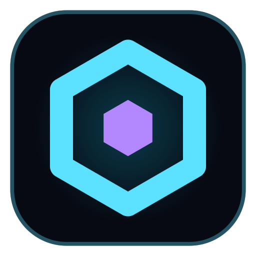

<div align="center">



# Panal

**Tu teléfono Android y tu PC, funcionando como uno. En español y con un tema futurista.**

Panal está basado en [NectarLink](https://github.com/thtbee/nectarlink) de
[thtbee](https://github.com/thtbee) (versión 0.1.5). Es una versión modificada
y no oficial: tiene nombre y logo propios porque la
[política de marca de NectarLink](TRADEMARKS.md) lo pide a las versiones
modificadas. Todo el mérito de la app original es de su autor.

[](LICENSE)
[](LICENSE)

</div>

## Qué cambia respecto a NectarLink

- **En español.** La app de PC y la de Android están traducidas al completo
  (1.876 y 1.227 frases), y siguen disponibles el inglés, el alemán, el chino y
  el turco.
- **Tema Nova.** Un quinto tema futurista: **Void** (oscuro: negro azulado con
  cian eléctrico y acentos violeta) y **Frost** (claro: blanco escarchado con
  cian profundo). Tiene una rejilla holográfica animada de fondo, tarjetas de
  cristal con borde de neón y botones con halo. Se elige en Ajustes ›
  Apariencia › Tema › Nova.
- **Actualizaciones firmadas.** Cada versión publica `SHA256SUMS.txt.sig`, una
  firma Ed25519 que la app de PC e `install.sh` comprueban antes de instalar
  nada. Una actualización sin firma válida no se instala nunca.
- **Los enlaces del teléfono piden permiso.** El PC ya no abre solo en el
  navegador los enlaces que llegan del teléfono: muestra una notificación con
  el botón **Abrir**. Puedes cambiarlo en Ajustes › Archivos y sincronización.
- **Los documentos del PC no se abren solos en el teléfono.** Se guardan en
  Descargas y su notificación los abre con un toque. Puedes cambiarlo en los
  Ajustes de la app de Android.
- **CI más seguro.** Todas las acciones de GitHub Actions están fijadas por
  hash, la firma se hace en un trabajo aislado con un entorno protegido
  (`release-signing`) y las compilaciones nocturnas solo se programan si las
  activas.
- **Se actualiza desde este repositorio**, no desde el original.

Panal mantiene el protocolo de NectarLink, así que puede emparejarse con la
app oficial de NectarLink en el otro dispositivo.

## Descargas

Las versiones se publican en
[Releases](https://github.com/zaiddia/NectarLink/releases).

| | Necesita |
|---|---|
| **Windows (x64 y ARM64)** | Windows 10 (2004+) u 11. El teléfono como cámara web necesita Windows 11. |
| **Linux (x86_64)** | Ubuntu 24.04 o más nuevo, Debian 13, Fedora 40 o más nuevo |
| **Android** | Android 8.0 o más nuevo |

En Linux, un solo comando lo instala todo y comprueba la firma de la versión:

```bash
curl -fsSL https://github.com/zaiddia/NectarLink/releases/latest/download/install.sh | sh
```

> [!IMPORTANT]
> Si ya tienes la app oficial de NectarLink en el teléfono, desinstálala antes
> de instalar el APK de Panal: están firmados con claves distintas y Android no
> deja instalar uno encima del otro. El instalador de Windows no tiene firma de
> código, así que SmartScreen avisará la primera vez (**Más información** ›
> **Ejecutar de todas formas**).

## Primeros pasos

1. Instala Panal en tu PC y en tu teléfono.
2. En el PC, la guía de configuración muestra un código QR. Escanéalo con el
   teléfono o elige el PC en la lista de dispositivos cercanos y compara el
   código de 6 dígitos. También funciona con un cable USB.
3. Permite lo que quieras compartir. Cada función tiene su propio interruptor
   por dispositivo, y las sensibles vienen desactivadas.
4. Opcional: configura la **depuración inalámbrica** en la app del teléfono para
   las funciones que Android reserva a apps con permisos especiales.

La [guía de usuario](docs/guide/README.md) explica cada paso y cada función (de momento, en inglés).

## Qué hace

- **Notificaciones** del teléfono en el PC, con respuestas rápidas y botón para
  copiar códigos de un solo uso.
- **Mensajes** (SMS, MMS, RCS, WhatsApp, Telegram, Signal…) en una sola bandeja.
- **Llamadas**: contesta, cuelga y marca desde el PC.
- **Portapapeles** compartido, **archivos y carpetas** a velocidad de Wi‑Fi,
  **fotos** y **Handoff** de enlaces, mapas y videos.
- **Duplicar la pantalla** a 60 fps con sonido, y **apps del teléfono en
  ventanas** del PC.
- **El teléfono como touchpad, teclado, cámara web, micrófono y altavoz**, y un
  **Deck** de botones al estilo Stream Deck.
- **Línea de tiempo**, **Paleta de comandos** (`Ctrl+Alt+Space`), **Bandeja**
  lateral y **Connection Doctor**.

## Privado por diseño

- **Local.** Los dispositivos hablan directamente por tu red o por cable USB,
  sin servidores ni cuentas.
- **Cifrado de extremo a extremo.** QUIC con TLS 1.3 y claves de dispositivo
  intercambiadas al emparejar.
- **Tú decides qué se comparte**, dispositivo por dispositivo.
- **El único tráfico a internet** es la búsqueda de actualizaciones en este
  repositorio de GitHub (puedes desactivarla) y, solo si la activas, la
  conexión por datos móviles mediante un relé cifrado.

Detalles: [modelo de seguridad](docs/technical/security-model.md).

## Compilar desde el código

| Parte | Necesita |
|---|---|
| Núcleo y CLI | [Rust](https://rustup.rs) estable |
| App de Windows | Windows 11, Visual Studio 2022 Build Tools (C++), [Qt 6.12](https://www.qt.io/download-open-source) para MSVC 2022 x64 |
| App de Linux | Ubuntu 24.04 o más nuevo, un compilador de C++17, pkg-config, los paquetes de desarrollo de X11, Wayland y D-Bus, y [Qt 6.12](https://www.qt.io/download-open-source) |
| App de Android | Android SDK (plataforma 37, NDK 30.0.16248370), JDK 17 o más nuevo y `cargo-ndk` (ver [android/README.md](android/README.md)) |

```sh
cargo test -p nectarlink-protocol -p nectarlink-core   # núcleo y tests
cargo run -p nectarlink-desktop                         # app de PC (con Qt en el PATH)
cd android && ./gradlew assembleDebug                   # app de Android
```

### Publicar una versión

Las versiones las compila el CI de este repositorio a partir de una etiqueta
`v*`. Antes de la primera, añade en **Settings › Secrets and variables ›
Actions**:

| Secreto | Qué es |
|---|---|
| `ANDROID_KEYSTORE` | Tu almacén de claves de Android (`.jks`) en base64 |
| `ANDROID_KEYSTORE_PASSWORD` | Su contraseña (alias `nectarlink`) |
| `UPDATE_SIGNING_KEY` | La clave privada Ed25519 de actualizaciones (PEM), en el entorno `release-signing` |

La clave pública que la comprueba está en
[`.github/release-key.pub.pem`](.github/release-key.pub.pem) y dentro de la app
([`desktop/app/src/release_key.rs`](desktop/app/src/release_key.rs)). Para
proteger la firma, en **Settings › Environments › release-signing** activa
**Required reviewers** con tu usuario: así nada se firma sin tu aprobación.

## Licencia

- Apps de PC y Android y CLI: [GPL-3.0-or-later](LICENSES/GPL-3.0-or-later.txt)
- Bibliotecas del núcleo: [MPL-2.0](LICENSES/MPL-2.0.txt)
- Especificación del protocolo y documentación: [CC BY 4.0](LICENSES/CC-BY-4.0.txt)

Basado en NectarLink, © los colaboradores de NectarLink. Las modificaciones de
Panal se publican bajo las mismas licencias. El nombre y el logo de NectarLink
pertenecen a su proyecto ([TRADEMARKS.md](TRADEMARKS.md)); Panal no está
respaldado por él.
