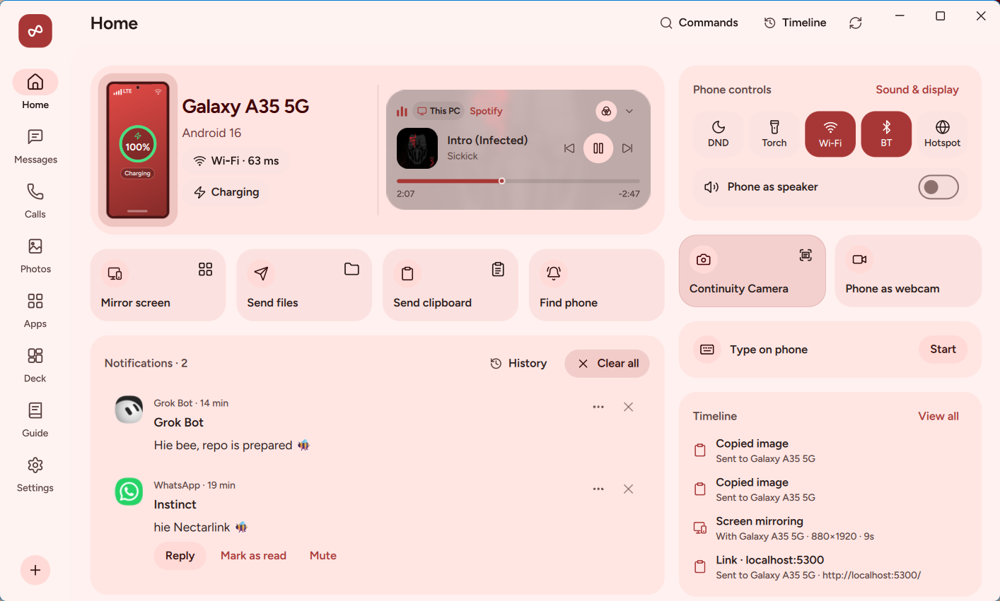

# Guía de usuario de Panal

Panal conecta tu teléfono Android y tu PC directamente por tu red local. Reúne en una sola aplicación de código abierto las notificaciones, los mensajes, las llamadas, el portapapeles compartido, la transferencia de archivos, la exploración de fotos, la duplicación de pantalla, la cámara, el audio y el control entre dispositivos.

Panal está basado en [NectarLink](https://github.com/thtbee/nectarlink) de thtbee. Las capturas de esta guía son de la app original y pueden mostrar el nombre y el logo de NectarLink.

  

## Por qué esta guía está organizada así

La documentación se divide en dos partes para que encuentres las respuestas rápido:

1. **Guía de usuario (`docs/guide/`)**: organizada por tareas cotidianas y áreas de funciones. Cada página explica qué hace una función, por qué es útil, qué permisos o ajustes necesita, cómo usarla paso a paso, dónde se guardan tus datos y qué límites impone cada plataforma. Sigue la misma navegación que las apps de PC y Android, y se puede leer directamente en GitHub.
2. **Referencia técnica ([`docs/technical/`](../technical/README.md))**: escrita para desarrolladores, auditores de seguridad y colaboradores, en inglés. Cubre la arquitectura interna, el protocolo, los puentes FFI, los esquemas de base de datos, los presupuestos de rendimiento y las instrucciones de compilación.

Separar las tareas del día a día de los detalles internos mantiene las instrucciones breves y deja a los ingenieros toda la especificación del sistema.

## Contenido

### Configuración y fundamentos

- [Primeros pasos](getting-started.md): requisitos del sistema, instalación en Windows, Linux y Android, la guía del primer inicio, los métodos de emparejamiento (código QR, código de 6 dígitos cercano, emparejamiento automático por USB) y cómo elegir el nivel de control de Android (`Standard`, `Assist` o `Elevated`).

### Funciones del día a día

- [Notificaciones](notifications.md): el panel de notificaciones en vivo, las ventanas emergentes del escritorio, las respuestas rápidas, los botones de acción, las actualizaciones en vivo y temporizadores, la detección de códigos de verificación, las reglas por app, los perfiles de notificaciones y el reenvío de notificaciones del PC al teléfono.
- [Mensajes](messages.md): conversaciones SMS y MMS, conversaciones unificadas de apps de chat (`MessagingStyle` y `RemoteInput`), imágenes adjuntas, búsqueda de contactos y códigos de un solo uso.
- [Llamadas](calls.md): avisos de llamadas entrantes en el PC, contestar o rechazar, rechazar con un SMS, llamar desde el marcador o los contactos del PC, historial de llamadas, controles en llamada con `Elevated` y por qué el audio de voz se queda en el teléfono.
- [Portapapeles](clipboard.md): compartir texto, HTML, imágenes y archivos copiados entre el PC y el teléfono, enviar con el botón de Ajustes rápidos y el menú Compartir, sincronización automática en segundo plano con `Elevated`, sugerencias inteligentes, historial cifrado de 50 elementos y exclusión automática de contraseñas y códigos de un solo uso.
- [Archivos y transferencias](files-and-transfers.md): enviar archivos y carpetas en ambos sentidos, arrastrar y soltar, la integración con **Enviar a** del Explorador de archivos, pausar y reanudar, verificación de integridad BLAKE3, la cola de envío persistente y el panel **Pendiente de enviar**, montar el almacenamiento del teléfono en el Explorador de archivos, explorar los archivos del PC desde el teléfono, sincronizar carpetas y la compatibilidad con LocalSend.
- [Fotos](photos.md): explorar el carrete, las capturas y los álbumes del teléfono en el PC, verlos a resolución completa, arrastrar fotos al Explorador de archivos o a otras apps, y avisos de fotos nuevas.

### Pantalla, cámara, audio y entrada

- [Duplicación y ventanas de apps](mirroring.md): duplicar la pantalla del teléfono hasta 60 fps (H.264, H.265, AV1), reenviar el audio del teléfono, capturas y grabaciones MP4, mantener el teléfono encendido o apagar su pantalla, control táctil y de teclado a distancia (`Assist` y `Elevated`), abrir apps del teléfono en su propia `app window`, el modo escritorio DeX y la duplicación inversa de la pantalla del PC en el teléfono.
- [Cámaras y audio](cameras-and-audio.md): usar el teléfono como cámara web de Windows (el complemento de cámara virtual `Panal Webcam`), controles de lente y zoom, Continuity Camera para tomar fotos y escanear documentos con recorte de esquinas y mejora en blanco y negro, usar el teléfono como altavoz inalámbrico de baja latencia para el PC, y grabar notas de voz con marcadores de tiempo.
- [Entrada y control](input-and-control.md): controlar el PC desde el teléfono (touchpad, mouse aéreo con giroscopio, teclado con barra de modificadores, dictado por voz, control de presentaciones con puntero láser), escribir en el teléfono con el teclado del PC, el teclado de macros `Deck`, los controles del teléfono en el Inicio del PC, el Modo escritorio en un soporte, y las acciones Bloquear, Suspender y Wake-on-LAN.
- [Superficies del escritorio y automatización](desktop-surfaces.md): la Bandeja (`Shelf`) del borde de la pantalla, el gesto de lanzar para enviar, la píldora de actividad `Nectar Island`, la `Timeline` (Línea de tiempo) con búsqueda entre dispositivos, la `Command Palette` (Paleta de comandos, `Ctrl+Alt+Space`), el `Handoff` de enlaces, mapas, videos y documentos, los avisos de tareas terminadas `notify-when`, las automatizaciones de disparador y acción, la API HTTP local y el cliente de línea de comandos.

### Configuración, privacidad y ayuda

- [Referencia de ajustes](settings.md): cada ajuste de la app de PC (las 9 categorías) y de la app de Android, explicado uno a uno.
- [Privacidad y seguridad](privacy-and-security.md): explicación sencilla de las claves de identidad Ed25519, el emparejamiento criptográfico, el cifrado de extremo a extremo con QUIC y TLS 1.3, la red local primero, la búsqueda automática de actualizaciones, la opción **Conectar con datos móviles**, los permisos por dispositivo, los avisos de consentimiento y la retención de datos local.
- [Solución de problemas](troubleshooting.md): usar `Connection Doctor`, resolver problemas de firewall, red pública, VPN y aislamiento de AP del Wi‑Fi, ajustar la batería de Android según el fabricante, y arreglar la depuración inalámbrica de `Elevated`, el transporte USB, el audio y la cámara virtual.
- [Preguntas frecuentes](faq.md): respuestas directas sobre cuentas, redes, consumo de batería, varios dispositivos y plataformas compatibles.
- [Limitaciones conocidas](known-limitations.md): resumen honesto de las limitaciones del sistema operativo y del hardware en Windows y Android.

## Glosario

Panal usa los mismos términos en la app de PC, en la app de Android y en esta guía:

| Término | Definición |
| :--- | :--- |
| `pair` (emparejar) | La ceremonia criptográfica, que se hace una sola vez, que vincula un teléfono y un PC. Intercambia claves públicas Ed25519 y verifica un secreto compartido con un token de código QR o un código de confirmación de 6 dígitos. |
| `paired device` (dispositivo emparejado) | Un teléfono o PC que completó el emparejamiento y está guardado en tu almacén de confianza local. Solo un dispositivo emparejado puede abrir una sesión cifrada de Panal con el tuyo. |
| `Standard` (Estándar) | El nivel de control predeterminado de Android. Usa los permisos normales de Android y el acceso a notificaciones, sin servicio de accesibilidad ni opciones de desarrollador. |
| `Assist` | El segundo nivel de control de Android. Añade el servicio de accesibilidad de Panal (**Usa el mouse y el teclado de tu PC** en **Control desde tu PC**) para que el mouse y el teclado del PC puedan tocar, deslizar, desplazarse y escribir durante la duplicación de pantalla, sin configuración de desarrollador. |
| `Elevated` | El tercer nivel de control de Android (**Toque y teclas reales (depuración inalámbrica)** en **Control desde tu PC**). Usa la depuración inalámbrica de Android (o `adb` por USB) para ejecutar un asistente local de shell (`UID 2000`, sin root). Permite arrastrar en tiempo real, teclado físico y mando por UHID, `app window`, sincronización automática del portapapeles del teléfono al PC en segundo plano, detección de códigos en notificaciones sensibles en Android 15 o superior, los interruptores de Wi‑Fi y Bluetooth, y los controles de silenciar, retener y altavoz en llamada. |
| `mirror` (duplicar) | Una transmisión en vivo de video y audio de la pantalla principal del teléfono en una ventana propia del PC (o, con **Compartir la pantalla del PC con el teléfono**, la pantalla del PC en el teléfono). |
| `app window` (ventana de app) | Una sola app de Android transmitida en su propia ventana independiente del PC mediante una pantalla virtual de Android (`Elevated` en Android 11 o superior), que funciona a la vez que lo que haya en la pantalla física del teléfono. |
| `Deck` | Una cuadrícula de botones personalizable en el teléfono que hace de teclado de macros y de control de audio en vivo para el PC. |
| `Shelf` (**Bandeja de archivos**) | Un panel lateral del PC (`Ctrl+Alt+S`) con la última foto del teléfono, la última captura, el recorte actual del portapapeles y los archivos recientes, para compartir arrastrando y soltando sin quitar el foco a la ventana. |
| `Timeline` (Línea de tiempo) | Un historial local con búsqueda de todo lo compartido entre tus dispositivos: archivos, recortes, enlaces, fotos guardadas, grabaciones de voz y sesiones de duplicación o cámara web. |
| `island` (**Nectar Island**) | Una píldora compacta opcional arriba en el centro del monitor del PC que muestra llamadas, el progreso de las transferencias, la multimedia, temporizadores y avisos. |
| **Pendiente de enviar** | Un panel de cola persistente en Inicio (en el PC y en Android) con los archivos, recortes, enlaces y avisos de tareas enviados mientras el otro dispositivo estaba sin conexión. Los entrega solos, en orden, en cuanto el dispositivo se reconecta. |
| `Command Palette` (Paleta de comandos) | Un lanzador con el teclado en el PC (`Ctrl+Alt+Space`) para ejecutar cualquier acción de Panal, enviar texto o archivos, empezar a duplicar o ir a un ajuste desde cualquier aplicación. |
| `Connection Doctor` | Una herramienta de diagnóstico de la app de PC (**Ajustes › Conexión y Acerca de › Connection Doctor**) y de la app de Android que revisa las reglas del firewall, el tipo de perfil de red, las rutas de la VPN, el aislamiento de AP del Wi‑Fi y las restricciones de batería en segundo plano de Android. |
| **Conectar con datos móviles** | Un ajuste opcional (**Ajustes › Conexión y Acerca de › Conectar con datos móviles** en el PC y **Ajustes › Dispositivos › Conectar con datos móviles** en Android, desactivado en ambos por defecto) que mantiene conectados los dispositivos emparejados en redes distintas (por ejemplo, LTE/5G y la fibra de casa) mediante paquetes de relé cifrados de extremo a extremo cuando no hay un camino directo por la red local. |
| `Handoff` | Enviar un enlace web, una ubicación de mapa (URI `geo:`), un enlace de video con su momento de reproducción actual o un documento a un dispositivo emparejado para que se abra al instante en la app predeterminada del otro lado. |
