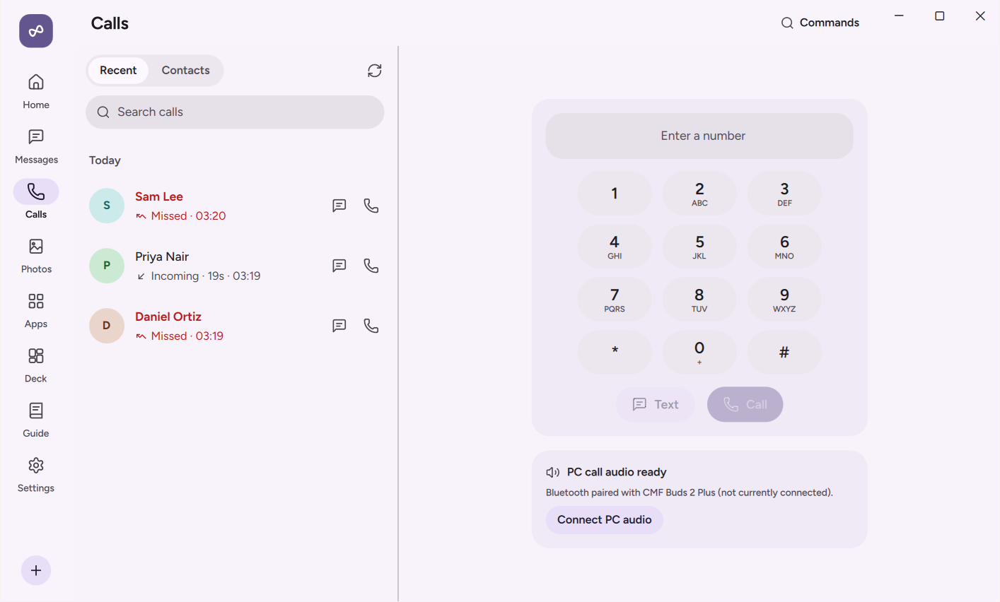

# Llamadas

La página **Llamadas** del PC te permite ver las llamadas entrantes con identificador, contestarlas o rechazarlas desde el escritorio, rechazar una llamada con una respuesta rápida por SMS, marcar números desde un teclado, consultar el historial de llamadas recientes y los contactos, y controlar las llamadas activas.

  

## Qué necesitas

| Requisito | Detalles |
| :--- | :--- |
| **Permisos de Android** | **Llamadas en tu PC** (`READ_PHONE_STATE`, `READ_CALL_LOG`, `ANSWER_PHONE_CALLS`, `CALL_PHONE`) y **Contactos en tu PC** (`READ_CONTACTS`) en **Ajustes › Permisos › Llamadas, contactos y mensajes**. |
| **Nivel de control de Android** | `Standard` para avisos de llamada entrante, identificador, contestar, rechazar, colgar, registro de llamadas, marcador y volumen. `Elevated` (en Android 12 o posterior) activa desde el PC los controles de **Silenciar**, **Altavoz**, **En espera** y **Teclado (DTMF)** durante la llamada. |
| **Interruptores por dispositivo** | **Llamadas** y **Contactos** (ambos activados por defecto en **Ajustes › Dispositivos** del PC). |
| **Red** | Red local, cable USB o **Conectar con datos móviles**. |

## Uso paso a paso

### Atender llamadas entrantes en el PC

1. Cuando suena el teléfono, Panal muestra en el PC un aviso de llamada entrante (y despliega la `Nectar Island` si está activada) con el nombre, el número y la foto del contacto.
2. Si **Pausar multimedia durante las llamadas** está activado en **Ajustes › Cámara y audio**, la música o el vídeo que suene en el PC se pausa solo mientras el teléfono suena o hay una llamada, y se reanuda al terminar.
3. Desde el aviso de llamada entrante puedes:
   - Hacer clic en **Contestar** para descolgar en el teléfono.
   - Hacer clic en **Rechazar** para enviar la llamada al buzón de voz.
   - Hacer clic en **Silenciar** para callar el tono sin rechazar la llamada.
   - Hacer clic en **Responder con un mensaje** (si el acceso a SMS está activado) para rechazar la llamada y enviar al momento una respuesta SMS predefinida o personalizada.

### Controlar una llamada activa

Mientras hay una llamada activa en el teléfono, la barra de llamada del PC muestra el tiempo transcurrido y ofrece controles según el nivel de control del teléfono:

- **Con `Standard` o `Assist`**: ves la duración de la llamada, ajustas el volumen y haces clic en **Colgar** para terminarla.
- **Con `Elevated` (Android 12 o posterior)**: aparecen controles adicionales en la tarjeta del PC para activar **Silenciar**, pasar el teléfono a **Altavoz**, poner la llamada **En espera** o abrir el **Teclado** para enviar tonos DTMF a menús automáticos.

### Llamar desde el PC

1. Abre **Llamadas** en la barra lateral del PC.
2. Puedes empezar una llamada de tres formas:
   - **Desde el teclado**: escribe o pega un número en el teclado de marcación (o pulsa las teclas numéricas del teclado) y haz clic en **Llamar**.
   - **Con dos SIM**: elige la SIM en **Llamar con**, junto al teclado. El PC la recuerda para ese teléfono y la usa en cada llamada que inicia, así el teléfono no se detiene a preguntar qué SIM usar.
   - **Desde Contactos**: busca en los contactos sincronizados (los favoritos aparecen arriba) y haz clic en el botón de llamada junto a cualquier número.
   - **Desde Recientes**: haz clic en cualquier entrada del historial para devolver la llamada o abrir una conversación de texto con esa persona.
3. El teléfono hace la llamada al momento.

### Consultar el historial de llamadas

La página **Llamadas** agrupa por día las llamadas recientes entrantes, salientes y perdidas del teléfono. Las perdidas se resaltan en rojo y se resumen en la pantalla de Inicio del PC hasta que las veas. Un aviso de buzón de voz del teléfono aparece en el feed de notificaciones como cualquier otra notificación.

## Por qué el audio de la llamada se queda en el teléfono

Cuando contestas o haces una llamada desde el PC, Panal controla la llamada en el teléfono, pero el audio de voz sigue en el auricular, el altavoz o los auriculares Bluetooth emparejados directamente con el teléfono.

Esto se debe a dos restricciones del sistema operativo (documentadas en detalle en [`docs/research/hfp.md`](../research/hfp.md)):

1. **Enrutado de voz por hardware en Android**: en dispositivos Android sin root, el audio de las llamadas móviles (`VOICE_CALL`, `VOICE_DOWNLINK`, `VOICE_UPLINK`) lo enruta el DSP del módem y no se puede capturar por software (`AudioPlaybackCapture` excluye expresamente la comunicación de voz, incluso con el nivel de shell `Elevated`).
2. **Restricciones de Bluetooth HFP en Windows 11**: la API `AudioPlaybackConnection` de Windows solo admite reproducción multimedia A2DP en un sentido (no canales de voz bidireccionales del perfil manos libres), y el intermediario HFP `PhoneLineTransportDevice` de Microsoft en Windows 11 22H2 y posterior rechaza las apps de terceros con `E_ACCESSDENIED` salvo que se ejecuten con la identidad interna del sistema de Microsoft o con un controlador de kernel firmado por WHQL.

Para hablar con manos libres en el escritorio, haz clic en **Altavoz** en la barra de llamada de Panal (con `Elevated`) o mantén tus auriculares inalámbricos emparejados con el teléfono mediante Bluetooth multipunto.

## Qué hacen las opciones

- **Interruptor Llamadas** (`Ajustes › Dispositivos` en el PC, **activado** por defecto): activa para ese teléfono el identificador de llamadas, la sincronización del registro, los avisos de llamada entrante y el control de llamadas.
- **Interruptor Contactos** (`Ajustes › Dispositivos` en el PC, **activado** por defecto): sincroniza los contactos del teléfono para que el identificador y el marcador muestren nombres y fotos.
- **Pausar multimedia durante las llamadas** (`Ajustes › Cámara y audio` en el PC, **activado** por defecto): pausa sola la reproducción multimedia de Windows cuando suena o se conecta una llamada en el teléfono, y la reanuda al terminar salvo que la hayas cambiado tú mientras tanto.
- **Activadores de la isla › Llamadas** (`Ajustes › General` en el PC, **activado** por defecto cuando `Nectar Island` está activada): muestra las llamadas entrantes y activas dentro de la píldora `Nectar Island` de la parte superior de la pantalla.

## Datos y privacidad

- **Por dónde viajan los datos**: los cambios de estado de llamada, los datos del identificador, las entradas del registro de llamadas y los contactos viajan directamente entre el teléfono y el PC por tu conexión QUIC cifrada de extremo a extremo.
- **Dónde se quedan**: el registro de llamadas y los contactos se leen en directo del teléfono y se mantienen en memoria en el PC durante la sesión. Panal nunca graba el audio de las llamadas.

## Límites

- **Audio bidireccional de llamadas en el PC**: como se explica arriba, las API públicas de Windows y Android no permiten que apps de terceros lleven el audio de voz de las llamadas móviles a los altavoces y el micrófono del PC sin un controlador de kernel o un firmware OEM firmado por el sistema.
- **Silenciar, En espera, Altavoz y teclado DTMF durante la llamada**: los permisos estándar de Android permiten a apps de terceros contestar y terminar llamadas (`TelecomManager`), pero silenciar el micrófono, cambiar al altavoz, poner en espera y enviar tonos DTMF durante una llamada móvil requieren `Elevated` en Android 12 o posterior, salvo que la app sustituya al marcador predeterminado.
- **Elección de SIM en teléfonos con dos SIM**: si no eliges una SIM en **Llamar con**, Android usa la SIM de llamadas predeterminada configurada en el teléfono (o pregunta en el teléfono si tu preferencia es "Preguntar siempre").
