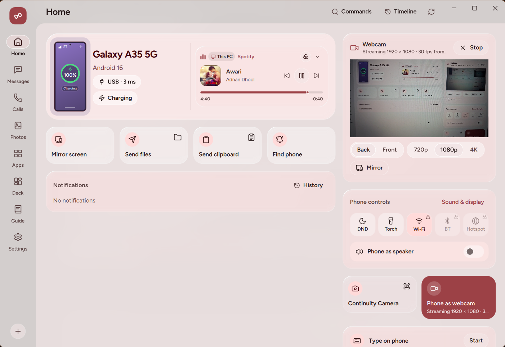
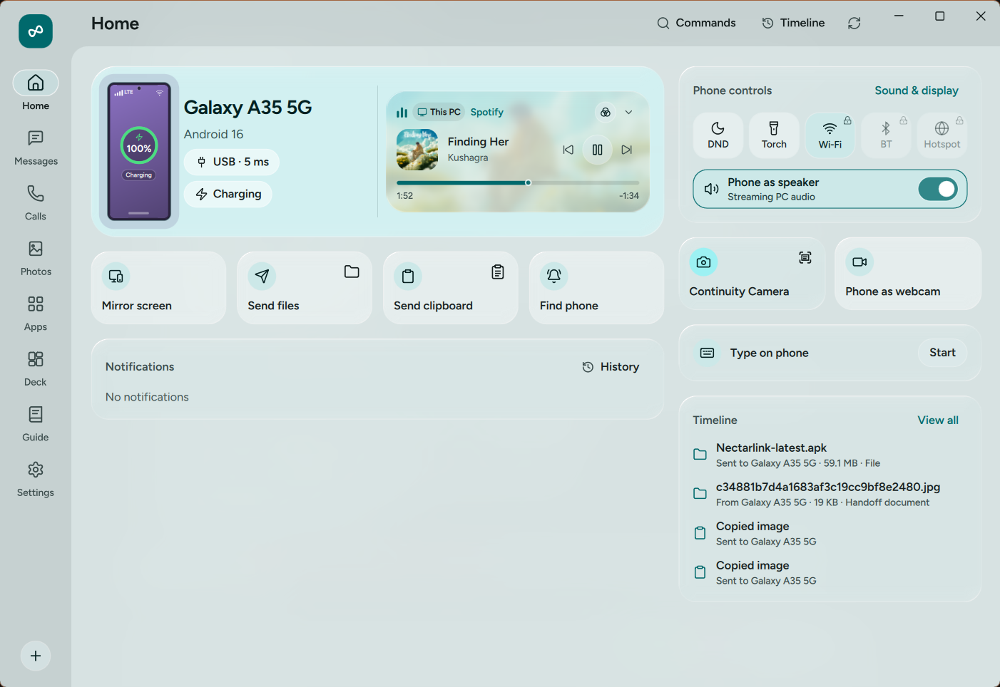

# Cámaras y audio

Panal permite al PC usar las cámaras y el audio del teléfono de cuatro formas: transmitir la cámara del teléfono como webcam de Windows (`Panal Webcam`), hacer fotos o escanear documentos directamente al portapapeles del PC (**Cámara de continuidad**), reproducir el audio del sistema del PC en el teléfono (**Teléfono como altavoz**) y grabar notas de voz en el teléfono que llegan solas al PC (**Grabadora de voz**).

  

## Qué necesitas

| Función | Requisitos |
| :--- | :--- |
| **Teléfono como webcam** | Nivel de control `Standard`. Permiso de **Cámara** de Android (`CAMERA`, se pide al iniciar la webcam). Interruptor por dispositivo **Webcam** activado en **Ajustes › Dispositivos** del PC (activado por defecto). Para usar la cámara en apps de terceros (Zoom, Teams, Meet, OBS, Cámara de Windows), haz clic en **Configurar** junto a **Complemento de cámara virtual** en **Ajustes › Cámara y audio** del PC (una única petición de administrador en Windows 11). |
| **Cámara de continuidad (Hacer foto / Escanear documento)** | Nivel de control `Standard`. Permiso de **Cámara** de Android. Interruptor **Webcam** activado. |
| **Teléfono como altavoz (enviar el audio del PC al teléfono)** | Nivel de control `Standard`. Interruptor por dispositivo **Controles multimedia** activado en **Ajustes › Dispositivos** del PC (activado por defecto). |
| **Grabadora de voz** | Nivel de control `Standard`. Permiso de **Micrófono** de Android (`RECORD_AUDIO`, se pide al empezar a grabar). Interruptor por dispositivo **Grabaciones de voz** activado en **Ajustes › Dispositivos** del PC (activado por defecto). |

## Uso paso a paso

### 1. Usar el teléfono como webcam de Windows

El sensor de la cámara principal del teléfono ofrece mucha mejor óptica y calidad con poca luz que la webcam integrada típica de un portátil.

#### Configuración única del complemento de cámara virtual

Puedes ver la vista previa de la cámara del teléfono en **Ajustes › Cámara y audio** de Panal al momento, sin configurar nada. Para que **Panal Webcam** aparezca como cámara seleccionable en Zoom, Microsoft Teams, Google Meet, Discord, OBS Studio y la app Cámara de Windows:

1. En el PC, abre **Ajustes › Cámara y audio**.
2. Junto a **Complemento de cámara virtual**, haz clic en **Configurar** y aprueba la petición de administrador del Control de cuentas de usuario (UAC) de Windows.
3. Panal registra `nectarlink_vcam.dll` en el servicio `MFCreateVirtualCamera` de Media Foundation de Windows 11. Una vez registrado, el indicador muestra **Lista** (y puedes quitarlo cuando quieras con **Quitar**).

#### Iniciar y controlar la webcam

1. Inicia la webcam desde cualquiera de los dos lados:
   - **Desde el teléfono**: toca **Webcam** en la pantalla de Inicio de Android y luego **Iniciar webcam**.
   - **Desde el PC**: abre **Ajustes › Cámara y audio** (o haz clic en el control de webcam de Inicio) y haz clic en **Iniciar webcam**. Por tu privacidad, **iniciar la webcam desde el PC publica una petición de confirmación en el teléfono** (`<PC> quiere usar tu cámara`), así la cámara del teléfono nunca se abre sin tu consentimiento en el teléfono. Para evitar el toque con un PC de confianza, activa **Iniciar la cámara y el micrófono sin preguntar** bajo ese PC en **Ajustes › PC** del teléfono (`Elevated`; desactivado por defecto). Sus peticiones de webcam y micrófono empiezan entonces al momento, incluso con el teléfono bloqueado, y la notificación **Detener** y el punto de cámara de Android siguen visibles.
2. Mientras transmite, puedes ajustar la cámara desde el teléfono o desde el PC:
   - **Objetivo**: cambia entre la cámara **Trasera** y la **Frontal**.
   - **Resolución**: elige **720p** (`1280 x 720`), **1080p** (`1920 x 1080`) o **4K** (`3840 x 2160` en teléfonos cuyo sensor admite 4K a 30 fps).
   - **Zoom**: toca los valores `1x` o `2x` o arrastra el control deslizante de zoom en el teléfono.
   - **Linterna**: enciende o apaga el flash LED trasero como luz de relleno.
   - **Imagen en espejo**: voltea horizontalmente el vídeo en **Ajustes › Cámara y audio** del PC.
3. Abre tu app de videoconferencia en Windows y elige **Panal Webcam** como cámara.

### 2. Cámara de continuidad: hacer una foto o escanear un documento

Cuando necesitas insertar la foto de un objeto, una pizarra o un recibo directamente en un documento del PC:

1. En el PC, lanza la Cámara de continuidad de cualquiera de estas tres formas:
   - Pulsa el atajo global: **`Ctrl+Alt+C`** para **Hacer foto** o **`Ctrl+Alt+D`** para **Escanear documento** (ambos se pueden cambiar en **Ajustes › Atajos y reglas**).
   - Abre la `Paleta de comandos` (`Ctrl+Alt+Espacio`) y elige **Hacer foto con el teléfono** o **Escanear documento con el teléfono**.
   - Haz clic en **Hacer foto** o **Escanear documento** en la pantalla de Inicio o en la `Bandeja`.
2. El teléfono recibe una petición de captura (`<PC> quiere hacer una foto` o `<PC> quiere escanear un documento`). Toca la notificación para abrir la pantalla de captura.
3. **En modo Foto**: encuadra, toca **Hacer foto**, revisa la vista previa y toca **Usar foto** (o **Repetir**).
4. **En modo Escaneo**:
   - Captura la página o el recibo.
   - Arrastra los cuatro tiradores de las esquinas (**Ajustar esquinas**) hasta los bordes del documento. Panal corrige la perspectiva y lo convierte en un rectángulo plano.
   - Activa **Mejorar documento** para aplicar una mejora en blanco y negro de alto contraste con texto nítido y legible.
   - Toca **Enviar escaneo**.
5. La foto o el escaneo mejorado llega al PC en `Descargas\Panal` y se coloca solo en el portapapeles de Windows, para que pulses `Ctrl+V` directamente en Word, Notion, Slack, el correo o cualquier editor de imágenes.

### 3. Teléfono como altavoz: escuchar el audio del PC en el teléfono

Si tu PC de sobremesa no tiene altavoces, o quieres moverte por la habitación mientras escuchas la música, el vídeo o las llamadas del PC con auriculares conectados al teléfono:

  

1. Activa **Teléfono como altavoz** desde cualquiera de los dos lados:
   - **En el PC**: haz clic en **Teléfono como altavoz** en la pantalla de Inicio, o activa **Enviar el audio del PC al teléfono** en **Ajustes › Cámara y audio**.
   - **En el teléfono**: toca **Usar el teléfono como altavoz** en la tarjeta **Audio del PC** de la pantalla de Inicio de Android.
2. Ambos interruptores se mantienen sincronizados en tiempo real. El PC captura la reproducción del sistema con el bucle de WASAPI de Windows y la envía como PCM de 16 bits sin comprimir en pequeños datagramas QUIC. El teléfono la reproduce con un `AudioTrack` multimedia normal, así que se siguen aplicando su ecualización y sus efectos de sonido, y mantiene unos 40 ms en búfer para absorber las fluctuaciones de la Wi-Fi.
   - El audio va al teléfono que activó **Usar el teléfono como altavoz**. Si lo activas desde el PC, va al primer teléfono conectado.
3. Desde la tarjeta **Audio del PC** del teléfono (o en `Deck`) también puedes ajustar el volumen general del PC, silenciarlo y cambiar entre los dispositivos de salida de audio conectados al PC.

#### Al revés: el sonido del teléfono en el PC

Para oír lo que reproduce el teléfono (música, vídeos, sonidos de apps) por los altavoces o auriculares del PC sin abrir una ventana de duplicación, activa **Sonido del teléfono en este PC** en la pantalla de Inicio del PC.

- Con `Elevated` empieza al momento. Si no, el teléfono pregunta antes, como en la duplicación: toca la notificación y permítelo. El aviso de Android habla de compartir la pantalla, pero al PC solo va el sonido.
- Es el mismo sonido que envía la duplicación: en Android 10 y posterior, las apps que permiten capturar su audio (casi todas las de multimedia y juegos). Las llamadas no se incluyen.
- El teléfono se queda en silencio mientras su sonido suena en el PC. Sin `Elevated`, baja el volumen multimedia a 0 y lo vuelve a subir al desactivarlo (si mientras tanto subiste tú el volumen, se queda el tuyo).
- Abrir la ventana de duplicación del teléfono lo sustituye, porque esa ventana trae el sonido con la imagen. Desactívalo en el PC o toca **Detener** en el teléfono.

### 4. Grabadora de voz: grabar en el teléfono, guardar en el PC

Usa el micrófono del teléfono para grabar notas de voz, entrevistas o resúmenes de reuniones que pasan directamente al PC en el formato de audio que prefieras:

1. En el teléfono, toca **Grabar** en la pantalla de Inicio de Android y luego **Empezar a grabar**.
2. Mientras grabas, un medidor de nivel muestra la entrada del micrófono, y la grabación sigue sin cortes en un servicio en primer plano aunque apagues la pantalla del teléfono.
3. Toca **Pausar** y **Reanudar** cuando haga falta. Para marcar un momento importante, escribe una etiqueta opcional y toca **Añadir marcador** para guardar un marcador con la hora.
4. Cuando terminas y tocas **Enviar**:
   - Si el PC está conectado, la grabación se transfiere al momento y llega a la carpeta de grabaciones elegida (`Descargas\Panal` o `Documentos\Panal Recordings` por defecto).
   - Si elegiste **MP3**, **WAV** o **FLAC** en **Ajustes › Archivos y sincronización › Grabaciones de voz** del PC (en lugar del **M4A** predeterminado), el PC convierte el archivo de audio solo al recibirlo.
   - Si añadiste marcadores, Panal escribe junto al archivo de audio un archivo `<nombre>.markers.txt` con la hora y la etiqueta de cada marcador.
   - Si el PC está desconectado al terminar, la nota de voz se queda guardada en el teléfono y se envía sola en cuanto el PC se reconecta.

## Qué hacen las opciones

- **Enviar el audio del PC al teléfono** (`Ajustes › Cámara y audio` en el PC, por defecto: **desactivado**): envía en tiempo real el audio del sistema Windows al teléfono conectado.
- **Pausar multimedia durante las llamadas** (`Ajustes › Cámara y audio` en el PC, por defecto: **activado**): pausa sola la reproducción multimedia del PC cuando el teléfono suena o hay una llamada.
- **Complemento de cámara virtual** (`Ajustes › Cámara y audio` en el PC): registra o quita la cámara virtual de Media Foundation `Panal Webcam` de Windows 11.
- **Teléfono** (`Ajustes › Cámara y audio` en el PC, aparece con varios teléfonos emparejados): elige qué teléfono emparejado se usa como webcam.
- **Cámara** (`Ajustes › Cámara y audio` en el PC, por defecto: **Trasera**): elige el objetivo **Trasero** o **Frontal** del teléfono.
- **Imagen en espejo** (`Ajustes › Cámara y audio` en el PC, por defecto: **desactivado**): voltea horizontalmente el vídeo de la webcam.
- **Resolución** (`Ajustes › Cámara y audio` en el PC, por defecto: **720p**): elige la salida de webcam **720p**, **1080p** o **4K** (`2160p`).
- **Grabaciones de voz** (`Ajustes › Archivos y sincronización` en el PC, formato por defecto: **M4A**): define la carpeta de destino (**Elegir carpeta** / **Restablecer**) y el formato de salida (**M4A**, **MP3**, **WAV** o **FLAC**) de las grabaciones de voz entrantes.
- **Atajos de Hacer foto / Escanear documento** (`Ajustes › Atajos y reglas` en el PC, por defecto: `Ctrl+Alt+C` y `Ctrl+Alt+D`): teclas de acceso rápido globales de Windows para la Cámara de continuidad.

## Datos y privacidad

- **Consentimiento expreso de cámara en el teléfono**: un PC emparejado nunca puede abrir la cámara del teléfono sin tu permiso. Cada vez que haces clic en **Iniciar webcam** o lanzas la **Cámara de continuidad** desde el PC, el teléfono muestra una notificación que requiere un toque en el teléfono antes de abrir la cámara, salvo que hayas activado **Iniciar la cámara y el micrófono sin preguntar** para ese PC (solo webcam y micrófono). Mientras transmite, el indicador verde de cámara de Android y la notificación persistente de Panal **Transmitiendo la cámara a `<PC>`** siguen visibles en el teléfono con un botón **Detener**.
- **Aislamiento de la memoria compartida**: en Windows, los fotogramas decodificados de la webcam pasan a la DLL de cámara virtual de Media Foundation a través de un búfer circular de memoria compartida limitado a la sesión de inicio (`Local\PanalVirtualCamera_v2`), con comprobación estricta de límites (`MAX_WIDTH = 3840`, `MAX_HEIGHT = 2160`), para que otras cuentas de usuario de Windows no puedan leer la imagen.
- **Caché temporal de la cámara**: las capturas temporales de la Cámara de continuidad en el teléfono se guardan en la caché privada de la app y se borran solas en 24 horas (o al momento con **Ajustes › Funciones y datos › Datos y almacenamiento › Miniaturas de fotos y caché de cámara › Borrar**).

## Límites

- **Hardware para webcam 4K**: transmitir en 4K (`3840 x 2160`) requiere un sensor de cámara y un codificador por hardware que admitan 4K a 30 fps, además de suficiente ancho de banda Wi-Fi o USB. Si la cámara del teléfono solo llega a 1080p, transmite a su máxima resolución admitida.
- **Webcam SDR de 8 bits**: la webcam usa color SDR de 8 bits (tipos de medios `NV12` / `RGB32` de Media Foundation) para ser compatible con Zoom, Teams, Meet, Chrome y OBS; no se usa vídeo HDR de 10 bits.
- **Petición de administrador para registrar la cámara virtual**: registrar o quitar una cámara virtual de Media Foundation para todo el sistema en Windows 11 (**Complemento de cámara virtual › Configurar**) requiere una única aprobación de administrador (UAC). La vista previa de la webcam dentro de la ventana de Panal funciona sin privilegios de administrador.
- **Caducidad de las peticiones de Cámara de continuidad**: si lanzas **Hacer foto** o **Escanear documento** con el teléfono desconectado, la petición en cola caduca a los **2 minutos**, así el teléfono no te pide una foto por sorpresa horas después.
