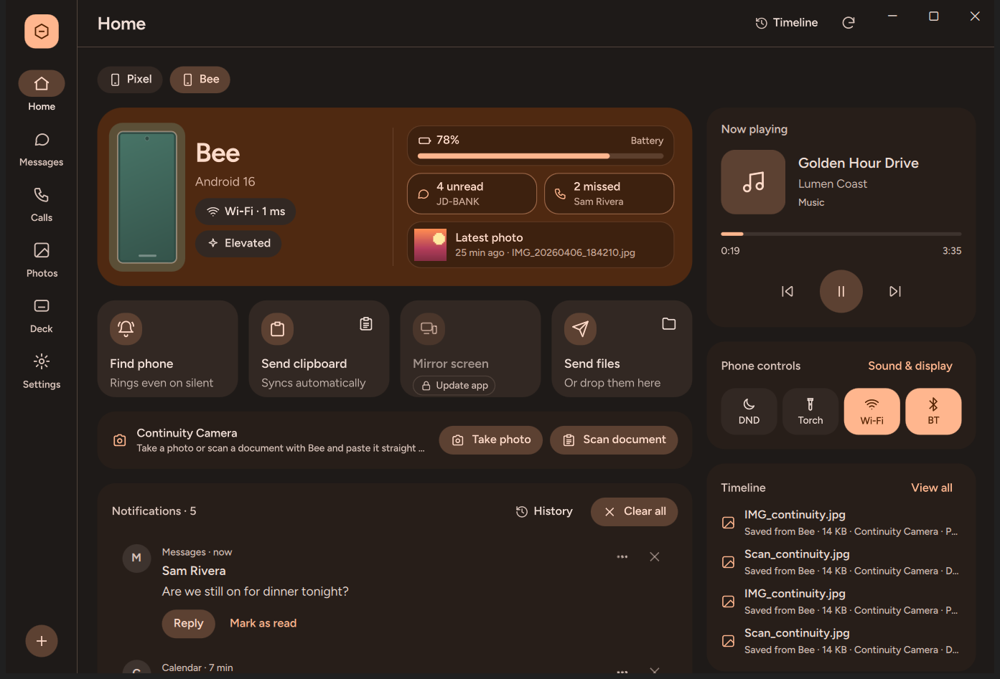

# Portapapeles

Panal comparte el portapapeles entre el PC y el teléfono Android. Copia texto plano, texto HTML con formato, una imagen o un archivo en un dispositivo y pégalo en el otro, con etiquetas de acción para enlaces y direcciones, un historial cifrado opcional de 50 elementos y filtrado automático de contraseñas y códigos de verificación de un solo uso.

  

## Qué necesitas

| Requisito | Detalles |
| :--- | :--- |
| **Permisos de Android** | No hace falta ningún permiso especial para sincronizar del PC al teléfono ni para enviar a mano del teléfono al PC. |
| **Nivel de control de Android** | `Standard` para la sincronización automática del PC al teléfono y el envío con un toque del teléfono al PC (desde el mosaico de Ajustes rápidos, el menú Compartir, el widget o el botón de la app). `Elevated` activa la **sincronización automática en segundo plano del teléfono al PC** cada vez que copias texto o imágenes en cualquier app de Android. |
| **Interruptor por dispositivo** | **Portapapeles** (activado por defecto en **Ajustes › Dispositivos** del PC). |
| **Red** | Red local, cable USB o **Conectar con datos móviles**. Si el dispositivo de destino está desconectado, tu último envío espera en la cola `Pendiente de enviar` (sustituyendo cualquier recorte anterior en cola para ese dispositivo) y llega solo al reconectar. |

## Uso paso a paso

### Copiar en el PC para pegar en el teléfono

1. En el PC, copia texto plano, texto HTML con formato o una imagen (`Ctrl+C`, clic derecho › **Copiar** o recorte de pantalla con `Win+Mayús+S`).
2. Con **Sincronizar el portapapeles con el teléfono** activado en **Ajustes › General** (lo predeterminado), Panal envía lo copiado al teléfono conectado en segundo plano.
3. En el teléfono, toca **Pegar** en cualquier campo de texto o editor de imágenes.
4. También puedes enviar el portapapeles del PC a mano cuando quieras con **Enviar portapapeles** en la pantalla de Inicio del PC o ejecutando **Enviar portapapeles al teléfono** en la `Paleta de comandos` (`Ctrl+Alt+Espacio`).

### Copiar en el teléfono para pegar en el PC

Android 10 y posterior impiden que las apps en segundo plano lean el portapapeles del sistema salvo que tengan privilegios de shell. Panal te da dos formas de enviar el portapapeles del teléfono al PC:

- **Automática en segundo plano (con `Elevated`)**: cuando activas `Elevated` (con la depuración inalámbrica en **Ajustes › Permisos › Control desde tu PC** o **Ajustes › Funciones y datos › Portapapeles › Acceso al portapapeles en segundo plano**), el ayudante de shell local de Panal detecta los cambios del portapapeles y envía al PC el texto y las imágenes copiados en cuanto tocas **Copiar** en cualquier app.
- **Envío manual con un toque (con `Standard` o `Assist`)**: sin `Elevated`, puedes enviar lo que copiaste en el teléfono desde cuatro accesos rápidos:
  1. **Mosaico de Ajustes rápidos**: baja el panel de notificaciones y toca el mosaico **Enviar portapapeles**.
  2. **Menú Compartir de Android**: selecciona texto o una imagen en cualquier app, toca **Compartir** y elige **Enviar al PC** (o toca el icono de Compartir directo de tu PC).
  3. **Widget de la pantalla de inicio**: toca **Enviar recorte** en el widget **Acciones rápidas del PC** de Panal.
  4. **Dentro de la app Panal**: toca **Enviar portapapeles** en la pantalla de Inicio de Android (o en la notificación persistente de conexión).

### Copiar y pegar archivos (`Ctrl+C` / `Ctrl+V`)

Panal conecta los archivos del portapapeles de Windows (`CF_HDROP`) con las transferencias de archivos:

- **Del PC al teléfono**: si copias uno o varios archivos en el Explorador de archivos (`Ctrl+C`) y haces clic en **Enviar portapapeles** en Panal, esos archivos se transfieren directamente al teléfono.
- **Del teléfono al PC**: con **Copiar archivos recibidos** activado en **Ajustes › General** (lo predeterminado), los archivos pequeños y las fotos que envías del teléfono al PC se guardan en `Descargas\Panal` y se colocan solos en el portapapeles de Windows como archivos, para que pulses `Ctrl+V` directamente en un correo, un chat, un documento o una carpeta.

### Etiquetas de acción

Cuando llega un recorte de texto de un dispositivo emparejado y coincide con un patrón reconocible, Panal muestra una etiqueta de acción en el aviso de confirmación para que actúes con un clic o un toque:

| Contenido detectado | Acción de la etiqueta |
| :--- | :--- |
| **URL web (`https://...`)** | **Abrir**: abre el enlace en el navegador predeterminado. |
| **Dirección postal o coordenadas** | **Abrir en Mapas**: abre la dirección en la app de mapas predeterminada. |
| **Número de teléfono** | **Llamar**: abre el número en el marcador de Panal (en el PC) o en el marcador del teléfono (en Android). |
| **Número de seguimiento de paquete** (UPS, FedEx, USPS, DHL) | **Seguir**: abre la página de seguimiento del transportista. |
| **Dirección de correo** | **Correo**: empieza un correo nuevo a esa dirección en el cliente de correo predeterminado. |

Puedes desactivar estas sugerencias cuando quieras en **Ajustes › General › Sugerir acciones del portapapeles** en el PC o en **Ajustes › Funciones y datos › Portapapeles › Sugerir acciones para el texto copiado** en Android.

### Usar el historial del portapapeles

La app de Windows y la de Android guardan un **Historial del portapapeles** local, cifrado y opcional, con los últimos 50 recortes de texto e imagen compartidos entre tus dispositivos:

1. Abre **Historial del portapapeles** desde la pantalla de Inicio (o desde `Línea de tiempo` / `Bandeja` en el PC).
2. Busca recortes por texto, filtra por dispositivo de origen, haz clic en **Copiar** para volver a poner un recorte anterior en el portapapeles o en **Fijar** para que un fragmento importante no se pierda cuando lleguen recortes nuevos.
3. Haz clic en **Eliminar** en un elemento o en **Borrar historial** para eliminar todos los recortes guardados.

## Qué hacen las opciones

### En Windows

- **Sincronizar el portapapeles con el teléfono** (`Ajustes › General`, por defecto: **activado**): envía solo a los teléfonos conectados el texto y las imágenes copiados en el PC.
- **Copiar códigos de un solo uso** (`Ajustes › General`, por defecto: **desactivado**): copia solos al portapapeles del PC los códigos de verificación detectados en las notificaciones y los SMS del teléfono.
- **Copiar archivos recibidos** (`Ajustes › General`, por defecto: **activado**): coloca los archivos recién recibidos en el portapapeles de archivos de Windows (`CF_HDROP`) para pegarlos con `Ctrl+V`.
- **Sugerir acciones del portapapeles** (`Ajustes › General`, por defecto: **activado**): muestra etiquetas de acción (**Abrir**, **Abrir en Mapas**, **Llamar**, **Seguir**, **Correo**) cuando llega texto que coincide.
- **Historial del portapapeles** (`Ajustes › Almacenamiento y privacidad`, por defecto: **activado**): guarda hasta 50 recortes sincronizados (durante 7 días, hasta 128 MB) en un archivo local cifrado, con un botón **Borrar**.

### En Android

- **Acceso al portapapeles en segundo plano** (`Ajustes › Funciones y datos › Portapapeles`): te guía para activar la depuración inalámbrica (`Elevated`) y que la sincronización del teléfono al PC funcione sola en segundo plano.
- **Sugerir acciones para el texto copiado** (`Ajustes › Funciones y datos › Portapapeles`, por defecto: **activado**): muestra etiquetas de acción cuando llega texto del PC.
- **Historial del portapapeles** (`Ajustes › Funciones y datos › Datos y almacenamiento`, por defecto: **activado**): activa o desactiva el historial local cifrado de 50 elementos en el teléfono y te permite borrarlo.

## Datos y privacidad

- **Exclusión automática de contraseñas y códigos de un solo uso**:
  - Cualquier elemento del portapapeles que un gestor de contraseñas marque como privado o sensible (los formatos `ExcludeClipboardContentFromMonitorProcessing` / `CloudClipboard` en Windows, o `ClipDescription.EXTRA_IS_SENSITIVE` en Android 13+) se ignora y **nunca** se transmite ni se guarda.
  - Los códigos de verificación de un solo uso (OTP) nunca se escriben en el historial ni en la `Línea de tiempo`, y un OTP copiado solo en el PC nunca se reenvía al teléfono.
- **Cifrado en reposo**: con el **Historial del portapapeles** activado, los recortes guardados (`clipboard_history.enc` con cabecera `NLCB\x01`) y las imágenes (`clipboard_images/<id>.enc` con cabecera `NLCI\x01`) se cifran en reposo con el `KeyProtector` de la plataforma: **DPAPI de Windows** (`CryptProtectData`, ligado a tu cuenta de usuario de Windows) en el PC y el **Almacén de claves de Android** (`AES-256-GCM`, que puede estar respaldado por hardware) en Android.
- **Conservación**: las entradas no fijadas del historial caducan solas a los **7 días** (con un máximo de 50 elementos y 128 MB en total). En la `Línea de tiempo`, las entradas del portapapeles hacen referencia al elemento cifrado del historial por su ID, así que el contenido nunca se guarda en texto plano dentro de SQLite.

## Límites

- **Restricción del portapapeles en segundo plano en Android sin `Elevated`**: en Android 10 y posterior, solo la app en primer plano o el método de entrada activo (el teclado) pueden leer el portapapeles del sistema. Sin `Elevated`, compartir del teléfono al PC requiere tocar el mosaico de Ajustes rápidos, el menú Compartir, el widget o el botón de la app.
- **Tamaño máximo de los recortes**: cada recorte de texto tiene un límite de 256 KiB en la transmisión (`clip::MAX_TEXT_BYTES`) y las imágenes, de 32 MiB (`clip::MAX_IMAGE_BYTES`) en la sincronización en directo (16 MiB por imagen en el historial local), para que una copia enorme por error nunca bloquee la conexión. Para imágenes o archivos más grandes, usa [Archivos y transferencias](files-and-transfers.md).
