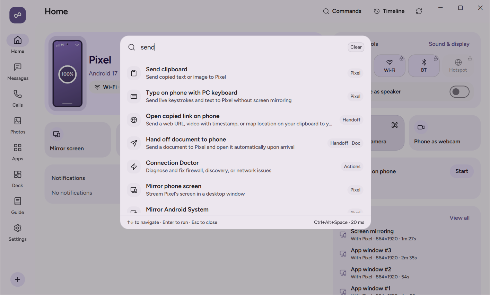
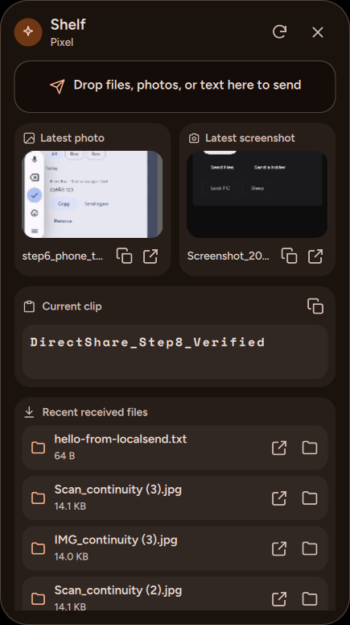
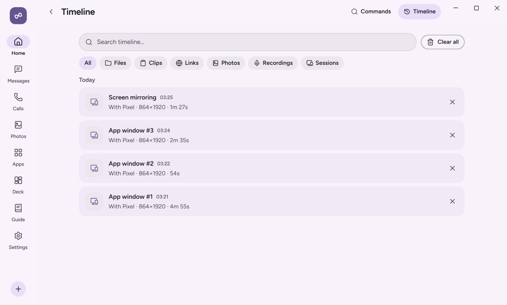

# Superficies de escritorio y automatización

Además de la ventana principal, Panal se integra en Windows 11 con superficies de escritorio rápidas y ligeras y con herramientas de automatización: el panel lateral **`Bandeja`**, la **`Nectar Island`** en la parte superior de la pantalla, la **`Línea de tiempo`** entre dispositivos con búsqueda, la **`Paleta de comandos`** global (`Ctrl+Alt+Espacio`), el **`Handoff`** avanzado para enlaces, mapas, vídeos y documentos, los avisos de fin de proceso **`notify-when`**, un **motor de reglas** de disparador y acción, una **API HTTP** local autenticada, una extensión para la **Paleta de comandos de PowerToys** y el cliente de línea de comandos `panal`.

<p align="center">
  
</p>

## Qué necesitas

| Función | Requisitos |
| :--- | :--- |
| **Panel lateral `Bandeja` (`Ctrl+Alt+S`)** | App de Windows 11 en ejecución (con la ventana abierta o en la bandeja del sistema). |
| **`Nectar Island`** | Activa **Nectar Island** en **Ajustes › General** del PC (desactivada por defecto). |
| **`Línea de tiempo`** | Activada por defecto en Windows y en Android (guarda hasta 5.000 elementos o 90 días por defecto). |
| **`Paleta de comandos` (`Ctrl+Alt+Espacio`)** | App de Windows 11 en ejecución (con la ventana abierta o en la bandeja del sistema). |
| **`Handoff` avanzado (enlaces, mapas, minuto de vídeo, documentos)** | Nivel de control `Standard`. Interruptor **Archivos** activado en **Ajustes › Dispositivos**. |
| **Avisos de tareas `notify-when` y línea de comandos (`panal`)** | App de Windows 11 en ejecución en la misma sesión de usuario. |
| **Automatizaciones de disparador y acción** | Se configuran en **Ajustes › Atajos y reglas › Reglas de disparador y acción** del PC. |
| **API de automatización local (`127.0.0.1:53320`)** | Activa **API de automatización local** en **Ajustes › Conexión y Acerca de** del PC (desactivada por defecto). |

## Uso paso a paso

### 1. El panel lateral `Bandeja` y lanzar para enviar

La `Bandeja` es un panel lateral ligero del PC que te da acceso inmediato, con arrastrar y soltar, a los elementos recientes del teléfono sin cambiar de ventana ni quitar el foco del teclado a la app actual:

<p align="center">
  
</p>

1. Pulsa **`Ctrl+Alt+S`** desde cualquier aplicación (o lanza un archivo hacia el borde de la pantalla) para desplegar la `Bandeja`.
2. La `Bandeja` muestra cuatro huecos en directo del teléfono conectado:
   - **Última foto**
   - **Última captura**
   - **Portapapeles actual**
   - **Archivos recibidos recientes**
3. **Arrastrar a cualquier app**: arrastra cualquier elemento de la `Bandeja` directamente a un correo, un documento, un cuadro de subida del navegador, un chat o una carpeta del Explorador.
4. **Soltar o lanzar para enviar**: arrastra cualquier archivo, carpeta, imagen o texto seleccionado del PC a la `Bandeja` (o lanza un archivo hacia el borde donde está la `Bandeja`) para enviarlo directamente al teléfono, con la opción **Deshacer** durante 3 segundos.
5. Pulsa **Esc** o haz clic fuera de la `Bandeja` para ocultarla. Oculta, la `Bandeja` descarga por completo su superficie QML, así no consume GPU ni memoria en segundo plano.

### 2. `Nectar Island`

`Nectar Island` es una píldora compacta y opcional en la parte superior central del monitor principal que muestra la actividad del teléfono en directo sin llenar tu espacio de trabajo de avisos emergentes:

1. Activa **Nectar Island** en **Ajustes › General** del PC (está **desactivada por defecto**).
2. En la fila **Activadores de la isla**, justo debajo, elige qué actividades aparecen en la píldora:
   - **Llamadas** (activado por defecto): identificador de llamada entrante con botones Contestar/Rechazar y duración de la llamada en directo.
   - **Transferencias** (activado por defecto): barras de progreso de transferencias en directo y número de elementos en `Pendiente de enviar`.
   - **Multimedia** (activado por defecto): carátula, título y controles de la pista en reproducción.
   - **Alertas** (desactivado por defecto): notificaciones del teléfono, códigos de verificación de un solo uso, temporizadores activos y Live Updates, y grabaciones de voz entrantes.
3. Pasa el ratón o haz clic en `Nectar Island` para desplegar sus controles, o deja que vuelva a ser una píldora mínima cuando no hay actividad. `Nectar Island` se oculta sola cuando ejecutas un juego o un vídeo a pantalla completa, o cuando No molestar de Windows está activo.

### 3. `Línea de tiempo` entre dispositivos

La `Línea de tiempo` te da un único registro local con búsqueda de todo lo que ha pasado entre el teléfono y el PC:

<p align="center">
  
</p>

1. Haz clic en **Línea de tiempo** en la barra lateral del PC (o baja hasta la tarjeta **Línea de tiempo** en la pantalla de Inicio de Android).
2. Las entradas se agrupan por día (**Hoy**, **Ayer** y fechas anteriores) e incluyen:
   - **Archivos** y carpetas enviados y recibidos
   - **Recortes** compartidos (enlazados por ID al historial cifrado del portapapeles, así el texto nunca se duplica en SQLite)
   - **Enlaces** abiertos, ubicaciones de mapas y vídeos traspasados
   - **Fotos** guardadas y escaneos de la Cámara de continuidad
   - **Grabaciones** recibidas (notas de voz)
   - **Sesiones** de duplicación de pantalla y webcam (con su duración)
3. Filtra por categoría (**Todo**, **Archivos**, **Recortes**, **Enlaces**, **Fotos**, **Grabaciones**, **Sesiones**), por dispositivo emparejado si tienes más de un teléfono o PC, o escribe en el cuadro **Buscar en la línea de tiempo**.
4. Cada entrada ofrece acciones rápidas según su tipo: **Abrir**, **Mostrar en la carpeta**, **Copiar**, **Enviar otra vez** o **Quitar**.

### 4. `Paleta de comandos` global (`Ctrl+Alt+Espacio`)

Pulsa **`Ctrl+Alt+Espacio`** desde cualquier lugar de Windows para abrir la `Paleta de comandos` de Panal sobre la ventana actual:

1. Empieza a escribir para buscar de forma aproximada cualquier acción, dispositivo emparejado, archivo reciente o ajuste:
   - **Duplicar la pantalla del teléfono**
   - **Enviar archivos al teléfono** / **Enviar portapapeles al teléfono**
   - **Hacer foto con el teléfono** (`Ctrl+Alt+C`) / **Escanear documento con el teléfono** (`Ctrl+Alt+D`)
   - **Escribir en el teléfono con el teclado del PC**
   - **Hacer sonar el teléfono (Buscar mi teléfono)**
   - **Activar o desactivar Teléfono como altavoz**
   - **Abrir el almacenamiento del teléfono en el Explorador de archivos**
   - **Abrir la guía de configuración** / **Abrir la guía de funciones**
   - **Ejecutar el Doctor de conexión**
2. También puedes escribir o pegar una URL o un texto directamente en la `Paleta de comandos` para enviarlo al teléfono al momento.
3. Usa las flechas **Arriba** y **Abajo** y pulsa **Intro** para ejecutar el comando resaltado, o pulsa **Esc** para cerrar la paleta.

### 5. `Handoff` avanzado (enlaces, mapas, minuto de vídeo y documentos)

`Handoff` te permite empezar a leer, ver, navegar o editar en un dispositivo y seguir al momento en el otro:

- **Enlaces web**: comparte cualquier URL del navegador del teléfono al PC con el menú Compartir de Android (o envía una URL desde el PC con la `Paleta de comandos` o `panal send <url>`). El enlace se abre al momento en el navegador predeterminado del dispositivo que lo recibe.
- **Mapas y direcciones**: comparte entre dispositivos un enlace de Google Maps o una URI de ubicación `geo:` para abrir esa ubicación directamente en Mapas.
- **Enlaces de vídeo con el minuto de reproducción**: cuando compartes un enlace de YouTube, Vimeo o Twitch (o ejecutas `panal send <url> --at-seconds 142`), Panal añade la posición actual de reproducción para que el dispositivo que lo recibe ofrezca la acción **Seguir viendo**, que reanuda el vídeo en el segundo exacto en que lo dejaste.
- **Documentos (`--open` / `Mayús+soltar`)**: mantén **`Mayús`** al soltar un documento en Panal (o ejecuta `panal send informe.pdf --open`) para transferir el archivo y abrirlo solo en el visor predeterminado del dispositivo que lo recibe en cuanto termina la transferencia.

### 6. Avisos de fin de tarea (`panal notify-when`)

Cuando lanzas en el PC una compilación, una batería de pruebas, un renderizado o una descarga larga y quieres alejarte con el teléfono:

1. En cualquier terminal de Windows (PowerShell, Símbolo del sistema o Windows Terminal), envuelve un comando o engánchate a un ID de proceso (`PID`) existente:
   ```powershell
   # Ejecuta un comando y avisa al teléfono cuando termine o falle
   panal notify-when -- cargo test --workspace

   # O vigila un proceso que ya está en marcha por su PID
   panal notify-when 14820
   ```
2. Mientras el comando o el proceso se ejecuta en el PC, el teléfono muestra una notificación en curso (**Ejecutándose en `<PC>`**) con un cronómetro en marcha.
3. En cuanto el proceso termina, el teléfono recibe un aviso que indica si salió bien o mal, su código de salida y cuánto tardó (por ejemplo, `cargo test terminó / Tardó 1 min 42 s` o `cargo build falló (salida 101)`). Si el teléfono se desconecta un momento mientras termina la tarea, el aviso espera en la cola `Pendiente de enviar` y llega al reconectar.

### 7. Automatizaciones de disparador y acción (motor de reglas)

Puedes automatizar acciones rutinarias entre el teléfono y el PC sin escribir scripts:

1. Abre **Ajustes › Atajos y reglas** en el PC y baja hasta la tarjeta **Reglas de disparador y acción**.
2. Haz clic en uno de los ajustes rápidos (**Bloquear el PC al desconectar** o **Pausar multimedia al sonar**) o añade reglas propias combinando un disparador y una acción:
   - **Disparadores**: `Cuando el teléfono se conecta`, `Cuando el teléfono se desconecta`, `Cuando suena el teléfono`, `Cuando termina una llamada`, `Cuando la batería del teléfono está baja`, `Cuando el teléfono está cargado`.
   - **Acciones**: `Bloquear este PC`, `Suspender este PC`, `Pausar la multimedia del PC`, `Reanudar la multimedia del PC`, `Silenciar el audio del PC`, `Reactivar el audio del PC`, `Mostrar notificación`, `Ejecutar comando`.
3. Activa o desactiva reglas una a una, o haz clic en **Quitar** para borrar una regla cuando quieras.

### 8. API HTTP local autenticada y extensión de PowerToys

Para usuarios avanzados que usan la **Paleta de comandos de PowerToys**, **AutoHotkey**, **Raycast**, **Flow Launcher** o scripts propios de PowerShell o Python, Panal incluye una API HTTP/JSON local opcional:

1. Abre **Ajustes › Conexión y Acerca de** en el PC y activa **API de automatización local** (puerto predeterminado `53320`).
2. Panal escucha solo en la interfaz de bucle local (`127.0.0.1:53320`, nunca expuesta en la red local) y escribe un token Bearer aleatorio de 256 bits en `%LOCALAPPDATA%\Panal\api-token.json`.
3. Cada petición debe incluir `Authorization: Bearer <token>`, y cualquier petición con una cabecera `Origin` de navegador se rechaza con `403 Forbidden` para evitar ataques entre sitios desde el navegador.
4. Endpoints disponibles (consulta [`docs/api.md`](../api.md) para ver los esquemas completos de petición y respuesta y ejemplos con PowerShell y `curl`):
   - `GET /v1/devices`: lista los dispositivos emparejados, su estado de conexión y su nivel de batería.
   - `POST /v1/send`: envía archivos, URL o texto a un teléfono.
   - `GET /v1/clipboard` y `POST /v1/clipboard`: lee o envía texto del portapapeles y su historial.
   - `POST /v1/notify`: envía una notificación propia a un teléfono.
   - `POST /v1/ring`: lanza Buscar mi teléfono.
   - `POST /v1/play-on-phone`: reproduce en el teléfono lo que suena en este PC.
   - `POST /v1/camera`: lanza la Cámara de continuidad (`"photo"` o `"scan"`).
   - `GET /v1/timeline`: consulta las entradas recientes de la `Línea de tiempo`.
5. Una extensión complementaria para la **Paleta de comandos de PowerToys**, en `tools/powertoys-cmdpal/`, se conecta a esta API para lanzar acciones de Panal directamente desde PowerToys.

## Qué hacen las opciones

- **Nectar Island** y **Activadores de la isla** (`Ajustes › General` en el PC, por defecto: **desactivado**): activa la píldora de actividad de la parte superior de la pantalla y elige qué activadores (`Llamadas`, `Transferencias`, `Multimedia`, `Alertas`) la despliegan.
- **Atajos de Paleta de comandos / Bandeja de archivos / Hacer foto / Escanear documento** (`Ajustes › Atajos y reglas` en el PC): personaliza las teclas rápidas globales de Windows (`Ctrl+Alt+Espacio`, `Ctrl+Alt+S`, `Ctrl+Alt+C`, `Ctrl+Alt+D`), con un botón **Restablecer** junto a cada una.
- **Reglas de disparador y acción** (`Ajustes › Atajos y reglas` en el PC): gestiona las reglas de automatización del tipo "Cuando pase X, haz Y".
- **Línea de tiempo entre dispositivos** (`Ajustes › Almacenamiento y privacidad` en el PC y `Ajustes › Funciones y datos › Datos y almacenamiento` en Android, por defecto: **90 d**): define cuánto se conserva antes del borrado automático (**30 d**, **90 d**, **1 año** o **Todo** hasta 5.000 elementos) y ofrece un botón **Borrar**.
- **API de automatización local** (`Ajustes › Conexión y Acerca de` en el PC, por defecto: **desactivada**, puerto `53320`): inicia o detiene el servidor HTTP local y configura su puerto TCP (de `1024` a `65535`).

## Datos y privacidad

- **`Línea de tiempo` solo local**: las entradas de la `Línea de tiempo` se guardan únicamente en la base de datos SQLite local (`nectarlink.db`) de cada dispositivo y se eliminan solas según el periodo de conservación elegido (**30 días**, **90 días**, **1 año** o **5.000 elementos**). Las entradas del portapapeles en la `Línea de tiempo` solo guardan una referencia al archivo cifrado `clipboard_history.enc`, así el texto de los recortes nunca se guarda en texto plano en SQLite.
- **Ninguna exposición en red de la API local**: la API de automatización local está desactivada por defecto, solo escucha en `127.0.0.1`, requiere un token Bearer de 256 bits generado con un CSPRNG que solo puede leer tu cuenta de usuario de Windows, y borra `api-token.json` al momento cuando la desactivas.

## Límites

- **Conflictos de teclas rápidas globales**: si otra aplicación de Windows ya ha registrado `Ctrl+Alt+Espacio`, `Ctrl+Alt+S`, `Ctrl+Alt+C` o `Ctrl+Alt+D` como tecla rápida del sistema, puedes asignar cualquier combinación de `Ctrl`/`Alt`/`Mayús`/`Win` que no choque en **Ajustes › Atajos y reglas**.
- **Aún no hay widget para el panel de Widgets de Windows**: Panal no ofrece un widget en el panel de Widgets `Win+W` de Windows 11. La **Jump List** de la barra de tareas funciona en todas las instalaciones, y en Android el widget **Acciones rápidas del PC** de la pantalla de inicio funciona en todos los dispositivos.
