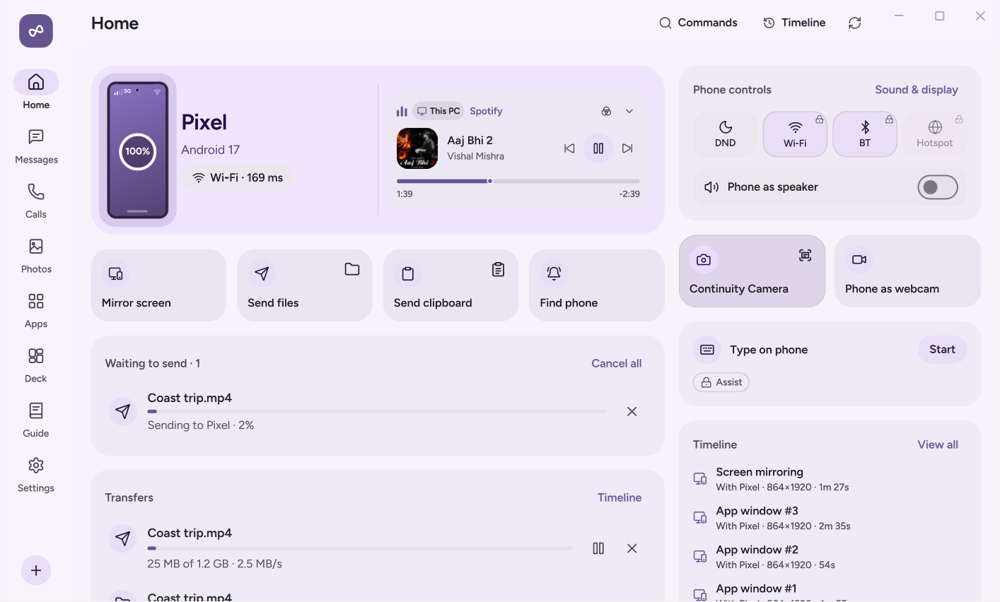
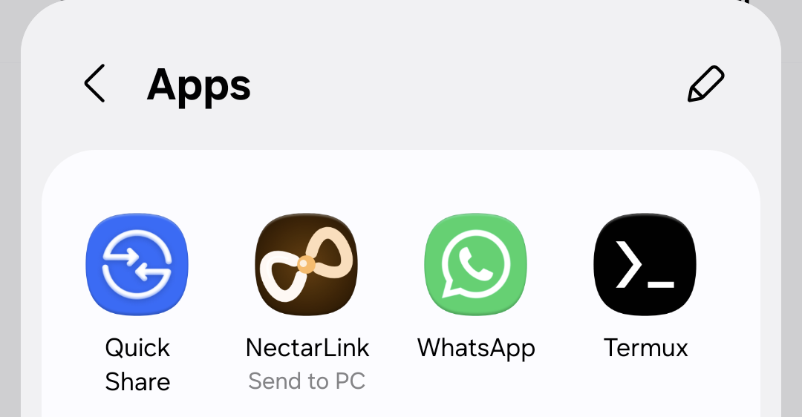
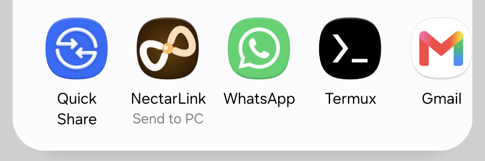
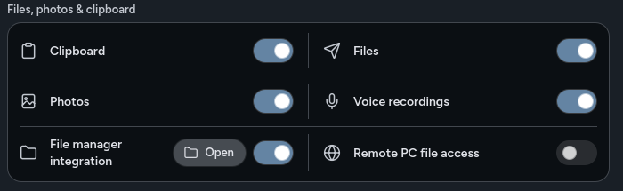

# Archivos y transferencias

Panal transfiere archivos y carpetas entre el teléfono y el PC a toda la velocidad de tu Wi-Fi local o del USB. Cada transferencia admite pausa y reanudación manual, recuperación automática tras un corte de conexión, verificación de integridad BLAKE3 de extremo a extremo y una cola sin conexión `Pendiente de enviar` para que nada se pierda si el otro dispositivo está dormido o fuera de alcance. También puedes montar el almacenamiento del teléfono dentro del Explorador de archivos de Windows, ver las carpetas del PC desde el teléfono, configurar la sincronización automática de carpetas y compartir archivos con dispositivos LocalSend cercanos.

  

## Qué necesitas

| Función | Requisitos |
| :--- | :--- |
| **Enviar archivos y carpetas (en ambos sentidos)** | Nivel de control `Standard`. Interruptor **Archivos** activado en **Ajustes › Dispositivos** (activado por defecto). No hace falta ningún permiso especial de Android para enviar archivos que eliges o compartes, ni para guardar los entrantes en `Download/Panal`. |
| **Almacenamiento del teléfono en el Explorador de archivos** | Windows 11 (API Cloud Files). Interruptor **Ver el almacenamiento de este teléfono en el Explorador de archivos** activado para ese PC en **Ajustes › Dispositivos** de Android (desactivado por defecto) e interruptor **Integración con el Explorador de archivos** (`storage`) activado en **Ajustes › Dispositivos** del PC (desactivado por defecto). En Android, concede **Acceso a todos los archivos** o elige carpetas concretas en **Solo carpetas seleccionadas**. |
| **Ver archivos del PC desde el teléfono ("Tu PC en el bolsillo")** | **Tu PC en el bolsillo** activado en **Ajustes › Archivos y sincronización** del PC (desactivado por defecto) e **Integración con el Explorador de archivos** (`storage`) activada para el dispositivo. Si te conectas con **Conectar con datos móviles** (relé), también debe estar activado **Acceso remoto a archivos del PC** (`remote_files`, desactivado por defecto) para ese teléfono. |
| **Carpetas sincronizadas (en un sentido o en ambos)** | El mismo acceso al almacenamiento en el teléfono (`Acceso a todos los archivos` o carpetas seleccionadas) más una regla de sincronización configurada en **Ajustes › Archivos y sincronización › Carpetas sincronizadas** del PC. |
| **Compatibilidad con LocalSend** | **LocalSend en la red local** activado en **Ajustes › Archivos y sincronización** del PC o en **Ajustes › Funciones y datos › LocalSend** de Android (desactivado por defecto). Ambos dispositivos deben estar en la misma red Wi-Fi. |

## Uso paso a paso

### Enviar archivos y carpetas del PC al teléfono

Puedes enviar archivos o carpetas enteras desde el PC de cualquiera de estas formas:

1. **Arrastrar y soltar**: arrastra archivos o carpetas a la ventana principal de Panal, al panel lateral `Bandeja` (`Ctrl+Alt+S`) o a una ventana de `mirror` abierta.
2. **Lanzar para enviar**: arrastra un archivo con un gesto rápido hacia el borde de la pantalla donde está la `Bandeja`. Aparece durante 3 segundos un aviso con **Deshacer** antes de empezar la transferencia.
3. **Botón de la pantalla de Inicio**: haz clic en **Enviar archivos** en la pantalla de Inicio del PC y elige archivos o carpetas.
4. **Menú `Enviar a` del Explorador de archivos**: haz clic derecho en cualquier archivo o carpeta del Explorador de Windows, elige **Enviar a** y haz clic en el nombre de tu teléfono.
   En Linux, haz clic derecho en archivos o carpetas y elige **Enviar a *tu teléfono* (Panal)**: en **Scripts** en Archivos de GNOME, y en el propio menú en Dolphin, Nemo, Thunar y Caja (Caja necesita el paquete `caja-actions`).
5. **Paleta de comandos o línea de comandos**: pulsa `Ctrl+Alt+Espacio` y elige **Enviar archivos al teléfono**, o ejecuta `panal send <ruta>` en una terminal.

Los archivos recibidos en el teléfono se guardan en `Download/Panal` (manteniendo la estructura de subcarpetas cuando envías una carpeta).

### Enviar archivos y carpetas del teléfono al PC

1. **Desde cualquier app de Android**: toca **Compartir** y luego el destino de Compartir directo de tu PC arriba del menú Compartir de Android (o toca **Panal**). La transferencia empieza al momento; si hay más de un PC conectado, primero eliges uno. El progreso aparece en una notificación con un botón **Cancelar**, seguida de una confirmación **Enviado a**.

   La fila corta del menú Compartir muestra las apps a las que más compartes, así que puede que Panal no aparezca la primera vez. Toca **Más** (**Apps** en teléfonos Samsung) y elige **Panal**. Después, Android suele mostrarla en la fila.

   

   
2. **Desde la app Panal**: abre Panal en el teléfono y toca **Enviar archivos** o **Enviar una carpeta** en **Transferencia rápida y portapapeles**.

Los archivos recibidos en el PC se guardan en `Descargas\Panal` (sin sobrescribir: se añade un sufijo numérico si ya existe un archivo con el mismo nombre). Si **Copiar archivos recibidos** está activado en **Ajustes › General**, los archivos pequeños recibidos también se colocan en el portapapeles de Windows para pegarlos donde quieras con `Ctrl+V`.

### Pausar, reanudar y verificar transferencias

- **Pausa y reanudación manual**: mientras se transfiere un archivo grande, haz clic en **Pausar** en la tarjeta **Transferencias** del PC o del teléfono para detener el envío en el byte actual, y en **Reanudar** cuando quieras seguir.
- **Reanudación automática al reconectar**: los archivos entrantes se escriben en un archivo temporal `.part`. Si se corta la Wi-Fi o desconectas el cable USB a mitad de transferencia, Panal conserva los bytes parciales y continúa solo desde el byte exacto cuando vuelve la conexión.
- **Comprobación de integridad BLAKE3**: cada transferencia calcula un hash criptográfico **BLAKE3** del archivo completo. El receptor verifica el hash antes de mover el `.part` terminado a su destino final. Si un solo byte no coincide, el archivo nunca se da por completo.

### Cola sin conexión y el panel `Pendiente de enviar`

Cuando envías archivos, carpetas, elementos del portapapeles, enlaces, documentos de `Handoff` o avisos `notify-when` mientras el otro dispositivo está desconectado, Panal no da error. En su lugar, pone el elemento en cola de forma fiable:

1. Un aviso de confirmación te indica que el dispositivo de destino está desconectado y que el elemento se enviará solo al reconectar, con un botón **Deshacer**.
2. En Inicio (en el PC y en Android) aparece un panel compacto **`Pendiente de enviar`** cuando hay elementos en cola, con el total y el icono, nombre, dispositivo de destino, tamaño y estado de cada elemento (`En espera`, `Enviando` con progreso en directo, `Error` con el motivo o `Caducado`). La información emergente de la bandeja del sistema y la `Nectar Island` también indican discretamente cuántos elementos esperan.
3. La cola se guarda en SQLite (tabla `send_queue`) y **sobrevive a reinicios de la app y del sistema** en ambas plataformas, con capacidad para 200 elementos o 10 GiB de archivos pendientes.
4. Los archivos en cola se referencian por ruta y se comprueban antes de enviar (`mtime` y tamaño en bytes). Si un archivo en cola se modificó o se borró mientras esperaba, Panal detiene ese elemento con un motivo claro en lugar de enviar contenido inesperado, y te deja reintentarlo o quitarlo.
5. **Caducidad automática**: para que no se ejecuten acciones obsoletas días después, los elementos en cola caducan según su tipo:
   - Peticiones de Cámara de continuidad: **2 minutos**
   - Enlaces, elementos del portapapeles y avisos de tareas: **24 horas**
   - Archivos y carpetas: **7 días**
6. **Cancelar**: haz clic en **Cancelar** junto a un elemento o en **Cancelar todo** en el panel `Pendiente de enviar`. Cancelar una transferencia en curso la detiene en ambos lados y borra el archivo temporal `.part` del receptor.
7. En cuanto el dispositivo de destino se reconecta, los elementos en cola se envían solos por orden de llegada (FIFO), y el panel `Pendiente de enviar` desaparece cuando la cola queda vacía.

### Montar el almacenamiento del teléfono en el Explorador de archivos de Windows

Puedes ver el almacenamiento interno del teléfono o carpetas seleccionadas directamente en el Explorador de archivos de Windows, como si fuera una carpeta local:

1. En el teléfono, abre **Ajustes › Permisos › Fotos y vídeos** y permite **Acceso a todos los archivos** o toca **Añadir carpeta** junto a **Solo carpetas seleccionadas** para elegir carpetas concretas con el selector del Storage Access Framework de Android.
2. También en el teléfono, abre **Ajustes › Dispositivos** y activa **Ver el almacenamiento de este teléfono en el Explorador de archivos** para tu PC.
3. En el PC, abre **Ajustes › Dispositivos**, selecciona el teléfono y activa **Integración con el Explorador de archivos** (o haz clic en **Abrir** a su lado). La primera vez que el PC se conecta al almacenamiento del teléfono, este también muestra una confirmación si el acceso aún no estaba activado.
4. Windows monta el teléfono en `%USERPROFILE%\Panal\<Nombre del teléfono>` con la API nativa Cloud Files de Windows (`cfapi`).
5. Recorre las carpetas a velocidad local gracias a marcadores de archivo ligeros. Al hacer doble clic en un archivo, Windows descarga su contenido bajo demanda, con barras de progreso e iconos de sincronización nativos. Puedes arrastrar archivos nuevos a la carpeta para subirlos al teléfono, crear carpetas, renombrar y eliminar archivos (en Android 11+, los archivos multimedia eliminados van a la papelera del teléfono en lugar de borrarse para siempre).
6. Con **Acceso a todos los archivos**, una tarjeta SD o una memoria USB del teléfono aparece como carpeta propia (por ejemplo, **Tarjeta SD**) junto a las carpetas del almacenamiento interno. Antes de Android 11, Android solo deja a las apps leer las tarjetas SD, así que sus archivos se pueden abrir pero no cambiar. Con **Solo carpetas seleccionadas**, elige en su lugar una carpeta de la tarjeta SD en el selector de Android.

### Montar el almacenamiento del teléfono en Linux

En Linux, Panal monta el almacenamiento del teléfono como una carpeta que puedes abrir en cualquier gestor de archivos:

1. Haz en el teléfono los pasos 1 y 2 de las instrucciones de Windows de arriba (permite **Acceso a todos los archivos** o elige carpetas y activa **Ver el almacenamiento de este teléfono** para tu PC).
2. En el PC, abre **Ajustes › Dispositivos**, selecciona el teléfono y activa **Integración con el gestor de archivos** (`storage`, desactivado por defecto).

   

3. Panal monta el teléfono en `~/Panal/<Nombre del teléfono>` con FUSE y añade un marcador **<Nombre del teléfono> (Panal)** para los gestores de archivos que leen los marcadores de GTK (`~/.config/gtk-3.0/bookmarks`) o los lugares de KDE (`~/.local/share/user-places.xbel`).

El montaje necesita `/dev/fuse` y el ayudante `fusermount3` (o `fusermount`), que suelen venir con el paquete FUSE de tu distribución. Si faltan, Panal registra `FUSE mount unavailable` y la carpeta queda vacía.

Si la carpeta se abre pero listarla falla con **Permiso denegado**, el teléfono no ha permitido el acceso al almacenamiento: repite el paso 1. El montaje pertenece a tu usuario, así que ejecuta `ls` y otras herramientas como tú mismo y no con `sudo`.

### Ver archivos del PC desde el teléfono ("Tu PC en el bolsillo")

1. En el PC, abre **Ajustes › Archivos y sincronización**, activa **Tu PC en el bolsillo** y asegúrate de que **Integración con el Explorador de archivos** (`storage`) está activada para tu teléfono en **Ajustes › Dispositivos**.
2. Si quieres ver archivos del PC fuera de casa con datos móviles (**Conectar con datos móviles**), activa también **Acceso remoto a archivos del PC** (`remote_files`) para ese teléfono en **Ajustes › Dispositivos**.
3. En el teléfono, toca **Archivos del PC** en la pantalla de Inicio para ver las carpetas compartidas del PC (`Descargas`, `Documentos`, `Escritorio`, `Imágenes` y `Panal Shared`), descargar archivos al teléfono cuando quieras o subir archivos del teléfono a una carpeta del PC.

### Sincronización automática de carpetas

Para mantener una carpeta del teléfono (como `DCIM/Camera` o una carpeta de notas) sincronizada con una carpeta del PC:

1. En el PC, abre **Ajustes › Archivos y sincronización** y baja hasta la tarjeta **Carpetas sincronizadas**.
2. Haz clic en **Añadir carpeta**, elige la carpeta del teléfono (DCIM/Camera, Screenshots, Download y otras están a un toque, o escribe cualquier ruta como `WhatsApp/Media`), elige dónde va en el PC y escoge entre:
   - **En un sentido (del teléfono al PC)**: copia los archivos nuevos y actualizados de la carpeta del teléfono (y de sus subcarpetas hasta 3 niveles) a la carpeta del PC, sin llevar los cambios del PC al teléfono.
   - **Sincronización en ambos sentidos**: sincroniza altas y cambios en las dos direcciones. Si el mismo archivo cambia en ambos dispositivos entre sincronizaciones, Panal conserva las dos versiones guardando una copia de conflicto en lugar de sobrescribir tu trabajo.
3. Cada archivo sincronizado se escribe en un archivo temporal `.nectarlink.part` y se verifica su tamaño y su hash **BLAKE3** antes de reemplazar el archivo de destino. Haz clic en **Sincronizar ahora** para ejecutar al momento todas las reglas activadas, o activa y desactiva reglas una a una.

### Compatibilidad con LocalSend

Panal incluye un cliente y servidor LocalSend v2.1 integrado para intercambiar archivos sin emparejar con cualquier teléfono, tableta, Mac, equipo Linux o PC con Windows cercano que use la app LocalSend:

1. Activa **LocalSend en la red local** en **Ajustes › Archivos y sincronización** del PC o en **Ajustes › Funciones y datos › LocalSend** del teléfono.
2. Los dispositivos LocalSend cercanos en la misma red Wi-Fi (multidifusión UDP `224.0.0.167:53317` y puerto TCP `53317`) aparecen solos en la lista LocalSend de Panal, y tu dispositivo aparece en la suya.
3. Como LocalSend es un protocolo de red local sin autenticación, **cada transferencia LocalSend entrante requiere tu aprobación expresa** (`Aceptar` o `Rechazar`) antes de escribir un solo byte en el disco.

## Qué hacen las opciones

- **Enviar a desde el Explorador de archivos** (**Enviar a desde el gestor de archivos** en Linux; `Ajustes › Archivos y sincronización` en el PC, por defecto: **activado**): añade los teléfonos emparejados al menú `Enviar a` del clic derecho en el Explorador de Windows, o al menú contextual de Archivos de GNOME, Dolphin, Nemo, Thunar y Caja en Linux.
- **Tu PC en el bolsillo** (`Ajustes › Archivos y sincronización` en el PC, por defecto: **desactivado**): permite a los teléfonos emparejados con permiso de almacenamiento ver las carpetas de usuario del PC (`Descargas`, `Documentos`, `Escritorio`, `Imágenes`).
- **LocalSend en la red local** (`Ajustes › Archivos y sincronización` en el PC y `Ajustes › Funciones y datos › LocalSend` en Android, por defecto: **desactivado**): permite compartir archivos en la red local sin emparejar con dispositivos LocalSend.
- **Carpetas sincronizadas** (`Ajustes › Archivos y sincronización` en el PC): gestiona las reglas de sincronización de carpetas en un sentido y en ambos.
- **Copiar archivos recibidos** (`Ajustes › General` en el PC, por defecto: **activado**): coloca los archivos pequeños entrantes en el portapapeles de Windows para pegarlos al momento con `Ctrl+V`.
- **Historial de transferencias** (`Ajustes › Almacenamiento y privacidad` en el PC y `Ajustes › Funciones y datos › Datos y almacenamiento` en Android): borra el registro de transferencias completadas sin eliminar ningún archivo guardado en `Descargas`.

## Datos y privacidad

- **Por dónde viajan los datos**: todas las transferencias entre dispositivos emparejados usan flujos QUIC cifrados de extremo a extremo. Las transferencias LocalSend usan HTTPS en tu red Wi-Fi local.
- **Aislamiento de rutas**: tanto el proveedor de almacenamiento emparejado de Panal como el receptor LocalSend sanean estrictamente todas las rutas y nombres de archivo, y rechazan el salto a carpetas superiores con `..`, los prefijos de unidad, los nombres de dispositivo reservados de Windows (`CON`, `NUL`, `COM1`) y los enlaces simbólicos que escapan de la raíz compartida.
- **Dónde se quedan**: los archivos recibidos se quedan en `Descargas\Panal` en Windows y en `Download/Panal` en Android. Borrar el **Historial de transferencias** o la **Línea de tiempo** solo quita las entradas del registro; los archivos descargados nunca se tocan.

## Límites

- **Destino del menú Compartir de Windows (`windows.shareTarget`)**: enviar archivos arrastrando y soltando, con el menú **Enviar a** del Explorador, el menú contextual del Explorador, la `Bandeja` y `panal --share` funciona en cualquier instalación normal de Windows. Aparecer en la ventana del sistema `Win+Compartir` de Windows 11 requiere que el manifiesto de paquete disperso de Panal esté registrado con un certificado de firma de código de confianza o que el modo de desarrollador de Windows esté activado.
- **Límites de la cola**: la cola sin conexión `Pendiente de enviar` admite hasta **200 elementos** o **10 GiB** de archivos pendientes por dispositivo. Las funciones interactivas en directo (duplicación de pantalla, webcam, control remoto y hacer sonar un dispositivo) nunca se ponen en cola porque solo tienen sentido con el dispositivo conectado.
- **Profundidad de la sincronización de carpetas**: la sincronización recursiva recorre hasta 3 niveles de subcarpetas dentro de cada par de carpetas configurado.
