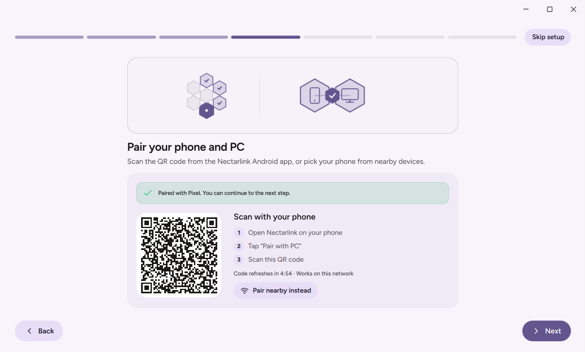
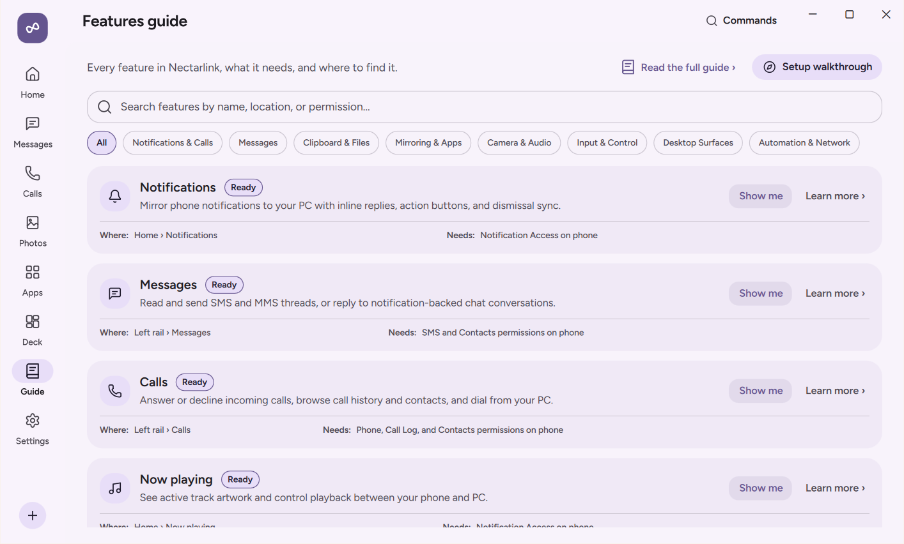
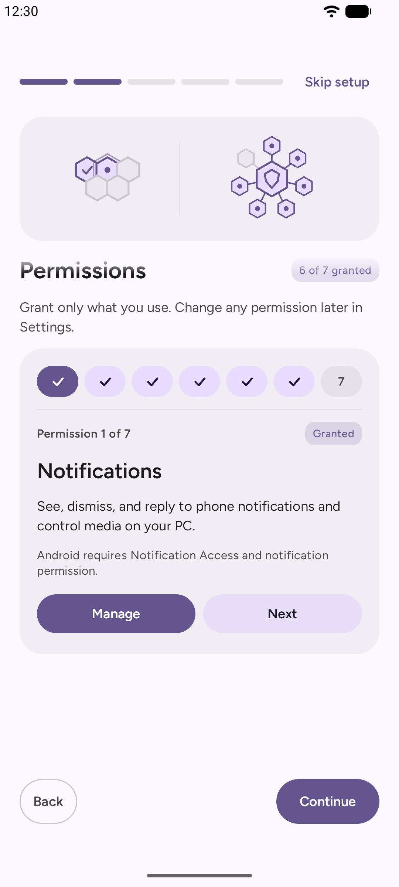
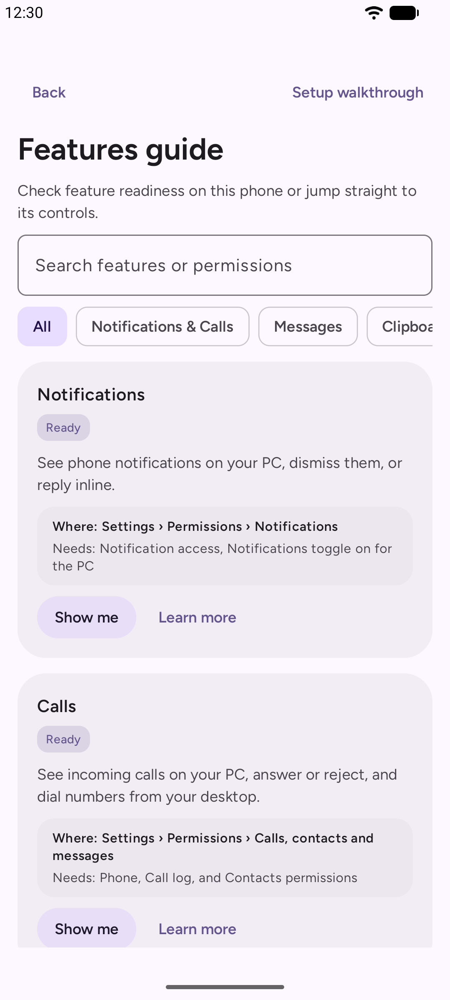
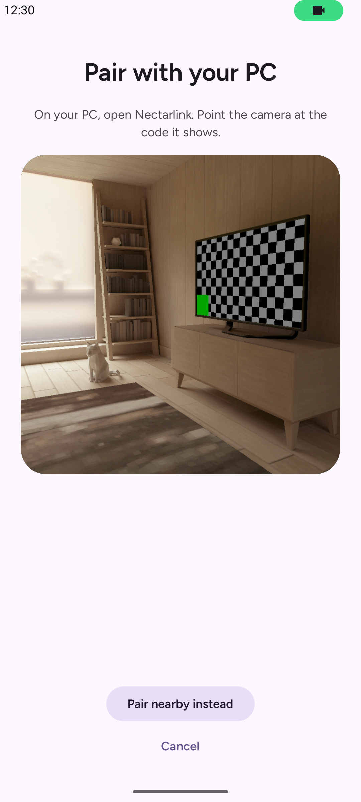
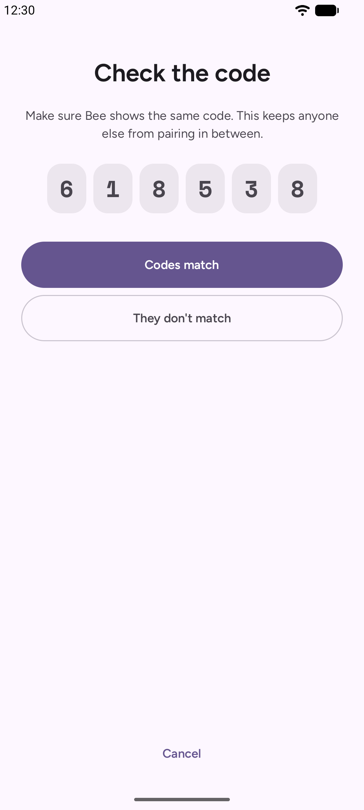
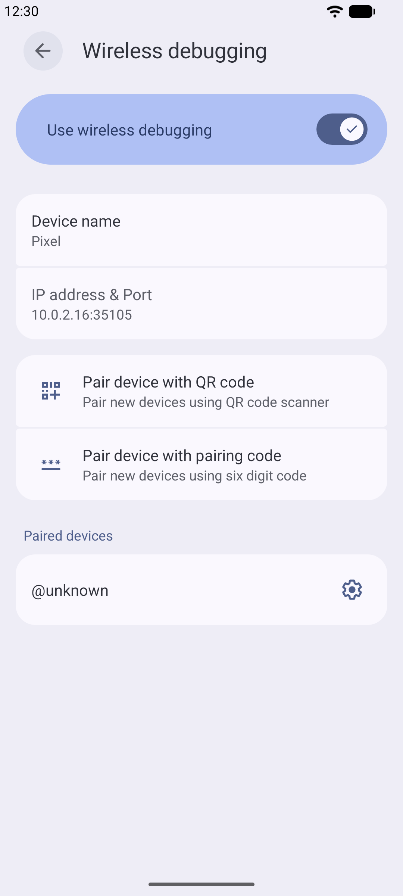

# Primeros pasos

Esta guía te acompaña en la instalación de Panal en Windows, Linux y Android, la guía del primer inicio, el emparejamiento de tus dispositivos y la elección del nivel de control de Android que mejor encaja con tu forma de trabajar.

## Requisitos del sistema

| Plataforma | Versión mínima | Notas |
| :--- | :--- | :--- |
| **PC con Windows** | Windows 10 (versión 2004 o más nueva) o Windows 11, de 64 bits | El teléfono como cámara web (`MFCreateVirtualCamera`) y el fondo Mica necesitan Windows 11 (compilación 22000 o más nueva). El almacenamiento del teléfono en el Explorador de archivos solo se ha probado en Windows 11. |
| **PC con Linux** | Ubuntu 24.04 o más nuevo, Debian 13, Fedora 40 o más nuevo, u otra distribución de 2024 en adelante (glibc 2.39 o más nueva), Intel o AMD de 64 bits | X11 o Wayland. El teléfono como cámara web necesita el controlador `v4l2loopback`, que el comando de instalación configura. |
| **Teléfono o tableta Android** | Android 8.0 (API 26) o más nuevo | Android 10 o superior para capturar el audio interno al duplicar; Android 11 o superior para la depuración inalámbrica en el propio teléfono (`Elevated`) y las `app window`; Android 12 o superior para silenciar, retener y altavoz en llamada con `Elevated`. |
| **Red** | Wi‑Fi o red local compartida, cable USB, o **Conectar con datos móviles** | Por defecto, todo el tráfico entre dispositivos va directo por tu red local o por un cable USB de datos sin salir de ella (las copias instaladas solo contactan con GitHub Releases por HTTPS para buscar actualizaciones; ver [Privacidad y seguridad](privacy-and-security.md)). |

## Instalar Panal

### En Windows

1. Descarga el instalador de Windows más reciente (`Panal-<versión>-x64-setup.exe` para PC Intel/AMD o `Panal-<versión>-arm64-setup.exe` para PC Snapdragon/ARM64) desde la página de [Releases](https://github.com/zaiddia/NectarLink/releases) del proyecto en GitHub.
2. Ejecuta el instalador. Todavía no tiene firma de código, así que Windows SmartScreen puede mostrar **Windows protegió su PC**: elige **Más información** y luego **Ejecutar de todas formas**.
3. Haz clic en **Instalar** y acepta el aviso de administrador. El instalador pone Panal en Archivos de programa; para ponerlo en otro sitio, como otra unidad, haz clic antes en **Cambiar** junto a **Se instala en**. Va a una carpeta nueva `Panal` dentro de la que elijas, en una unidad interna del PC (no USB ni de red). Las actualizaciones se instalan sin preguntar en Archivos de programa o en la raíz de una unidad. En una carpeta que pueden modificar personas sin permisos de administrador, como una que creaste tú, las actualizaciones piden tu permiso, para que nada pueda colar sus propios archivos y ejecutarlos con todos los permisos. El instalador también registra la regla del Firewall de Windows necesaria para la detección y las conexiones QUIC locales, añade un acceso directo en el menú Inicio (y otro en el escritorio, salvo que desmarques **Añadir un acceso directo en el escritorio**) y hace que Panal se inicie en la bandeja del sistema al iniciar sesión (lo desactivas con **Iniciar con Windows** en **Ajustes › General**). **Qué instala esto**, en la primera pantalla, enumera todo lo que añade.
4. La última pantalla muestra un código QR de la página de descarga de la app de Android. Escanéalo con la cámara del teléfono y luego haz clic en **Abrir Panal**.

### En Linux

Abre una terminal y ejecuta:

```bash
curl -fsSL https://github.com/zaiddia/NectarLink/releases/latest/download/install.sh | sh
```

Muestra cada paso mientras avanza, y `sudo` te pide la contraseña una vez. El comando:

1. Comprueba que tu sistema puede ejecutar Panal.
2. Descarga el paquete para tu sistema (un `.deb` con apt en Ubuntu y Debian, un `.rpm` con dnf en Fedora o con zypper en openSUSE, o el tarball en los demás), comprueba la firma de la versión (`SHA256SUMS.txt.sig`) y lo compara con `SHA256SUMS.txt`. Si algo no coincide, no se instala nada.
3. Lo instala con las librerías y herramientas que necesita, y añade Panal al menú de aplicaciones.
4. Prepara el teléfono como cámara web: instala el controlador `v4l2loopback` y lo carga como **Panal Webcam**, ahora y en cada arranque. En Fedora el controlador viene de RPM Fusion, que el instalador no añade por ti; te dice cómo hacerlo. Con el arranque seguro (Secure Boot) activado, también te explica cómo registrar la clave del controlador.
5. Permite que el teléfono escriba y mueva el puntero: una regla de udev da al usuario con la sesión iniciada acceso a `/dev/uinput`, como hacen los controladores de mandos de juego.
6. Abre los puertos de Panal (7718, mDNS en el 5353 y LocalSend en el 53317) en ufw o firewalld, solo para tu red local.

Para instalar solo la app, termina el comando con `sh -s -- --no-extras` en lugar de `sh`. Sin `sudo` ni `doas`, instala el tarball en tu carpeta personal y omite los pasos 4 a 6.

También puedes descargar tú mismo un paquete desde Releases: `panal_<versión>_amd64.deb`, `panal-<versión>-1.x86_64.rpm`, `Panal-<versión>-x86_64.AppImage` o `Panal-<versión>-linux-x86_64.tar.gz` (ejecuta su `install.sh`). El AppImage se añade al menú de aplicaciones la primera vez que lo abres. **Connection Doctor**, en **Ajustes › Conexión y Acerca de**, encuentra lo que aún falte para la cámara web, la entrada o el firewall, y te dice cómo arreglarlo.

Cada tipo de instalación se actualiza de la misma forma en que se instaló.

### En Android

1. Descarga `Panal-<versión>-android.apk` desde Releases (o escanea el código QR que aparece al terminar la instalación en Windows, o en la guía del PC).
2. Abre el APK descargado y permite la instalación si Android te lo pide. Como Panal ofrece mensajería SMS/MMS completa, registro de llamadas, acciones de notificaciones, control por accesibilidad y, de forma opcional, `Acceso a todos los archivos` para montar el almacenamiento del teléfono en el Explorador de archivos (permisos que Google Play restringe), la app completa se distribuye directamente como un APK firmado, con actualizaciones verificadas con SHA-256:
   - Si Google Play Protect muestra un aviso de desarrollador desconocido, toca **Más detalles › Instalar de todas formas**.
   - Donde la **Protección mejorada contra fraudes** de Google Play Protect está activa (185 mercados, incluida la India), bloquea los APK instalados desde el navegador que declaran `READ_SMS`, `BIND_NOTIFICATION_LISTENER_SERVICE` o `BIND_ACCESSIBILITY_SERVICE` sin mostrar el botón **Instalar de todas formas**. Instálalo por USB con `adb install -r Panal-<versión>-android.apk`, o pausa temporalmente **Analizar apps con Play Protect** en **Google Play Store › icono de tu perfil › Play Protect › Ajustes (engranaje)** mientras instalas el APK, y luego vuelve a activarlo.
3. Abre **Panal** en tu teléfono.

Panal usa el identificador `app.panal`, así que puede convivir en el mismo teléfono con la app oficial de NectarLink.

### Desinstalar

- **Windows:** abre **Configuración › Aplicaciones › Aplicaciones instaladas**, elige **Panal** y luego **Desinstalar**. Esto quita la app, su regla del firewall, la tarea de actualización, los accesos directos y la entrada del menú Compartir, y borra sus ajustes y emparejamientos en este PC. Los archivos recibidos y las grabaciones de voz se quedan donde se guardaron.
- **Linux:** ejecuta `curl -fsSL https://github.com/zaiddia/NectarLink/releases/latest/download/install.sh | sh -s -- --uninstall`. Esto quita la app, se haya instalado como se haya instalado, sus ajustes de cámara web, entrada y firewall, su entrada en el menú y el inicio con el equipo. Tus ajustes y emparejamientos se quedan en `~/.local/share/Panal`; borra esa carpeta para quitarlos también. Un AppImage se quita borrando el archivo.
- **Android:** desinstálala como cualquier otra app.

## Guía del primer inicio

La primera vez que abres Panal en una instalación nueva, una guía configura tu dispositivo en unos pocos pasos. Puedes volver atrás u omitir cualquier paso opcional, y si cierras la app a mitad, continúa donde lo dejaste. También puedes volver a abrir la guía cuando quieras desde **Ajustes › Conexión y Acerca de** en el PC o **Ajustes › Funciones y datos › Acerca de** en Android.

### Pasos en el PC

<p align="center">
  
</p>

1. **Bienvenida**: presenta Panal y cómo trabajan juntos tu teléfono y tu PC.
2. **Promesa de privacidad**: resume el diseño local de Panal: conexiones directas en tu red, cifrado de extremo a extremo con claves de dispositivo, y sin cuenta de usuario ni servidor en la nube.
3. **Instala la app del teléfono**: muestra un código QR que lleva directamente al APK de Android, si aún no lo tienes.
4. **Emparejar**: muestra el código QR de emparejamiento de tu PC y espera teléfonos cercanos o conectados por USB.
5. **Elige qué compartir**: te deja revisar los interruptores principales de cada dispositivo (Notificaciones, Mensajes, Llamadas, Portapapeles, Archivos, Fotos, Duplicación de pantalla, Cámara web) antes de la primera sesión.
6. **Configuración opcional del PC**: revisa el permiso de notificaciones de Windows, el interruptor **Iniciar con Windows** y las reglas del firewall con `Connection Doctor`.
7. **Listo**: abre la **Guía de funciones** de la app, que muestra cada función, si está disponible ahora para tu teléfono emparejado, y un botón **Muéstramelo** que lleva directo a cada control.

<p align="center">
  
</p>

### Pasos en Android

<p align="center">
  
  
</p>

1. **Bienvenida**: presenta la app del teléfono.
2. **Permisos**: pide solo los permisos que quieras usar, de uno en uno, con una explicación sencilla de para qué sirve cada uno:
   - **Notificaciones**: permite que Panal refleje las notificaciones del teléfono en tu PC y ejecute respuestas rápidas o acciones.
   - **SMS y MMS**: te deja leer conversaciones y enviar mensajes desde el PC.
   - **Llamadas y registro de llamadas**: muestra quién llama, las llamadas recientes y los controles de llamada en el PC.
   - **Contactos**: asocia números con nombres y fotos en Llamadas y Mensajes del PC.
   - **Fotos y videos**: muestra el carrete y las capturas nuevas en el PC.
   - **Seguir disponible en segundo plano**: excluye a Panal del agresivo ahorro de batería de Android para que el PC siempre pueda llegar al teléfono.
   - **Red local**: permite la detección y las conexiones QUIC directas con tu PC.
3. **Emparejar**: escanea el código QR que muestra el PC o conéctate con un código de 6 dígitos cercano.
4. **Elige un nivel de control**: explica `Standard`, `Assist` y `Elevated` para que elijas el nivel de integración que prefieras.
5. **Listo**: te lleva a Inicio y enlaza con la **Guía de funciones** de la app.

> **Nota sobre Android 13 y superior ("Ajustes restringidos")**: cuando instalas un APK fuera de una tienda de apps en Android 13 o superior, Android pone en gris al principio los interruptores de **Acceso a notificaciones** y **Accesibilidad** como precaución de seguridad. Si un interruptor está en gris, toca **Información de la app** en el aviso de Panal (o abre **Ajustes › Apps › Panal** de Android), toca el menú de tres puntos arriba a la derecha, toca **Permitir ajustes restringidos**, confirma con el bloqueo de pantalla y vuelve a Panal.

## Emparejar el teléfono y el PC

Panal tiene tres formas de emparejar el teléfono y el PC. Las tres establecen la misma confianza criptográfica mutua Ed25519 y una sesión QUIC cifrada de extremo a extremo.

<p align="center">
  
</p>

### Método 1: escanear el código QR (lo más rápido por Wi‑Fi)

1. En el PC, abre Panal. Si aún no hay ningún teléfono emparejado, la pantalla de emparejamiento se abre sola. Si no, ve a **Ajustes › Dispositivos** y haz clic en **Emparejar un dispositivo nuevo**.
2. En el teléfono, abre Panal y toca **Escanear código** (o apunta la cámara del teléfono al código QR de la pantalla del PC).
3. El código QR contiene la clave pública de tu PC, sus direcciones IP locales y un secreto criptográfico de un solo uso de 128 bits (`s`) que caduca a los 5 minutos. Ambos dispositivos verifican la prueba HMAC-SHA256 y completan el emparejamiento al instante.

### Método 2: código cercano de 6 dígitos (sin cámara)

1. Asegúrate de que el teléfono y el PC están en la misma red Wi‑Fi o local.
2. Abre la pantalla de emparejamiento de Panal en el PC.
3. En el teléfono, toca **Emparejar cerca en su lugar** y elige el nombre de tu PC en la lista.
4. Ambas pantallas muestran un código de verificación de 6 dígitos, derivado con HMAC-SHA256 de los números aleatorios comprometidos por los dos dispositivos y de sus claves públicas Ed25519 durante la sesión de emparejamiento TLS 1.3.
5. Comprueba que los 6 dígitos coinciden en ambas pantallas y luego haz clic en **Los códigos coinciden** en el PC y toca **Los códigos coinciden** en el teléfono. Si no coinciden, toca **No coinciden** para cancelar la conexión.

### Método 3: conectar un cable USB (emparejamiento automático)

Si tienes la depuración USB (`adb`) activada en el teléfono, Panal lo detecta en cuanto lo conectas al PC con un cable USB. El USB necesita `adb` de Android en el PC con su servidor en marcha: instala las platform-tools de Google y ejecuta `adb start-server` después de cada reinicio (Android Studio y scrcpy también lo inician). Panal no lo inicia por sí mismo.

<p align="center">
  
</p>

1. Conecta el teléfono al PC con un cable USB de datos y acepta el aviso **¿Permitir la depuración USB?** en el teléfono si aparece.
2. Panal crea un túnel local por USB y abre solo el aviso de confirmación de 6 dígitos en el PC y en el teléfono.
3. Comprueba que el código de 6 dígitos coincide en ambas pantallas y acepta en los dos dispositivos.
4. Una vez emparejados, Panal usa la conexión USB de alta velocidad (`Por USB`) siempre que el cable esté conectado, y cambia solo a Wi‑Fi al desconectarlo.

## Elegir un nivel de control de Android

Android agrupa las capacidades de las apps en niveles de acceso al sistema. Panal está diseñado para que las funciones del día a día funcionen desde el principio en el nivel `Standard`, mientras que los usuarios avanzados pueden optar por `Assist` o `Elevated` sin rootear el teléfono.

### Comparación de los niveles

| Función o capacidad | `Standard` (predeterminado) | `Assist` (accesibilidad) | `Elevated` (depuración inalámbrica / ADB) |
| :--- | :--- | :--- | :--- |
| **Configuración necesaria** | Permisos normales de Android | Activar Panal en Accesibilidad de Android | Emparejar una vez la depuración inalámbrica en el teléfono (o `adb` por USB) |
| **Notificaciones, respuesta rápida, acciones, descarte sincronizado** | Sí | Sí | Sí |
| **Texto de notificaciones sensibles y códigos en Android 15 o superior** | Ocultos por Android | Ocultos por Android | **Activado** (`RECEIVE_SENSITIVE_NOTIFICATIONS`) |
| **SMS, MMS, conversaciones unificadas, llamadas, contactos, fotos** | Sí | Sí | Sí |
| **Transferencias de archivos, sincronización de carpetas, almacenamiento del teléfono en el Explorador** | Sí | Sí | Sí |
| **Portapapeles del PC al teléfono** | Automático | Automático | Automático |
| **Portapapeles del teléfono al PC** | Manual (botón de Ajustes rápidos, menú Compartir o botón de la app) | Manual (botón de Ajustes rápidos, menú Compartir o botón de la app) | **Automático en segundo plano** |
| **Duplicación de pantalla (video y audio en el PC)** | Sí (Android pregunta cada vez) | Sí (Android pregunta cada vez) | **Sin aviso al iniciar** (`PROJECT_MEDIA` concedido automáticamente) |
| **Controlar el teléfono con el mouse y el teclado del PC al duplicar** | Solo ver | Tocar, deslizar, desplazarse, escribir texto básico | **Arrastrar en tiempo real, distribuciones de teclado físico por UHID, mando XInput, presión e inclinación del lápiz** |
| **Apagar la pantalla física del teléfono al duplicar** | No | No | **Sí** |
| **Apps del teléfono en ventanas propias del PC (`app window`)** | No | No | **Sí** (Android 11 o superior) |
| **Silenciar, retener, altavoz y teclado en llamada desde el PC** | Contestar, rechazar, colgar, volumen | Contestar, rechazar, colgar, volumen | **Sí** (Android 12 o superior) |
| **Controles del teléfono en el Inicio del PC** | Volumen, modo de timbre, linterna (y No molestar y brillo con sus permisos) | Igual que `Standard` | **Añade Wi‑Fi y Bluetooth** (y concede solos los permisos de No molestar y brillo) |

### Ventajas e inconvenientes

- **`Standard`** es lo que menos configuración necesita y no da a Panal ninguna capacidad de introducir toques ni de shell. Sus únicos límites vienen de las reglas de Android: las apps en segundo plano no pueden leer el portapapeles solas, Android muestra un aviso de confirmación cada vez que empieza la duplicación, y la duplicación es solo para ver.
- **`Assist`** se activa en unos 30 segundos en **Ajustes de Android › Accesibilidad › Panal: control desde tu PC**. Deja que el mouse y el teclado del PC toquen, deslicen y escriban en la pantalla duplicada. Como la API de gestos de accesibilidad de Android envía trazos completos en lugar de un flujo continuo del puntero, arrastrar (por ejemplo, mantener pulsado y arrastrar) va a saltos en lugar de ser continuo.
- **`Elevated`** ejecuta un pequeño proceso auxiliar de código abierto (`app.nectarlink.android.elevated.InputServer`) con el usuario `shell` de Android (`UID 2000`) mediante la depuración inalámbrica integrada en Android. Da a Panal las mismas capacidades que `scrcpy` en el escritorio, más la sincronización del portapapeles en segundo plano y las `app window`, sin cable al PC ni root. Solo el propio proceso de Panal (que presenta un token de sesión de 192 bits de un solo uso por la interfaz local) puede hablar con el asistente.

### Cómo activar `Elevated` en el teléfono (depuración inalámbrica)

Puedes configurar `Elevated` directamente en el teléfono en unos dos minutos con Android 11 o superior:

<p align="center">
  
</p>

1. Abre **Panal** en el teléfono y ve a **Ajustes › Permisos › Control desde tu PC**.
2. Junto a **Toque y teclas reales (depuración inalámbrica)**, toca **Configurar**.
3. Si aún no tienes activadas las **Opciones de desarrollador**, abre **Ajustes › Acerca del teléfono** de Android y toca **Número de compilación** 7 veces hasta que Android confirme que eres desarrollador.
4. Toca **Abrir Opciones de desarrollador** en Panal. Baja hasta **Depuración inalámbrica**, activa el interruptor y toca las palabras **Depuración inalámbrica** para abrir su pantalla.
5. Toca **Vincular dispositivo con código de sincronización**. Aparece un cuadro con un código de 6 dígitos.
6. No cierres ese cuadro. Desliza hacia abajo el panel de notificaciones, busca la notificación **Emparejar Panal con la depuración inalámbrica**, toca **Introducir código**, escribe los 6 dígitos y envíalos.
7. Panal se empareja con la depuración inalámbrica e inicia el asistente `Elevated` al momento. Después de este emparejamiento único, Panal vuelve a iniciar `Elevated` en segundo plano cada vez que te reconectas al Wi‑Fi o reinicias el teléfono.

### Alternativa: `Elevated` automático por cable USB

Necesita `adb` en marcha en el PC, como en el [método 3](#método-3-conectar-un-cable-usb-emparejamiento-automático).

Si conectas el teléfono al PC con un cable USB y tienes la **Depuración USB** activada en las Opciones de desarrollador, Panal en el PC puede iniciar el asistente `Elevated` en el teléfono por `adb` automáticamente, sin el paso del código de vinculación por Wi‑Fi.
