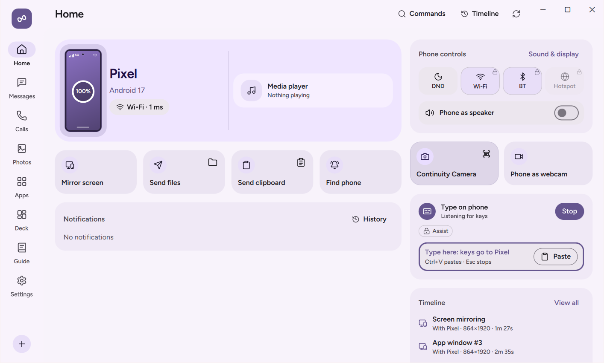

# Entrada y control

Panal te permite controlar el PC desde el teléfono y el teléfono desde el PC. Usa el teléfono como panel táctil multitáctil, ratón aéreo con giroscopio, teclado remoto, micrófono de dictado por voz, mando de presentaciones con puntero láser, botonera de macros `Deck` o reloj de mesilla `Desk clock`. En el otro sentido, escribe en el teléfono con el teclado del PC sin duplicar la pantalla, cambia ajustes del teléfono desde el Inicio del PC o bloquea, suspende y enciende el PC a distancia.

  

## Qué necesitas

| Función | Requisitos |
| :--- | :--- |
| **Controlar el PC desde el teléfono (panel táctil, ratón aéreo, teclado, dictado por voz, mando de presentaciones)** | Nivel de control `Standard` en Android. Interruptor por teléfono **Ratón, teclado y Deck remotos** (`remote_input`) activado en **Ajustes › Dispositivos** del PC (desactivado por defecto; el PC muestra un aviso de consentimiento la primera vez que el teléfono lo pide). El ratón aéreo requiere giroscopio en el teléfono; el dictado por voz requiere el permiso de **Micrófono** de Android (`RECORD_AUDIO`). |
| **Escribir en el teléfono con el teclado del PC (sin duplicar)** | `Assist` (servicio de accesibilidad de Android) o `Elevated` (depuración inalámbrica) en el teléfono. |
| **Botonera de macros `Deck`** | Interruptor por teléfono **Ratón, teclado y Deck remotos** (`remote_input`) activado en el PC. Los botones que ejecutan comandos de shell propios en el PC también requieren el interruptor aparte **Ejecutar comandos de shell desde Deck** (`commands`) en **Ajustes › Dispositivos** del PC (desactivado por defecto). |
| **Controles del teléfono en el Inicio del PC** | `Standard` para volumen multimedia, modo de timbre (sonido/vibración) y linterna. **No molestar y modo silencio** requiere el acceso a la política de notificaciones de Android (**Ajustes › Permisos › Control desde tu PC**). **Brillo de la pantalla** requiere el permiso de Android para modificar ajustes del sistema. Los interruptores de **Wi-Fi** y **Bluetooth** requieren `Elevated` (que además concede solo los permisos de No molestar y brillo). |
| **Bloquear, suspender y Wake-on-LAN** | Interruptor **Bloquear, suspender y encender el PC** (`pc_actions`) activado en **Ajustes › Dispositivos** del PC (activado por defecto). Wake-on-LAN requiere un adaptador de red del PC con Wake on LAN activado en el Administrador de dispositivos de Windows y en la BIOS/UEFI (normalmente Ethernet). |

## Uso paso a paso

### 1. Controlar el PC desde el teléfono

Toca **Controlar el PC** en la pantalla de Inicio de Android. La primera vez, haz clic en **Permitir** en el aviso que aparece en el PC (o activa **Ratón, teclado y Deck remotos** en **Ajustes › Dispositivos** del PC). Elige entre tres modos en la parte superior de la pantalla del teléfono:

#### Modo panel táctil

- **Mover el cursor**: arrastra un dedo por el panel. Ajusta la velocidad del puntero (de `0.5x` a `2.5x`) en **Ajustes › Funciones y datos › Controlar tu PC › Velocidad del panel táctil** de Android.
- **Clic izquierdo**: toca con un dedo o toca el botón **Izquierdo** bajo el panel.
- **Clic derecho**: toca con dos dedos o toca el botón **Derecho**.
- **Clic central**: toca el botón **Central**.
- **Desplazar**: arrastra dos dedos hacia arriba, abajo, izquierda o derecha.
- **Hacer clic y arrastrar**: toca dos veces y mantén con un dedo, luego arrastra.

#### Modo ratón aéreo

- Mantén el pulgar en el panel central e inclina el teléfono en el aire. Panal lee el giroscopio del teléfono con filtrado del temblor de la mano para mover el cursor del PC con precisión hacia donde apuntas.
- Toca el panel mientras mantienes para hacer clic izquierdo, y suelta el panel para dejar quieto el cursor. (Si el teléfono no tiene giroscopio, Panal te avisa y te sugiere el modo panel táctil.)

#### Teclado y dictado por voz

- **Teclado remoto**: toca **Teclado** para abrir el teclado en pantalla del teléfono y escribir directamente en la ventana enfocada del PC. Encima del teclado hay una barra desplazable con modificadores y teclas especiales del PC: **`Ctrl`**, **`Alt`**, **`Mayús`**, **`Win`**, **`Esc`**, **`Tab`**, **flechas**, **`Inicio`**, **`Fin`**, **`RePág`**, **`AvPág`**, **`Supr`**, **`Copiar`** y **`Pegar`**. Toca un modificador (`Ctrl`, `Alt`, `Mayús`, `Win`) para dejarlo fijado para la siguiente pulsación.
- **Dictado por voz**: toca o mantén **Dictar** y habla. Panal usa el reconocedor de voz del teléfono (reconocimiento en el dispositivo cuando está disponible) para mostrar transcripciones parciales en directo y escribir la frase terminada directamente en el campo de texto activo del PC.

#### Mando de presentaciones y puntero láser

Cambia al modo **Presentación** cuando des una charla o un pase de diapositivas:

- Toca **Siguiente diapositiva** o **Anterior** para avanzar o retroceder. Con la pantalla Presentación abierta en el teléfono, los botones físicos de **Subir volumen** y **Bajar volumen** también avanzan o retroceden una diapositiva sin mirar la pantalla.
- Toca **Iniciar presentación** (`F5`), **Terminar presentación** (`Esc`) o **Pantalla negra** (`B`) para controlar PowerPoint, Google Slides, Keynote Web o visores de PDF.
- **Mantener para el puntero láser**: mantén pulsado el botón láser para proyectar en el monitor del PC un punto láser brillante del color de acento que sigue cómo inclinas el teléfono (con el giroscopio) o cómo arrastras el dedo.

#### Modo pantalla

Con **Compartir la pantalla del PC con el teléfono** y **Ratón, teclado y Deck remotos** activados para este teléfono, **Pantalla** muestra la pantalla del PC en el teléfono y la controla:

- Arrastra en el panel táctil bajo la imagen para mover el cursor. Toca para hacer clic y usa dos dedos para el clic derecho o para desplazar.
- **Teclado** abre un cuadro sobre el teclado del teléfono. Lo que escribes llega al PC según lo escribes, **Enviar** pulsa Intro y la tecla de al lado borra.
- El botón de calidad cambia la resolución de la transmisión.

### 2. Escribir en el teléfono con el teclado del PC (sin duplicar)

Cuando el teléfono está en un soporte junto al monitor y solo quieres escribir un mensaje rápido o buscar algo en el teléfono con el teclado físico del PC sin abrir una ventana de duplicación:

1. En el **Inicio** del PC, haz clic en **Escribir en el teléfono** (o abre la `Paleta de comandos` con `Ctrl+Alt+Espacio` y elige **Escribir en el teléfono con el teclado del PC**).
2. Mientras la tarjeta **Escribir en el teléfono** está activa en el PC, cada pulsación (letras, números, texto Unicode, **flechas**, **Retroceso**, **Intro** y el pegado con `Ctrl+V`) va directamente al campo de texto enfocado del teléfono.
3. El teléfono muestra un aviso arriba (**Escribiendo desde `<PC>`**) con un botón **Dejar de escribir**, y pulsar **Esc** en el PC termina al momento la captura del teclado.

### 3. `Deck`: botonera de macros personalizable y control de audio del PC

`Deck` convierte el teléfono en una cuadrícula de botones de varias páginas y en un control de audio en directo para el PC:

1. **Usar `Deck` en el teléfono**: toca **Deck** en la pantalla de Inicio de Android.
   - La cabecera ofrece un **control deslizante del volumen general del PC**, un botón **Silenciar** y un **selector de dispositivo de salida** que muestra qué altavoz o auricular está activo en el PC.
   - Desliza a izquierda o derecha entre páginas de botones, o toca **Pantalla completa** para ocupar todo el teléfono en vertical u horizontal, con respuesta háptica en cada pulsación.
   - Los botones en directo se actualizan en tiempo real para mostrar si la multimedia del PC está **Reproduciendo** o **En pausa**, el porcentaje de volumen actual y si el micrófono del PC está **Silenciado** o **Activo**.
2. **Personalizar `Deck` en el PC**: haz clic en **Deck** en la barra lateral del PC.
   - Arrastra y suelta los botones para reordenarlos, añade páginas nuevas y personaliza la etiqueta, el icono y el color de cada botón.
   - Elige entre los tipos de botón integrados: **Reproducir / Pausa**, **Anterior**, **Siguiente**, **Subir / bajar / silenciar volumen**, **Silenciar micrófono**, **Bloquear el PC**, **Mostrar escritorio**, **Cambiar de ventana**, **Captura de pantalla**, **Atajo de teclado** (cualquier combinación propia), **Abrir enlace web**, **Escribir fragmento de texto**, **Abrir aplicación** (`.exe` o `.lnk`) o **Ejecutar comando de shell**.
   - **Protección para los comandos de shell**: los botones que ejecutan comandos de shell propios en el PC están bloqueados salvo que también actives **Ejecutar comandos de shell desde Deck** (`commands`, desactivado por defecto) para ese teléfono en **Ajustes › Dispositivos** del PC.

### 4. Controles del teléfono en el Inicio del PC

La sección **Controles del teléfono** de la pantalla de Inicio del PC te permite ver y cambiar ajustes de hardware y sonido del teléfono desde el escritorio:

- **Volumen multimedia**: arrastra el control para cambiar el volumen de reproducción del teléfono.
- **Modo de timbre**: cambia entre **Sonido**, **Vibración** y **Silencio**.
- **No molestar**: activa o desactiva No molestar (o cambia el perfil de notificaciones entre **Todo**, **Solo prioritarias** y **Silencio**).
- **Linterna**: enciende o apaga la linterna trasera del teléfono.
- **Brillo de la pantalla**: arrastra el control para ajustar el brillo de la pantalla del teléfono.
- **Wi-Fi y Bluetooth** (disponible con `Elevated`): activa o desactiva la Wi-Fi o el Bluetooth del teléfono. Apagar la Wi-Fi desde el PC pide confirmación antes para que no cortes una conexión Wi-Fi por error.

### 5. Modo escritorio (`Desk clock`) en Android

Cuando el teléfono está en el cargador o en un soporte de mesa, toca **Reloj de escritorio** en la pantalla de Inicio de Android para pasar al **Modo escritorio**: una pantalla tranquila y de alto contraste, en horizontal o vertical, con la hora, el estado de la conexión, la carátula y los controles de la multimedia del PC en directo y acciones rápidas pensadas para pantallas OLED.

### 6. Bloquear, suspender, Encontrar mi dispositivo y Wake-on-LAN

- **Encontrar mi dispositivo (en ambos sentidos)**: haz clic en **Buscar el teléfono** en el Inicio del PC para que el teléfono suene a todo volumen por el canal de alarma (aunque esté en silencio o en No molestar). Toca **Hacer sonar el PC** en el teléfono (o en el widget de la pantalla de inicio de Android) para que suene un aviso en el PC.
- **Bloquear o suspender el PC**: toca **Bloquear el PC** o **Suspender** en el teléfono (o en el widget **Acciones rápidas del PC** de Android) para bloquear la sesión de Windows o suspender el PC cuando te alejas.
- **Encender el PC (Wake-on-LAN)**: cuando el PC está suspendido o apagado, toca **Encender** en el teléfono (o en el widget de la pantalla de inicio de Android).
  - En la red local, el teléfono envía paquetes UDP de Wake-on-LAN a todas las direcciones MAC y de difusión guardadas para tu PC en conexiones anteriores.
  - Si tienes otro dispositivo Panal conectado en la red de casa mientras usas datos móviles (**Conectar con datos móviles**), Panal también puede retransmitir la petición de encendido a través de ese dispositivo de casa.
  - Consulta **Ajustes › Conexión y Acerca de › Encender desde el teléfono** en el PC para comprobar si el adaptador de red de Windows tiene Wake on LAN activado en el Administrador de dispositivos.

## Qué hacen las opciones

- **Ratón, teclado y Deck remotos** (`Ajustes › Dispositivos` en el PC, por defecto: **desactivado**): permite al teléfono seleccionado controlar el ratón, el teclado, el mando de presentaciones y los botones normales de `Deck` del PC.
- **Ejecutar comandos de shell desde Deck** (`Ajustes › Dispositivos` en el PC, por defecto: **desactivado**): permite al teléfono seleccionado lanzar botones de `Deck` que ejecutan comandos de shell propios en el PC.
- **Controles del teléfono** (`Ajustes › Dispositivos` en el PC, por defecto: **activado**): permite al PC ver y cambiar el volumen, el timbre, No molestar, la linterna, el brillo, la Wi-Fi y el Bluetooth del teléfono.
- **Bloquear, suspender y encender el PC** (`Ajustes › Dispositivos` en el PC, por defecto: **activado**): permite al teléfono seleccionado bloquear o suspender el PC y conocer su dirección MAC para Wake-on-LAN.
- **Velocidad del panel táctil** (`Ajustes › Funciones y datos › Controlar tu PC` en Android, por defecto: `1.0x`): ajusta la sensibilidad del puntero de `0.5x` a `2.5x`.

## Datos y privacidad

- **Consentimiento antes del control remoto**: la entrada de ratón, teclado y `Deck` desde un teléfono está **desactivada por defecto** en el PC y pide tu aprobación la primera vez que un teléfono emparejado solicita el control. Los botones de comandos de shell propios requieren un segundo interruptor aparte por dispositivo (**Ejecutar comandos de shell desde Deck**) que debes activar a mano en los Ajustes del PC.
- **Aviso visible al escribir en el teléfono**: siempre que el teclado del PC escribe en el teléfono con **Escribir en el teléfono**, el teléfono muestra un aviso activo (**Escribiendo desde `<PC>`**) con un botón **Dejar de escribir**.
- **Dictado por voz**: la escritura por voz usa el `SpeechRecognizer` del sistema Android (con preferencia por el reconocimiento en el dispositivo si está instalado) y solo envía al PC el texto reconocido por tu conexión QUIC cifrada.

## Límites

- **Requisitos de hardware para Wake-on-LAN**: encender por red un PC suspendido o apagado requiere tener Wake-on-LAN activado en la BIOS/UEFI del PC y en las propiedades del adaptador de red en el Administrador de dispositivos de Windows (**Administración de energía › Permitir que este dispositivo reactive el equipo**). La mayoría de los adaptadores Ethernet de sobremesa permiten encender tanto desde la suspensión (`S3`) como desde el apagado (`S5`), mientras que muchas tarjetas Wi-Fi de portátil solo despiertan desde el modo de espera de bajo consumo (`S0ix`) o la suspensión, no desde el apagado completo.
- **Interruptores de Wi-Fi y Bluetooth en Android 10+**: desde Android 10, las apps normales no pueden activar o desactivar la Wi-Fi ni el Bluetooth directamente. Esos dos interruptores del Inicio del PC requieren el nivel de control `Elevated` en el teléfono.
