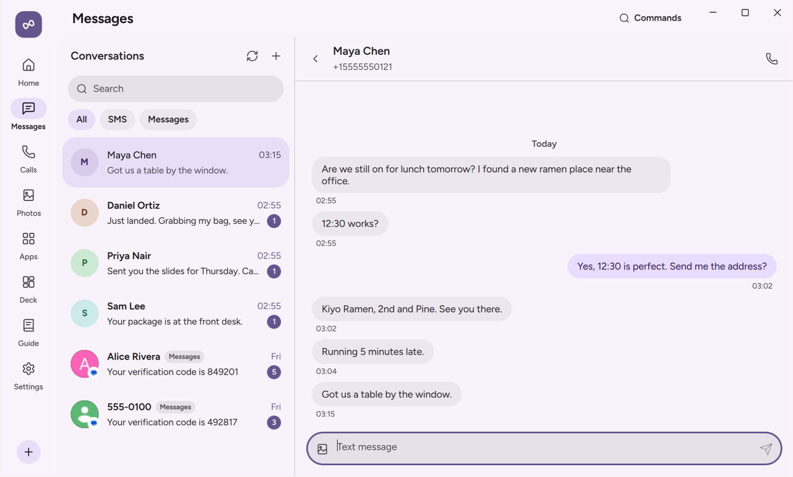
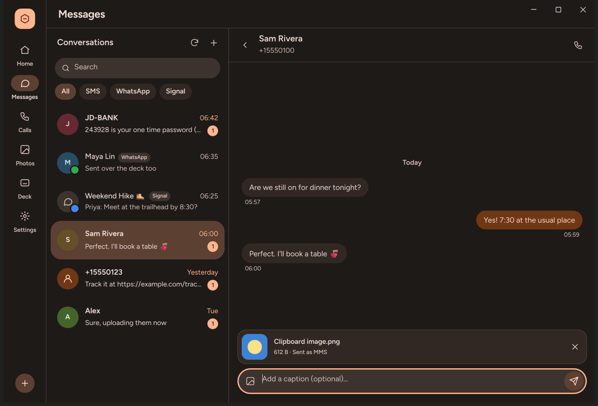

# Mensajes

La página **Mensajes** del PC reúne las conversaciones SMS y MMS del teléfono junto con las **conversaciones unificadas** de RCS, WhatsApp, Telegram, Signal y otras apps de mensajería. Desde una sola bandeja puedes leer conversaciones, buscar contactos, enviar mensajes e imágenes, programar mensajes, copiar códigos de verificación y filtrar el spam.

  

## Qué necesitas

| Requisito | Detalles |
| :--- | :--- |
| **Permisos de Android** | **Mensajes desde tu PC** (`READ_SMS`, `SEND_SMS`, `RECEIVE_SMS`) para las conversaciones SMS y MMS; **Contactos en tu PC** (`READ_CONTACTS`) para mostrar nombres y fotos; **Mostrar notificaciones en tu PC** (acceso a notificaciones) para las conversaciones unificadas de apps de chat de terceros. |
| **Nivel de control de Android** | `Standard` (toda la mensajería funciona sin `Assist` ni `Elevated`). |
| **Interruptores por dispositivo** | **Mensajes** y **Contactos** (ambos activados por defecto en **Ajustes › Dispositivos** del PC). |
| **Red** | Red local, cable USB o **Conectar con datos móviles**. |

## Uso paso a paso

### Leer conversaciones SMS, MMS y de apps de chat

1. Haz clic en **Mensajes** en la barra lateral del PC.
2. El panel izquierdo muestra tus conversaciones ordenadas por actividad reciente:
   - **Las conversaciones SMS y MMS** se sincronizan directamente desde la base de datos de telefonía del sistema, incluidas las conversaciones MMS de grupo y las imágenes adjuntas.
   - **Las conversaciones unificadas** recogen los mensajes entrantes de apps de chat que usan el formato de notificación `MessagingStyle` de Android (como RCS de Google Mensajes, WhatsApp, Telegram, Signal, Discord y Slack). Una etiqueta en cada conversación indica de qué app es. Panal elimina automáticamente los duplicados entre las notificaciones de SMS y el proveedor de SMS del sistema, para que ningún mensaje aparezca dos veces.
3. Cuando hay apps de chat, unas etiquetas arriba de la lista filtran las conversaciones por app. El cuadro de búsqueda filtra por nombre de contacto, número, app o texto del mensaje.

### Enviar mensajes y responder en apps de chat

1. Elige una conversación de la lista para abrir su historial a la derecha. Se abre en el último mensaje. Si subes, mantiene tu posición mientras llegan mensajes nuevos. Lo que lees en el PC deja de aparecer como no leído allí, aunque el teléfono mantiene su propio contador salvo que Panal sea su app de SMS predeterminada.
2. Haz clic en el cuadro de redacción de abajo, escribe el mensaje y pulsa **Intro** para enviarlo (o `Mayús+Intro` para un salto de línea).
   - En una **conversación SMS/MMS**, el teléfono envía el mensaje por tu operador (dividiendo los mensajes largos en varios SMS cuando hace falta) y lo guarda en su base de datos de SMS.
   - En una **conversación unificada** (como WhatsApp o Signal), el teléfono envía la respuesta por el canal `RemoteInput` de la notificación activa de esa app.

### Enviar imágenes (MMS)

Puedes adjuntar imágenes a cualquier conversación SMS/MMS de tres formas:

  

1. **Pegar desde el portapapeles**: copia cualquier imagen en el PC y pulsa `Ctrl+V` dentro del cuadro de redacción.
2. **Arrastrar y soltar**: arrastra un archivo `.png`, `.jpg`, `.webp` o `.gif` desde el Explorador de archivos o la Bandeja a la conversación.
3. **Selector de adjuntos**: haz clic en el icono de adjuntar (`+` o clip) del cuadro de redacción y elige una imagen del PC.
4. Aparece una miniatura sobre el cuadro de texto. Añade un texto opcional y pulsa **Intro** para enviar la imagen como MMS por la conexión móvil del teléfono.

### Empezar una conversación nueva

1. Haz clic en **Mensaje nuevo** arriba de la lista de conversaciones.
2. Escribe el nombre o el número de un contacto en el campo **Para**. Panal busca en los contactos sincronizados del teléfono mientras escribes y muestra nombres, números y avatares.
3. Haz clic en un contacto (o termina de escribir un número), escribe el mensaje y pulsa **Intro**.

### Códigos de un solo uso

Cuando un SMS o un mensaje de chat contiene un código de verificación, Panal muestra un botón **Copiar código** dentro de la burbuja del mensaje (y lo copia solo si **Copiar códigos de un solo uso** está activado en **Ajustes › General**).

## Qué hacen las opciones

- **Interruptor Mensajes** (`Ajustes › Dispositivos` en el PC, **activado** por defecto): permite que este teléfono y el PC sincronicen conversaciones SMS/MMS, conversaciones unificadas y respuestas.
- **Interruptor Contactos** (`Ajustes › Dispositivos` en el PC, **activado** por defecto): sincroniza nombres, números y avatares para que las conversaciones muestren nombres en lugar de números.
- **Copiar códigos de un solo uso** (`Ajustes › General` en el PC, **desactivado** por defecto): copia solos al portapapeles del PC los códigos de verificación de los SMS entrantes.
- **Mensajes en caché** (`Ajustes › Almacenamiento y privacidad` en el PC y `Ajustes › Funciones y datos › Datos y almacenamiento` en Android): muestra cuántos chats, mensajes y bytes de adjuntos MMS hay en caché local, con un botón **Borrar** para vaciarla cuando quieras.

## Datos y privacidad

- **Por dónde viajan los datos**: las conversaciones SMS, los adjuntos MMS, los contactos y los mensajes de las conversaciones unificadas viajan directamente entre el teléfono y el PC por tu conexión QUIC cifrada de extremo a extremo.
- **Dónde se quedan**:
  - En el **teléfono**, los SMS y MMS viven en el proveedor de telefonía del sistema Android (`content://sms` y `content://mms`). Los archivos temporales usados al crear o recibir adjuntos MMS se guardan en la caché privada de la app y se borran solos en 5 minutos.
  - En el **PC**, las conversaciones unificadas (chats `MessagingStyle`) se guardan en caché en tu base de datos SQLite local (`%LOCALAPPDATA%\Panal\nectarlink.db`, en `chat_threads` y `chat_messages`) y las imágenes MMS en `%LOCALAPPDATA%\Panal\cache\images\` hasta **90 días**, para que las conversaciones se abran sin esperas. **Borrar** junto a **Mensajes en caché** en **Ajustes › Almacenamiento y privacidad** quita todos los mensajes y adjuntos guardados en el PC sin borrar ningún mensaje del teléfono.

## Límites

- **Ventana de respuesta de las apps de chat (`RemoteInput`)**: las conversaciones unificadas de apps de terceros (como WhatsApp, Signal o Telegram) dependen de la acción `RemoteInput` de la notificación de esa app en Android. Puedes responder mientras su notificación (o la acción de sesión) siga activa en el teléfono, y no puedes iniciar una conversación nueva de WhatsApp o Signal con alguien que no te haya escrito antes.
- **Mensajes RCS de Google Mensajes**: Android no ofrece una API pública para leer o enviar mensajes RCS directamente de la base de datos. Los RCS que llegan mientras estás conectado aparecen como conversaciones unificadas mediante notificaciones `MessagingStyle` (con respuesta de texto), mientras que los mensajes que inicias desde **Mensaje nuevo** se envían como SMS o MMS normales.
- **Límites de tamaño de MMS del operador**: las imágenes MMS salientes se comprimen solas para ajustarse a los límites habituales de los operadores (normalmente entre 600 KB y 1,2 MB según tu operador). Para enviar fotos a resolución completa, usa [Fotos](photos.md) o [Archivos y transferencias](files-and-transfers.md).
