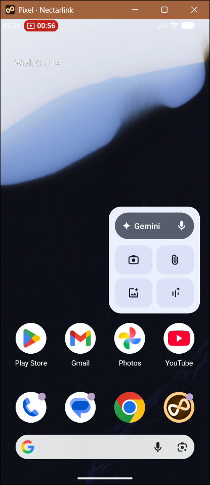
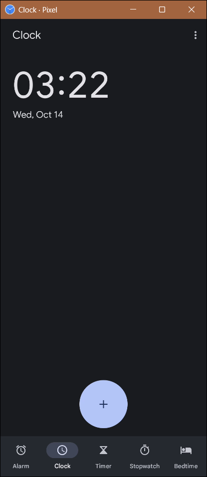
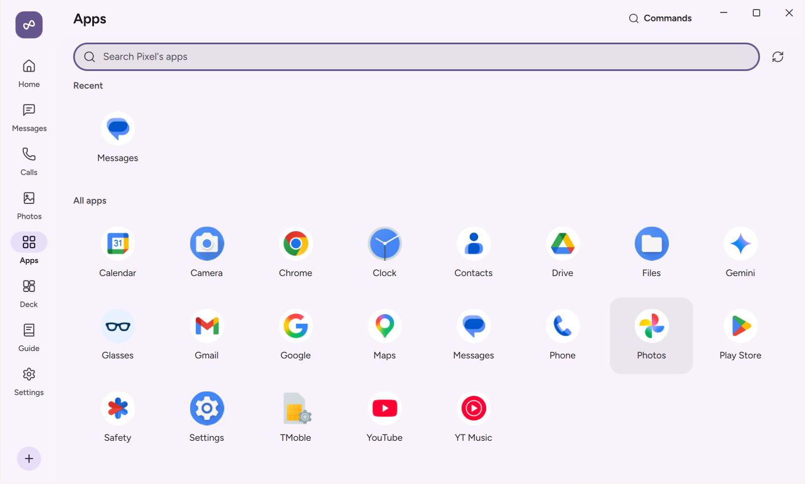

# Duplicación y ventanas de apps

Panal transmite la pantalla del teléfono al PC en una ventana propia hasta a 60 fotogramas por segundo, con codificación de vídeo por hardware (H.264, H.265 o AV1) y reenvío de audio en directo. Según el nivel de control de Android, puedes ver la pantalla, controlarla con el ratón y el teclado del PC, abrir apps de Android en sus propias ventanas de escritorio (`app window`), lanzar un escritorio completo (modo DeX) o duplicar al revés la pantalla del PC en el teléfono.

  

## Qué necesitas

| Función | Requisitos |
| :--- | :--- |
| **Ver la pantalla y el audio del teléfono en el PC (`mirror`)** | Nivel de control `Standard`. Interruptor **Duplicación de pantalla** activado en **Ajustes › Dispositivos** del PC (activado por defecto). Con `Standard` o `Assist`, Android muestra en el teléfono el aviso del sistema **Empezar a grabar o enviar** cada vez que empieza la duplicación. Con `Elevated`, Panal concede `PROJECT_MEDIA` automáticamente y la duplicación empieza sin aviso en el teléfono. |
| **Tocar, deslizar, desplazar y escribir desde el PC** | `Assist` (servicio de accesibilidad de Android activado en **Ajustes › Permisos › Control desde tu PC**) o `Elevated` (depuración inalámbrica). `Elevated` añade arrastre táctil en tiempo real, distribuciones de teclado físico UHID, mandos XInput y presión e inclinación del lápiz. |
| **Apagar la pantalla física del teléfono durante la duplicación** | Nivel de control `Elevated`. |
| **Apps del teléfono en ventanas propias del PC (`app window`)** | Nivel de control `Elevated` en Android 11 o posterior. |
| **Duplicación inversa (pantalla del PC en el teléfono)** | Interruptor por dispositivo **Compartir la pantalla del PC con el teléfono** (`pc_mirror`) en **Ajustes › Dispositivos** del PC (desactivado por defecto), o aprobación puntual en el diálogo de consentimiento del PC cuando se pide desde el teléfono. Controlar el PC desde la vista inversa también requiere **Ratón, teclado y Deck remotos** (`remote_input`, desactivado por defecto). |

## Uso paso a paso

### Duplicar la pantalla del teléfono en el PC

1. En el PC, haz clic en **Duplicar pantalla** en la pantalla de **Inicio** (o pulsa `Ctrl+Alt+Espacio` y elige **Duplicar la pantalla del teléfono**). También puedes empezar desde el teléfono tocando **Duplicar en el PC** en la pantalla de Inicio de Android.
2. Si el teléfono está en `Standard` o `Assist`, toca la notificación del teléfono y aprueba el diálogo de compartir pantalla de Android. Si está en `Elevated`, la ventana `mirror` se abre al momento en el PC sin aviso en el teléfono.
3. La pantalla del teléfono se transmite hasta a 1920 píxeles en el lado largo y 60 fps. Panal negocia solo el mejor códec por hardware que admiten ambos dispositivos (**AV1**, **H.265/HEVC** o **H.264/AVC**) y se adapta cuando giras el teléfono entre vertical y horizontal.
4. En Android 10 y posterior, el audio multimedia y de juegos del teléfono suena por los altavoces del PC durante la duplicación. Haz clic en el icono del altavoz de la barra de la ventana `mirror` para silenciar o reactivar el audio del teléfono en el PC.

### Controlar el teléfono desde la ventana de duplicación

Con `Assist` o `Elevated` activado en el teléfono:

- **Clic izquierdo y arrastrar**: toca o desliza en la pantalla. Con `Elevated`, el movimiento del puntero se transmite en tiempo real para arrastrar iconos, mover la línea de tiempo de un vídeo o dibujar sin tirones.
- **Rueda del ratón / desplazamiento con dos dedos en el panel táctil**: desplaza en vertical u horizontal bajo el cursor.
- **Clic derecho**: **Atrás** de Android.
- **Clic central**: **Inicio** de Android.
- **Escribir y atajos de teclado**: escribe directamente en cualquier campo enfocado de Android. Con `Elevated` (cuando el kernel y la política SELinux del teléfono permiten `/dev/uhid`), Panal registra un teclado HID físico virtual y un mando, así las distribuciones de teclado no estadounidenses, las combinaciones de teclas y los mandos Xbox/XInput funcionan de forma nativa en apps y juegos de Android.
- **Portapapeles y soltar archivos en la duplicación**: pulsar `Ctrl+C` o `Ctrl+V` con la ventana `mirror` enfocada sincroniza el portapapeles, y arrastrar archivos del Explorador de Windows a la ventana `mirror` los envía directamente a `Download/Panal` en el teléfono.
- **Lápiz**: la presión, la inclinación y los botones del lápiz de Windows Ink se reenvían a la pantalla del teléfono con `Elevated`.

### Barra de la duplicación y atajos de teclado

La cabecera de la ventana `mirror` incluye controles rápidos y atajos:

| Acción | Atajo | Qué hace |
| :--- | :--- | :--- |
| **Copiar captura** | `Ctrl+Mayús+C` | Copia el fotograma actual al portapapeles de Windows como imagen PNG. |
| **Guardar captura** | `Ctrl+S` | Guarda una captura PNG de la pantalla duplicada en `Descargas\Panal`. |
| **Grabar vídeo (MP4)** | `Ctrl+R` | Graba la transmisión en directo y el audio del teléfono en un `.mp4` en `Descargas\Panal` pasando el flujo H.264 sin pérdidas (sin recodificar vídeo en el PC). Pulsa `Ctrl+R` otra vez para detener y guardar. |
| **Mantener el teléfono despierto** | Icono de la barra | Evita que el tiempo de espera de la pantalla bloquee el teléfono mientras dura la duplicación. |
| **Apagar la pantalla del teléfono** | Icono de la barra (`Elevated`) | Apaga la pantalla física OLED/LCD del teléfono mientras la ventana `mirror` sigue funcionando en el PC, y la vuelve a encender sola al terminar. |
| **Bloquear el teléfono** | Icono de la barra | Bloquea el teléfono, como su botón de encendido. Aparece cuando puedes controlar el teléfono. |
| **Reproducir el sonido en el teléfono / aquí** | Icono de la barra | Deja de enviar el sonido del teléfono al PC para que vuelva a sonar en el teléfono, o lo devuelve al PC. Mientras está en el teléfono, las duplicaciones nuevas lo dejan ahí. |

### Abrir apps del teléfono en sus propias ventanas del PC (`app window`)

Con `Elevated` en Android 11 o posterior, puedes ejecutar apps del teléfono en ventanas separadas de Windows 11 sin duplicar toda la pantalla:

  

1. Haz clic en **Apps** en la barra lateral del PC para ver todas las apps del teléfono. También puedes hacer clic en **Abrir una app** en **Inicio**, o en cualquier notificación del teléfono en el feed, en el Historial de notificaciones o en un aviso emergente de Windows.
2. **Apps** muestra una fila **Recientes** (apps que abriste desde el PC y apps que han publicado notificaciones hace poco) sobre la lista completa de apps del teléfono. Escribe para buscar y pulsa Intro para abrir la primera coincidencia. Las apps ya abiertas en el PC llevan un punto.

  

3. Haz clic en cualquier app. Panal crea una pantalla virtual aislada en el teléfono y abre esa app en el PC en su propia `app window`, con su propio icono en la barra de tareas de Windows.
4. La app funciona de forma independiente de lo que se ve en la pantalla física del teléfono, y escribir desde el PC no abre el teclado en pantalla del teléfono.
5. Cambia el tamaño de la `app window` en el PC y la app de Android se recoloca para ajustarse a la nueva proporción. Panal recuerda el tamaño y la posición de la ventana de cada app para la próxima vez. Puedes abrir varias `app window` a la vez en pestañas o ventanas separadas.
6. El sonido del teléfono llega al PC con sus ventanas de apps, y el teléfono se queda en silencio. Es todo el sonido del teléfono, así que con varias ventanas abiertas las oyes todas. El icono del altavoz de la barra de cualquier `app window` lo silencia en el PC, y el sonido se detiene al cerrar la última `app window`.

### Modo de escritorio (DeX / modo escritorio)

En los teléfonos que admiten un lanzador de escritorio en pantallas secundarias (como Samsung DeX o el modo escritorio de Android 14+), puedes lanzar un escritorio 16:9 en una ventana del PC desde el menú de duplicación (`Elevated`).

### Duplicación inversa: ver la pantalla del PC en el teléfono

También puedes ver (y, si quieres, controlar) el escritorio del PC desde el teléfono:

1. En el teléfono, abre **Panal** y toca **Ver la pantalla del PC** en **Pantalla, cámara y entrada** (o abre la pantalla **Controlar el PC** y cambia a la vista de pantalla).
2. **Consentimiento expreso del PC**: como la pantalla de un PC es sensible, la duplicación inversa está **desactivada por defecto** (**Compartir la pantalla del PC con el teléfono** en **Ajustes › Dispositivos**). Si no está activada para tu teléfono, el PC muestra un diálogo de consentimiento con las opciones **Ahora no**, **Permitir** (solo para esta sesión, se borra solo al desconectar) o **Permitir para este dispositivo** (activa **Compartir la pantalla del PC con el teléfono** para ese teléfono).
3. **Indicador de compartir**: mientras dura una sesión de duplicación inversa, la barra de título de la ventana del PC muestra una píldora (**Compartiendo la pantalla con `<Teléfono>`**) con un botón **Detener**.
4. **Control de la entrada**: ver la pantalla del PC desde el teléfono es solo lectura salvo que también hayas activado **Ratón, teclado y Deck remotos** (`remote_input`) para ese teléfono en el PC.
5. **Pantalla principal**: el teléfono ve la pantalla principal del PC. En un PC con varios monitores, los demás no se comparten. Para compartir otro monitor, conviértelo en la pantalla principal en **Configuración › Sistema › Pantalla** de Windows.
6. **Conexiones lentas**: en un enlace lento (datos móviles a través del relé), el PC baja la tasa de bits del vídeo hasta que la imagen fluye bien, y la vuelve a subir cuando el enlace se recupera.

## Qué hacen las opciones

- **Duplicación de pantalla** (`Ajustes › Dispositivos` en el PC, por defecto: **activado**): permite al PC y al teléfono iniciar la duplicación del teléfono en el PC y las sesiones `app window`.
- **Compartir la pantalla del PC con el teléfono** (`Ajustes › Dispositivos` en el PC, por defecto: **desactivado**): permite al teléfono seleccionado ver la pantalla de este PC sin mostrar cada vez el diálogo de consentimiento.
- **Ratón, teclado y Deck remotos** (`Ajustes › Dispositivos` en el PC, por defecto: **desactivado**): permite al teléfono seleccionado enviar toques, clics y pulsaciones de teclas a este PC (también durante la duplicación inversa).
- **Usar el ratón y el teclado del PC** (`Ajustes › Permisos › Control desde tu PC` en Android): abre los ajustes de accesibilidad de Android para activar o desactivar el modo `Assist`.
- **Toque y teclas reales (depuración inalámbrica)** (`Ajustes › Permisos › Control desde tu PC` en Android): te guía para configurar o desactivar el modo `Elevated`.

## Datos y privacidad

- **Solo transmisión en directo**: los fotogramas de vídeo y las muestras de audio se codifican por hardware, se transmiten directamente por tu conexión QUIC cifrada de extremo a extremo y se decodifican en texturas de GPU en memoria. No se graba nada en el disco salvo que pulses expresamente **Guardar captura** (`Ctrl+S`) o **Grabar vídeo** (`Ctrl+R`).
- **Registro de sesión en la `Línea de tiempo`**: al terminar una sesión de duplicación, la `Línea de tiempo` guarda una sola entrada de resumen con el nombre del dispositivo y la duración (sin guardar vídeo ni capturas).
- **Consentimiento y visibilidad**: la duplicación del teléfono en el PC muestra en el teléfono una notificación persistente **Compartiendo tu pantalla con `<PC>`** con un botón **Detener** (y una notificación **una app está abierta en una ventana de un PC** con **Cerrar todo** al usar `app window`). La duplicación inversa del PC en el teléfono requiere el consentimiento del PC y muestra en el PC un aviso persistente **Dejar de compartir**.

## Límites

- **Contenido protegido con `FLAG_SECURE`**: las apps de Android que activan la marca de ventana `FLAG_SECURE` (como apps bancarias, gestores de contraseñas y apps de vídeo con DRM como Netflix) se ven en negro en las transmisiones `MediaProjection` con `Standard` y `Assist`, por diseño de Android.
- **Reglas de captura de audio y `REMOTE_SUBMIX`**: el `AudioPlaybackCapture` estándar de Android 10+ captura las apps que permiten la captura de reproducción (`USAGE_MEDIA`, `USAGE_GAME`). Las apps que la rechazan en su manifiesto no se pueden capturar con `Standard` ni `Assist`. Con `Elevated`, Panal intenta la captura interna de audio mediante `REMOTE_SUBMIX` (`UID 2000`), que funciona en compilaciones AOSP/Pixel pero puede estar bloqueada por políticas SELinux propias en algunas ROM de fabricante (en ese caso vuelve sola a la captura de reproducción estándar).
- **Acceso de kernel/SELinux a UHID**: la inyección de teclado físico virtual (`--uhid-key`) y de mando (`--uhid-gamepad`) con `Elevated` abre `/dev/uhid` como `shell` (`UID 2000`). En las ROM de fabricante cuya política SELinux niega a `shell` el acceso a `/dev/uhid`, Panal vuelve sola a la inyección estándar de teclas y movimiento de `InputManager` de Android.
