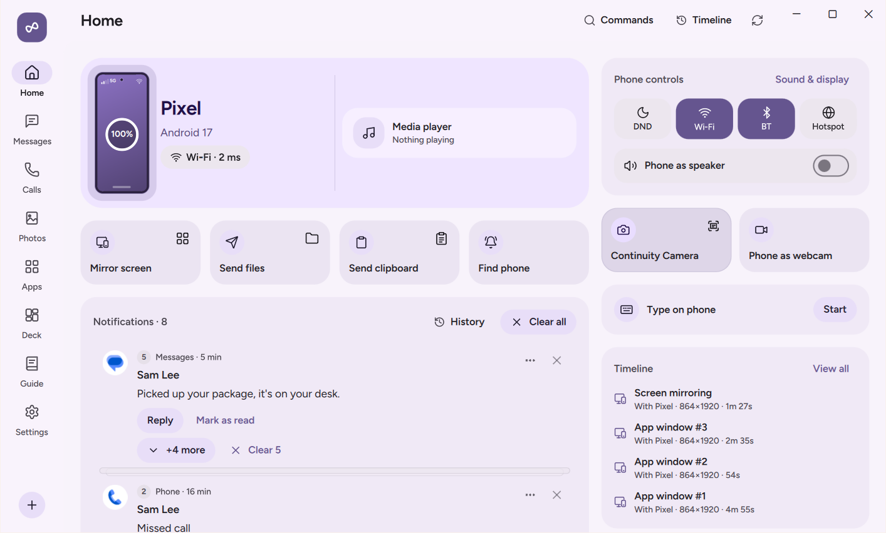
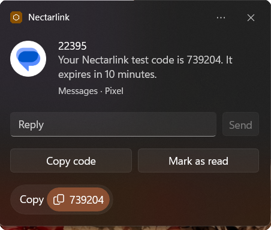

# Notificaciones

Panal refleja en tiempo real las notificaciones del teléfono en tu PC. Puedes leer los avisos, responder mensajes al momento, usar los botones de acción, seguir el progreso de entregas o temporizadores en vivo, copiar códigos de verificación con un clic y descartar notificaciones en los dos dispositivos a la vez.

  

## Qué necesitas

| Requisito | Detalles |
| :--- | :--- |
| **Permiso de Android** | **Acceso a notificaciones** (`Ajustes › Permisos › Notificaciones › Mostrar notificaciones en tu PC`). En Android 13 o superior, si el interruptor está en gris, abre antes **Información de la app › Permitir ajustes restringidos**. |
| **Nivel de control de Android** | `Standard` para todas las notificaciones normales, respuestas rápidas, acciones y actualizaciones en vivo. En Android 15 o superior hace falta `Elevated` para recibir las notificaciones que el modo de confirmación mejorada de Android marca como sensibles (como los códigos de verificación por SMS). |
| **Interruptor por dispositivo** | **Notificaciones** (activado por defecto en **Ajustes › Dispositivos** del PC). |
| **Red** | Red local, cable USB o **Conectar con datos móviles**. |

## Uso paso a paso

### Leer, agrupar y descartar notificaciones

1. Abre **Panal** en el PC y quédate en **Inicio**. Las notificaciones activas del teléfono conectado aparecen en la tarjeta **Notificaciones**, con el icono de cada app, el título, el texto, la hora y cualquier foto o imagen grande adjunta.
2. Cuando una app publica varias notificaciones, Panal las agrupa bajo un encabezado plegable con el número de avisos. Haz clic en el encabezado para desplegar o plegar los avisos de esa app, o en **Borrar grupo** (`x`) para descartarlos todos de una vez.
3. Haz clic en el botón `x` de cualquier tarjeta (o descarta la ventana emergente de Windows) para borrarla. El descarte se sincroniza en ambos sentidos: borrar una notificación en el PC la quita del panel del teléfono, y deslizarla en el teléfono la quita del PC. Al descartar una notificación o un grupo en el PC, una barra **Deshacer** te deja recuperarla localmente si te equivocaste.
4. Con `Elevated` activo (Android 11 o superior), haz clic en una tarjeta de notificación en el PC para abrir esa app del teléfono directamente en el PC, en su propia `app window`.

### Responder al momento y usar las acciones

1. Cuando una notificación admite respuesta directa (como un mensaje de chat o un correo), haz clic en **Responder** en la tarjeta de la app o escribe directamente en la ventana emergente de Windows.
2. Escribe la respuesta y pulsa **Intro** o haz clic en **Enviar**. El teléfono la envía al instante mediante el `RemoteInput` de la app original.
3. Los botones de acción de la notificación en el teléfono (como **Marcar como leído**, **Archivar**, **Recordar** o **Posponer**) aparecen como botones en la ventana emergente de Windows y en la tarjeta de Panal. Haz clic en cualquiera para ejecutarlo en el teléfono.

### Actualizaciones en vivo, barras de progreso y temporizadores

Las notificaciones que informan de un progreso o de un tiempo en curso se quedan fijadas arriba del panel y se actualizan en su sitio sin volver a aparecer ni repetir sonidos:

- **Actualizaciones en vivo de Android 16 (`ProgressStyle`)**: las notificaciones de viajes compartidos, comida a domicilio, navegación y seguimiento de vuelos muestran en vivo en el PC su barra de progreso por tramos, el hito actual y el icono de seguimiento.
- **Barras de progreso en curso**: las descargas, subidas y tareas del sistema actualizan su porcentaje en su sitio.
- **Cronómetros y cuentas atrás**: los temporizadores de cocina, cronómetros y entrenamientos en curso avanzan cada segundo en el panel (y en `Nectar Island` si está activada).

### Códigos de verificación de un solo uso

Cuando una notificación o un SMS entrante contiene un código de verificación de 4 a 8 dígitos:

  

1. Panal extrae el código localmente en tu dispositivo y añade un botón destacado **Copiar código (`123456`)** en la ventana emergente de Windows y en la tarjeta de Inicio.
2. Si activas **Copiar códigos de un solo uso** en **Ajustes › General**, Panal copia el código al portapapeles del PC en cuanto llega y muestra un breve aviso de confirmación, para que pegues con `Ctrl+V` directamente en el navegador.
3. Los códigos de un solo uso nunca se guardan en el historial del portapapeles ni en la `Timeline`, y copiar un código en el PC nunca lo devuelve al teléfono.

### Ver el historial de notificaciones descartadas

Si deslizaste un aviso por error en el teléfono o quieres revisar una notificación de antes:

1. En la tarjeta **Notificaciones** del Inicio del PC, cambia el filtro de **Activas** a **Historial**.
2. Panal muestra las notificaciones descartadas en las últimas 24 horas (hasta 300), con búsqueda por nombre de app o texto.
3. Puedes borrar el historial cuando quieras o desactivar la retención de 24 horas en **Ajustes › Almacenamiento y privacidad › Historial de notificaciones**.

### Reenviar las notificaciones del PC al teléfono (opcional)

Si te alejas del escritorio y quieres recibir en el teléfono los avisos del PC (recordatorios del calendario, compilaciones terminadas o mensajes de chat del escritorio):

1. En el PC, abre **Ajustes › Notificaciones** y activa **Reenviar notificaciones del PC**.
2. Concede a Windows el acceso de escucha de notificaciones si te lo pide.
3. Las notificaciones de Windows se reenvían al teléfono conectado en el canal **Tareas en tu PC**. Este ajuste viene **desactivado por defecto** por privacidad.

## Qué hacen las opciones

Todos los ajustes de notificaciones están en **Ajustes › Notificaciones** (y **Ajustes › General** / **Ajustes › Almacenamiento y privacidad**) del PC:

- **Seguir el No molestar del teléfono** (`Ajustes › Notificaciones`, por defecto: **desactivado**): al activarlo, el PC silencia las ventanas emergentes mientras el teléfono está en No molestar. Las notificaciones siguen llegando en silencio al panel de Panal para que las leas cuando quieras.
- **Perfil de notificaciones en Inicio**: desde la tarjeta de controles del teléfono en el Inicio del PC puedes cambiar el perfil de notificaciones del teléfono entre **Todas**, **Solo prioritarias** (No molestar) y **Silencio**.
- **Reenviar notificaciones del PC** (`Ajustes › Notificaciones`, por defecto: **desactivado**): refleja las notificaciones del escritorio de Windows en el teléfono conectado.
- **Horas de silencio** (`Ajustes › Notificaciones`): abre los ajustes **Sistema › Notificaciones** de Windows para configurar horarios automáticos de Concentración / No molestar en Windows 11.
- **Reglas por app** (`Ajustes › Notificaciones`): cada app del teléfono que haya enviado al menos una notificación aparece en una lista alfabética con su icono y un selector de tres opciones:
  - **Mostrar** (predeterminado): muestra una ventana emergente de Windows y el aviso en el panel de Panal.
  - **Sin ventanas emergentes**: suprime las ventanas emergentes de esa app pero mantiene sus notificaciones visibles en el panel de Panal.
  - **Ocultar**: bloquea por completo las notificaciones de esa app en el PC.
- **Copiar códigos de un solo uso** (`Ajustes › General`, por defecto: **desactivado**): copia automáticamente al portapapeles del PC los códigos de verificación detectados en notificaciones y SMS.
- **Historial de notificaciones** (`Ajustes › Almacenamiento y privacidad`, por defecto: **activado**): conserva en el PC las notificaciones descartadas durante 24 horas (hasta 300). Incluye un botón **Borrar**.

## Datos y privacidad

- **Por dónde viajan los datos**: el contenido de las notificaciones, los iconos y las imágenes viajan directamente entre el teléfono y el PC por tu sesión QUIC cifrada de extremo a extremo.
- **Dónde se quedan**: las notificaciones activas se guardan en memoria mientras siguen vigentes (hasta 200). Si el **Historial de notificaciones** está activado en el PC, las descartadas se guardan localmente en `%LOCALAPPDATA%\Panal\notification-history.json` (y las reglas por app en `notification-rules.json`), y las imágenes en caché en `%LOCALAPPDATA%\Panal\cache\images\` hasta 24 horas (como máximo 300 entradas); después se borran solas. El teléfono no guarda ninguna copia del historial.
- **Protección de códigos**: las notificaciones con códigos de verificación se excluyen del historial del portapapeles y de la `Timeline`. Ni la app de Android ni el asistente `Elevated` escriben nunca el texto de las notificaciones en `logcat` ni en registros en disco.

## Límites

- **Modo de confirmación mejorada de Android 15 o superior (`RECEIVE_SENSITIVE_NOTIFICATIONS`)**: desde Android 15, el sistema oculta a los receptores de notificaciones no confiables el texto de las notificaciones que parecen contener códigos de doble factor. Para recibir ese texto y los códigos en Android 15 o superior, activa una vez el nivel `Elevated`; su asistente concede `RECEIVE_SENSITIVE_NOTIFICATIONS` a Panal automáticamente.
- **Restricciones en segundo plano del fabricante**: si el fabricante de tu teléfono suspende Panal en segundo plano, las notificaciones pueden retrasarse hasta que enciendas la pantalla. Sigue los pasos de tu fabricante en [Solución de problemas](troubleshooting.md) para poner el uso de batería de Panal en **Sin restricciones**.
- **Historial de apps de chat**: la duplicación de notificaciones captura los avisos que llegan mientras el teléfono y el PC están conectados (o que siguen en el panel del teléfono). Android aísla las bases de datos completas de las apps de chat cifradas de terceros (como Signal o WhatsApp), así que no se pueden leer mensajes anteriores.
