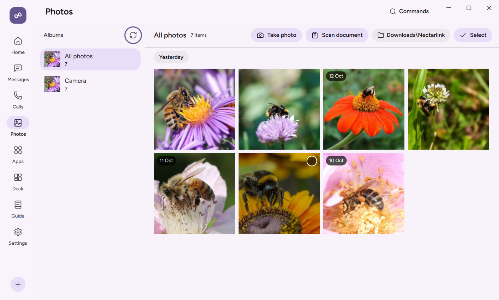

# Fotos

La página **Fotos** del PC te da acceso inmediato a la galería de la cámara, las capturas de pantalla y los álbumes del teléfono sin conectar un cable ni subir la galería a un servicio de fotos en la nube. Puedes ver miniaturas agrupadas por día, abrir fotos a resolución completa, arrastrar imágenes al Explorador de archivos o a apps de edición, y recibir un aviso en el PC en cuanto haces una foto o una captura en el teléfono.

  

## Qué necesitas

| Requisito | Detalles |
| :--- | :--- |
| **Permiso de Android** | **Fotos y vídeos en tu PC** (`READ_MEDIA_IMAGES` y `READ_MEDIA_VIDEO` en Android 13+, o `READ_EXTERNAL_STORAGE` en Android 12 y anteriores) en **Ajustes › Permisos › Fotos y vídeos**. En Android 14+ puedes dar acceso completo (**Permitir todo**) o elegir fotos concretas (**Seleccionar fotos**). |
| **Nivel de control de Android** | `Standard` (funciona de serie, sin accesibilidad ni opciones de desarrollador). |
| **Interruptor por dispositivo** | **Fotos** (activado por defecto en **Ajustes › Dispositivos** del PC). |
| **Red** | Red local, cable USB o **Conectar con datos móviles**. |

## Uso paso a paso

### Ver la galería, las capturas y los álbumes

1. Haz clic en **Fotos** en la barra lateral del PC.
2. Usa las etiquetas de álbum de arriba (**Todo**, **Cámara**, **Capturas** o cualquier álbum propio del `MediaStore` del teléfono) para filtrar la cuadrícula.
3. Las fotos se agrupan por día. Mientras te desplazas, Panal recibe miniaturas ligeras del teléfono y las guarda en caché local, así el desplazamiento sigue fluido incluso en galerías de más de 10.000 fotos.
4. Además, la pantalla de **Inicio** y el panel lateral `Bandeja` (`Ctrl+Alt+S`) muestran siempre tarjetas rápidas con la **Última foto** y la **Última captura** del teléfono.

### Ver fotos a resolución completa

1. Haz clic en cualquier miniatura de la cuadrícula **Fotos** para abrir el visor a resolución completa dentro de Panal.
2. Panal trae del teléfono, cuando lo pides, el archivo de imagen original sin comprimir.
3. Usa las flechas **Izquierda** y **Derecha** del teclado para recorrer la galería, o pulsa **Esc** para volver a la cuadrícula.
4. Desde la barra del visor puedes:
   - Hacer clic en **Copiar** (`Ctrl+C`) para copiar la imagen a resolución completa al portapapeles de Windows y pegarla en cualquier documento, chat o editor de imágenes.
   - Hacer clic en **Guardar** (`Ctrl+S`) para guardar el archivo original en `Descargas\Panal` (o elegir otra carpeta).
   - Hacer clic en **Abrir en Fotos** para abrir el original descargado en el visor de fotos predeterminado de Windows.

### Arrastrar fotos al Explorador de archivos o a otras apps

No hace falta guardar una foto antes de usarla en otro programa de Windows:

1. Apunta a cualquier foto de la página **Fotos**, de la pantalla de **Inicio** o de la `Bandeja`.
2. Arrástrala directamente al escritorio de Windows, a una carpeta del Explorador o a una app abierta (como PowerPoint, Photoshop, Figma, Slack o el navegador).
3. Panal prepara el archivo a resolución completa con su nombre original saneado (por ejemplo, `IMG_20261012_091500.jpg`), así la app que lo recibe obtiene el archivo real al momento.

### Seleccionar y guardar varias fotos

1. Pasa el ratón por una foto y haz clic en su marca de selección (o mantén `Mayús` / `Ctrl` al hacer clic) para seleccionar varias.
2. En la barra de selección de arriba, haz clic en **Guardar** para descargar de una vez todos los originales elegidos en `Descargas\Panal` (o en el botón de carpeta para elegir otra).

### Eliminar fotos desde el PC

1. Selecciona una o varias fotos o vídeos como arriba.
2. Haz clic en **Eliminar** y después en **¿Mover a la papelera del teléfono?** para confirmar.

Van a la papelera del teléfono, desde donde aún puedes restaurarlas, y desaparecen de la vista del PC. Requiere Android 11 o posterior y **Acceso a todos los archivos** para Panal; si no, Android pregunta en el teléfono en cada tanda.

### Avisos de fotos y capturas nuevas en el PC

Cada vez que haces una foto o una captura de pantalla en el teléfono mientras está conectado:

1. El observador del `MediaStore` del teléfono detecta la captura nueva al instante y avisa al PC.
2. Aparece en el PC una notificación con una miniatura (y se actualizan los huecos de **Última foto** / **Última captura** en Inicio y en la `Bandeja`), con botones para **Copiar** la imagen al portapapeles o **Guardarla** en el disco.

## Qué hacen las opciones

- **Interruptor Fotos** (`Ajustes › Dispositivos` en el PC, por defecto: **activado**): permite al PC ver la galería del teléfono y recibir avisos de fotos y capturas nuevas.
- **Fotos y vídeos en tu PC** (`Ajustes › Permisos › Fotos y vídeos` en Android): gestiona el permiso multimedia de Android. Si antes elegiste **Seleccionar fotos** (acceso parcial en Android 14+), toca aquí **Permitir todo** si quieres ver toda la galería en el PC.
- **Miniaturas de fotos** (`Ajustes › Almacenamiento y privacidad` en el PC y `Ajustes › Funciones y datos › Datos y almacenamiento` en Android): muestra el número y el tamaño en disco de las miniaturas en caché del PC (hasta 30 días) y de las capturas temporales de cámara del teléfono (hasta 24 horas), con un botón **Borrar** para vaciar la caché cuando quieras.

## Datos y privacidad

- **Lectura bajo demanda**: Panal nunca sube en bloque tu biblioteca de fotos en segundo plano. El teléfono lee los datos y miniaturas directamente del `MediaStore` de Android solo cuando abres la página **Fotos** (o la última foto o captura en Inicio), y los originales a resolución completa solo se transfieren cuando ves, copias, arrastras o guardas una foto concreta.
- **Conservación de la caché local**: las miniaturas descargadas en el PC se guardan en `%LOCALAPPDATA%\Panal\cache\photos\` y se borran solas a los **30 días**. Los archivos temporales de arrastrar y soltar de `%LOCALAPPDATA%\Panal\cache\photos\drag\` se limpian solos. **Borrar** junto a **Miniaturas de fotos** en **Ajustes › Almacenamiento y privacidad** elimina todas las miniaturas del PC sin tocar ninguna foto del teléfono ni los archivos que guardaste en `Descargas`.

## Límites

- **Acceso parcial a fotos en Android 14+**: si eliges **Seleccionar fotos** en lugar de **Permitir todo** cuando Android pide acceso multimedia, Android solo muestra a Panal las fotos que elegiste. Panal muestra un aviso en los Ajustes de Android (**Algunas fotos y vídeos no están disponibles en tu PC**) con un botón **Permitir todo** para ampliar el acceso cuando quieras.
- **Fotos que solo están en la nube**: Panal lee las fotos guardadas en el almacenamiento local del teléfono (`MediaStore`). Las fotos antiguas que un servicio de copia en la nube haya borrado del teléfono (como "Liberar espacio" de Google Fotos) no están en el dispositivo y no aparecen salvo que las vuelvas a descargar al teléfono.
