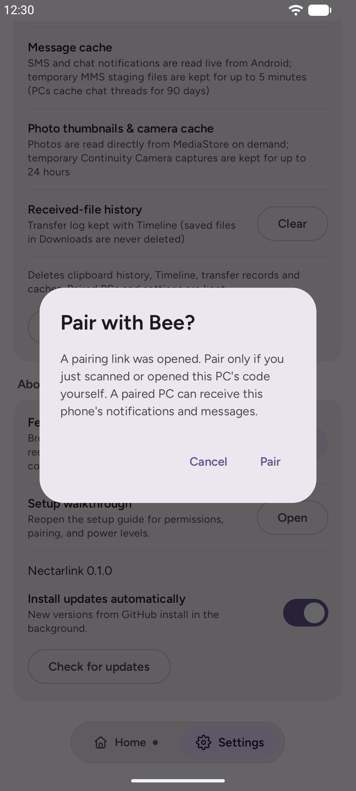

# Privacidad y seguridad

Panal está hecho para que tus datos personales se queden en tus propios dispositivos, bajo tu control directo. No hay cuenta de usuario, ni base de datos en la nube, ni analítica o telemetría, ni SDK de publicidad. Cada conexión entre el teléfono y el PC se autentica en ambos sentidos y se cifra de extremo a extremo.

Para una auditoría técnica línea a línea de cada frontera de red, IPC, memoria compartida y sistema de archivos, consulta [`docs/SECURITY-REVIEW.md`](../SECURITY-REVIEW.md).

## 1. Claves de identidad del dispositivo

La primera vez que Panal arranca en el PC o en el teléfono Android, genera un par de claves de identidad criptográfica **Ed25519** de 256 bits que se conserva:

- **Cómo se identifican los dispositivos**: cada dispositivo se identifica por su clave pública Ed25519 de 32 bytes (`DeviceId`), nunca por una dirección IP, un nombre de equipo o una dirección de correo.
- **Cómo se protege la clave privada en reposo**:
  - En **Windows**, `identity.key` se cifra con la API de protección de datos de Windows (**DPAPI**, mediante `CryptProtectData` con `CRYPTPROTECT_UI_FORBIDDEN` y la entropía `b"nectarlink/identity/v1"`), ligada a las credenciales de tu cuenta de usuario de Windows (no respaldada por hardware).
  - En **Android**, `identity.key` se cifra con una clave **AES-256-GCM** no exportable (`nectarlink.identity.v1`) dentro del **Almacén de claves de Android**, que puede estar respaldado por hardware según el teléfono.
  - En **Linux**, `identity.key` aún no se cifra. La protegen los permisos del archivo (`0600`), así que solo tu usuario puede leerla, pero también puede cualquier cosa que se ejecute como tú y cualquiera que lea el disco. El cifrado de disco completo cubre este segundo caso.

## 2. Emparejamiento criptográfico (secreto fuera de banda y SAS de 6 dígitos)

Un dispositivo desconocido en tu red Wi-Fi nunca puede leer tus notificaciones, tu portapapeles ni tus archivos. Los dispositivos solo se comunican tras completar un emparejamiento mutuo (`ALPN = "nectarlink-pair/0"`):

- **Emparejamiento con código QR**: cuando muestras un código QR de emparejamiento en el PC, Panal genera un secreto aleatorio de un solo uso de 128 bits (`s`, codificado en base64 apto para URL) que caduca a los 5 minutos y se invalida al usarse o tras 5 intentos fallidos. Escanear ese QR demuestra que el teléfono vio el secreto fuera de banda, calculando `HMAC-SHA256(s, "nectarlink-pair-v0" || idA || idB)` sobre las claves públicas Ed25519 de ambos dispositivos (`idA` para el que inicia e `idB` para el que responde).
- **Emparejamiento cercano y por USB con código de 6 dígitos**: cuando emparejas sin cámara (con **Emparejar cerca** o **Emparejamiento automático por USB**), ambos dispositivos establecen una sesión TLS 1.3, intercambian compromisos SHA-256 de nonces aleatorios de 128 bits (`nA` y `nB`) y derivan una cadena corta de autenticación (**SAS**) de 6 dígitos con **HMAC-SHA256** (`uint32_be(HMAC-SHA256(nA || nB, "nectarlink-sas-v0" || idA || idB)[0..4]) mod 1.000.000`). Si un atacante en una Wi-Fi no fiable intentara un ataque de intermediario, las claves públicas del cálculo SAS no coincidirían en ambos lados. No se empareja nada hasta que confirmas **Los códigos coinciden** en ambos dispositivos.

- **Enlaces de emparejamiento abiertos desde fuera de la app**: un enlace `nectarlink://pair` que llega al teléfono desde una página web, otra app o la cámara del sistema nunca empareja por sí solo. El teléfono pregunta antes, con el nombre del PC, y solo empareja cuando tocas **Emparejar**.

  

Una vez emparejados, cada dispositivo guarda la clave pública Ed25519 del otro en su almacén de confianza SQLite local (tabla `peers`).

**ID de instalación**: cada dispositivo comparte también un ID de instalación de 32 caracteres con los dispositivos con los que se empareja. Es un hash BLAKE3 con sal del Android ID en el teléfono, o del GUID de la máquina Windows o el machine ID de Linux en el PC, así que el identificador original nunca se envía. Sirve para una sola cosa: cuando restableces y vuelves a emparejar el mismo dispositivo, la entrada antigua se sustituye en lugar de quedarse duplicada. Dos dispositivos distintos con el mismo nombre nunca se fusionan.

## 3. Conexiones cifradas de extremo a extremo (QUIC + TLS 1.3)

Cada sesión posterior al emparejamiento (`ALPN = "nectarlink/0"`) funciona sobre **QUIC** (con `iroh`) con autenticación mutua **TLS 1.3**:

- **Verificación mutua**: el teléfono y el PC verifican la firma Ed25519 del otro durante el saludo TLS 1.3 y cortan al momento cualquier conexión cuya clave pública no esté en la tabla `peers` local.
- **Cifrado del túnel USB**: incluso conectado por cable USB (`Por USB`), Panal usa exactamente el mismo protocolo QUIC cifrado de extremo a extremo con TLS 1.3 sobre el puente de bucle local.
- **Límites estrictos en la transmisión**: cada mensaje del protocolo es CBOR con prefijo de longitud, limitado a 1 MiB antes de reservar memoria (`MAX_FRAME_LEN`), para que los mensajes malformados no agoten la memoria.

## 4. Conexiones de red y búsqueda automática de actualizaciones

### Comunicación local primero

- **Red local por defecto**: por defecto, Panal descubre los dispositivos emparejados en la red local con mDNS y se conecta directamente por IPv4/IPv6 en la red local o por cable USB (`127.0.0.1:53319` con `adb forward`). Ningún dato entre dispositivos sale de tu red local salvo que actives **Conectar con datos móviles**.
- **Opcional: **Conectar con datos móviles** (`away_mode`, desactivado por defecto en el PC y en Android)**: si activas **Conectar con datos móviles** en **Ajustes › Conexión y Acerca de** del PC y en **Ajustes › Dispositivos** de Android, Panal mantiene la conexión cuando el teléfono está en LTE/5G o en otra red Wi-Fi.
- **Qué publica**: mientras está activado, el dispositivo publica sus direcciones de red en el servicio público de direcciones de `iroh` bajo su clave pública, para que tu otro dispositivo pueda encontrarlo. El nombre del dispositivo no se incluye.
- **Desactivarlo**: tiene efecto al momento. Se dejan de publicar y buscar direcciones, se cierran las conexiones que no van por la red local o USB, y ningún relé transporta nada más. Una conexión inactiva con el relé sigue abierta, sin transportar nada, hasta el siguiente reinicio de Panal.
- **Cifrado de extremo a extremo a través de relés**: cuando no se puede abrir un paso directo UDP con **Conectar con datos móviles** activado, los paquetes QUIC cifrados se reenvían a través de un relé `iroh`. Como TLS 1.3 termina solo dentro del teléfono y del PC con tus claves Ed25519 emparejadas, un relé solo ve datagramas UDP cifrados opacos y nunca puede descifrar tus mensajes, notificaciones, portapapeles ni archivos.
- **Protección extra para el almacenamiento remoto**: aunque hayas activado la **Integración con el Explorador de archivos** (`storage`) en la Wi-Fi de casa, Panal bloquea la exploración del almacenamiento por una conexión con relé salvo que también actives expresamente **Acceso remoto a archivos del PC** (`remote_files`, desactivado por defecto) en **Ajustes › Dispositivos**.

### Búsqueda automática de actualizaciones

Para mantener la instalación al día sin tienda de apps, las copias instaladas consultan por HTTPS el repositorio GitHub de este proyecto. Cada consulta solo envía un `User-Agent` como `Panal/<versión> (Windows)`, sin información personal ni del dispositivo.

- **Qué se descarga**: el feed de tu canal, `https://raw.githubusercontent.com/zaiddia/NectarLink/channels/<stable|nightly>.json`, o la API de GitHub Releases si no hay feed publicado. Solo se acepta una descarga de los archivos de las versiones publicadas de este repositorio, solo si su SHA-256 coincide y solo si el archivo `SHA256SUMS.txt` lleva una firma Ed25519 válida de la clave de publicación de Panal.
- **Con qué frecuencia en el PC**: 30 segundos después de arrancar y luego cada 12 horas en Estable o cada 2 horas en Nightly.
- **Con qué frecuencia en Android**: como mucho una vez al día en Estable o cada 6 horas en Nightly, en segundo plano y cuando la app pasa a primer plano, y cuando tocas **Buscar actualizaciones**. Un dispositivo emparejado puede avisar a otro de que hay una compilación nueva, lo que solo adelanta esa misma consulta. No puede indicar un archivo.
- **Instalación en Windows**: con **Instalar actualizaciones automáticamente** activado (lo predeterminado), la actualización se hace en un momento tranquilo o cuando haces clic en **Actualizar**. El instalador registra una tarea de Windows, **Panal Update**, que ejecuta la actualización como SYSTEM para no necesitar una petición de administrador. No acepta datos de quien la lanza, solo instala una compilación oficial y escribe lo que ha hecho en `update.log` en la carpeta de instalación.
- **Instalación en Android**: se descarga, se comprueba y se instala un APK más nuevo. Android solo lo instala sobre Panal si lleva la misma firma, así que solo las compilaciones oficiales pueden actualizar la app.
- **Instalación en Linux**: una instalación solo acepta su propio tipo de archivo, por ejemplo un `.deb` para una instalación `.deb`.

Desactiva cualquiera de los dos ajustes en **Ajustes › Conexión y Acerca de** en el PC o en **Ajustes › Funciones y datos › Acerca de** en Android.

### Conexiones de red que hace Panal

| Conexión / actividad | Protocolo y destino | Estado predeterminado | Cómo controlarla o desactivarla |
| :--- | :--- | :--- | :--- |
| **Descubrimiento y sesión de dispositivos emparejados** | mDNS (`_nectarlink._udp.local`) y QUIC + TLS 1.3 directo por UDP en tu red local | **Activado** (solo red local) | Desempareja dispositivos en **Ajustes › Dispositivos** o cierra Panal |
| **Transporte por cable USB (`Por USB`)** | QUIC + TLS 1.3 sobre TCP de bucle local (`127.0.0.1:5037` del host ADB a `127.0.0.1:53319` en el dispositivo) | **Activado** con la depuración USB activa | Desconecta el cable USB o desactiva la depuración USB en el teléfono |
| **Búsqueda automática de actualizaciones (PC)** | `GET` HTTPS del feed del canal en `raw.githubusercontent.com`, o `api.github.com` (ver arriba); descarga la actualización de las versiones publicadas de este repositorio cuando hay una más nueva | **Activado** en copias instaladas | Desactiva **Ajustes › Conexión y Acerca de › Buscar actualizaciones** |
| **Búsqueda automática o manual de actualizaciones (Android)** | El mismo feed por HTTPS (ver arriba); descarga el `.apk` de las versiones publicadas de este repositorio cuando hay uno más nuevo | **Activado** en compilaciones de publicación | Desactiva **Ajustes › Funciones y datos › Acerca de › Buscar actualizaciones** |
| **Conectar con datos móviles** (`away_mode`) | Búsqueda DNS/Pkarr de `iroh` y servidores de relé QUIC cifrados de extremo a extremo con TLS 1.3 | **Desactivado** en el PC y en Android | Cambia **Ajustes › Conexión y Acerca de › Conectar con datos móviles** (PC) y **Ajustes › Dispositivos › Conectar con datos móviles** (Android) |
| **Dictado por voz** | El reconocedor de voz de Android del teléfono, que puede enviar lo que dices a su proveedor (normalmente Google) | Solo mientras tocas o mantienes **Dictar** | No uses **Dictar** |
| **Descubrimiento y transferencia LocalSend** | Multidifusión UDP `224.0.0.167:53317` y HTTPS/HTTP por TCP `53317` (solo red local) | **Desactivado** en el PC y en Android | Cambia **Ajustes › Archivos y sincronización › LocalSend en la red local** (PC) o **Ajustes › Funciones y datos › LocalSend** (Android) |
| **API de automatización local (PC)** | HTTP de bucle local en `127.0.0.1:53320` (nunca en interfaces de red local) | **Desactivado** | Cambia **Ajustes › Conexión y Acerca de › API de automatización local** |

## 5. Interruptores de funciones por dispositivo y avisos de consentimiento expreso

Emparejar un dispositivo no le da acceso ilimitado a todo. Controlas 19 interruptores de funciones por dispositivo en **Ajustes › Dispositivos** (consulta la [Referencia de ajustes](settings.md#3-dispositivos)), y las capacidades sensibles requieren tu consentimiento expreso:

| Capacidad | Estado predeterminado | Consentimiento y visibilidad |
| :--- | :--- | :--- |
| **Duplicación inversa** (`Compartir la pantalla del PC con el teléfono`) | **Desactivado** | Pregunta en la pantalla del PC (**Ahora no**, **Permitir**, **Permitir para este dispositivo**) cuando se pide desde un teléfono; mientras está activa muestra arriba un aviso persistente **Compartiendo la pantalla de este PC con `<Teléfono>`** con un botón **Dejar de compartir**. |
| **Control remoto del PC** (`Ratón, teclado y Deck remotos`) | **Desactivado** | Pregunta en el PC la primera vez que un teléfono emparejado pide mover el cursor o enviar teclas. |
| **Comandos de shell de Deck** (`Ejecutar comandos de shell desde Deck`) | **Desactivado** | Interruptor aparte por teléfono que debe activarse a mano en los Ajustes del PC antes de que pueda ejecutarse cualquier botón de comando de `Deck`. |
| **Almacenamiento en el Explorador de archivos** (`Integración con el Explorador de archivos`) | **Desactivado** en el PC y en el teléfono | Debe activarse por dispositivo, con un aviso expreso en el teléfono y la opción de compartir solo carpetas concretas (**Solo carpetas seleccionadas**). |
| **Duplicación de la pantalla del teléfono** (`Duplicación de pantalla`) | **Activado** | Android pregunta antes de compartir con `Standard`/`Assist`, y muestra en el teléfono una notificación persistente con un botón **Detener** (o **Cerrar todo** en sesiones `app window`) mientras está activa. |
| **Eliminar fotos desde el PC** | **Activado** con `photos` | Requiere **Acceso a todos los archivos** en el teléfono. Un PC emparejado puede mover fotos a la papelera del teléfono sin aviso en el teléfono, y allí se pueden restaurar. Desactiva `photos` para ese PC si quieres impedirlo. |
| **Teléfono como webcam, Teléfono como micrófono y Cámara de continuidad** | **Activado** | Iniciarlos desde el PC publica en el teléfono una notificación que requiere un toque en el teléfono antes de abrir la cámara, además de una notificación persistente **Detener** y el punto verde de cámara de Android. La única excepción es un PC que hayas elegido para **Iniciar la cámara y el micrófono sin preguntar** en el teléfono (`Elevated`, desactivado por defecto): sus peticiones de webcam y micrófono empiezan al momento. |
| **Escribir en el teléfono desde el PC** | Requiere `Assist` o `Elevated` | Muestra en el teléfono un aviso persistente **Escribiendo desde `<PC>`** con un botón **Dejar de escribir**. |
| **LocalSend** (`LocalSend en la red local`) | **Desactivado** | Cada oferta de archivo entrante de un dispositivo LocalSend cercano requiere tu aprobación expresa (**Aceptar** / **Rechazar**) antes de escribir ningún byte. |
| **Reenviar notificaciones del PC / Enviar el audio del PC / Compartir carpetas del PC** | **Desactivado** | Las tres funciones para compartir del PC al teléfono están desactivadas por defecto y solo se pueden activar en el propio PC. |

## 6. Cómo se protege el ayudante de shell `Elevated`

Si decides activar el nivel de control `Elevated` en Android, Panal inicia su ayudante (`app.nectarlink.android.elevated.InputServer` mediante `app_process`) como el usuario `shell` de Android (`UID 2000`) a través de la depuración inalámbrica o de `adb` por USB.

Para que ninguna otra app del teléfono pueda abusar de este ayudante:

1. **Escucha en bucle local y autenticación con token de 192 bits por sesión**: como SELinux de Android impide a las apps normales conectarse a sockets Unix propiedad de `shell`, `InputServer` escucha solo en un socket TCP de bucle local (`127.0.0.1:<puerto_efímero>`) y exige un token secreto `SecureRandom` de 24 bytes (48 caracteres hexadecimales) en la primera línea de cada conexión. La app Panal genera un token nuevo al lanzar el ayudante y lo verifica en tiempo constante (`MessageDigest.isEqual`); cualquier conexión no autenticada se cierra al momento, antes de leer un comando.
2. **Comandos fijos y una lista estricta de permitidos**: los comandos que llegan por el socket son verbos fijos que se envían directamente a las API de Android (`IInputManager`, `IClipboard`, `/dev/uhid` y otras). El único que ejecuta un comando de shell, `C`, solo acepta una lista explícita: desplegar el panel de notificaciones, Wi-Fi, Bluetooth, zona Wi-Fi, brillo `0..255` y los permisos que Panal necesita para sí misma. Los comandos de shell arbitrarios se rechazan.

## 7. Almacenamiento local de datos, cifrado y conservación

Todos los datos en caché se quedan dentro de tu carpeta de perfil local (`%LOCALAPPDATA%\Panal` en Windows, `~/.local/share/Panal` en Linux y la carpeta de datos privada de la app en Android):

| Almacén de datos | Cómo se guarda | Conservación predeterminada |
| :--- | :--- | :--- |
| **Historial del portapapeles** | Cifrado en reposo en `clipboard_history.enc` (cabecera `NLCB\x01`) y `clipboard_images/<id>.enc` (cabecera `NLCI\x01`) con el `KeyProtector` de la plataforma (**DPAPI de Windows** en Windows, **AES-256-GCM del Almacén de claves de Android** en Android; sin sellar en Linux, donde solo lo protegen los permisos del archivo). Las contraseñas que los gestores marcan como sensibles y los códigos de verificación de un solo uso (OTP) nunca se envían ni se guardan. | **7 días**, hasta 50 elementos / 128 MB |
| **Historial de notificaciones (PC)** | Guardado localmente en `notification-history.json` (y las reglas por app en `notification-rules.json`), con imágenes en caché en `cache\images\`. Los códigos de un solo uso se excluyen. No se duplica en el teléfono. | **24 horas**, hasta 300 elementos |
| **`Línea de tiempo` entre dispositivos** | Guardada localmente en `nectarlink.db`. Los elementos del portapapeles en la `Línea de tiempo` hacen referencia a `clipboard_history.enc` por su ID, así el texto nunca se guarda en texto plano en SQLite. | **90 días** (configurable a `30 d`, `90 d`, `1 año` o hasta `5.000` elementos) |
| **Mensajes en caché (PC)** | En caché en `nectarlink.db` y `cache\images\` para que la bandeja cargue rápido. Los archivos temporales de MMS en Android se borran en 5 minutos. | **90 días** en el PC |
| **Miniaturas de fotos (PC)** | En caché en `cache\photos\`. Las fotos a resolución completa solo se traen cuando las pides. Las capturas temporales de la Cámara de continuidad en Android se borran en 24 horas. | **30 días** en el PC |
| **Cola sin conexión `Pendiente de enviar`** | Guardada en `nectarlink.db` (tabla `send_queue`). El texto y las imágenes copiados, los enlaces y los avisos de tareas se sellan con el `KeyProtector` de la plataforma, como el historial del portapapeles (no en Linux, que aún no lo tiene). Los nombres de archivo se guardan tal cual, y los archivos se referencian por ruta en lugar de duplicarse. | Peticiones de cámara: **2 min**; Enlaces/Recortes/Avisos: **24 h**, luego se quitan; Archivos: **7 d**. Borrar el historial del portapapeles quita los recortes en espera. **Borrar todo...** también quita los enlaces y avisos en espera, y deja los archivos que elegiste enviar. |
| **Contraseña de OBS Studio (PC)** | Se guarda en `settings.json` solo después de escribirla en **Ajustes › Atajos y reglas › OBS Studio**, cifrada con **DPAPI de Windows** para tu cuenta de Windows (en Linux, protegida solo por los permisos del archivo). Solo se usa para iniciar sesión en el servidor WebSocket de OBS de este PC (`127.0.0.1`). | Hasta que la quites |
| **Carátulas multimedia** | Se extraen de la sesión multimedia local (GSMTC de Windows, MPRIS de Linux o `MediaSession` de Android) y se guardan en caché local en el disco. | Caché local de la sesión |

Puedes borrar cualquier almacén por separado o hacer clic en **Borrar todo...** cuando quieras en **Ajustes › Almacenamiento y privacidad** en el PC o en **Ajustes › Funciones y datos › Datos y almacenamiento** en Android.
