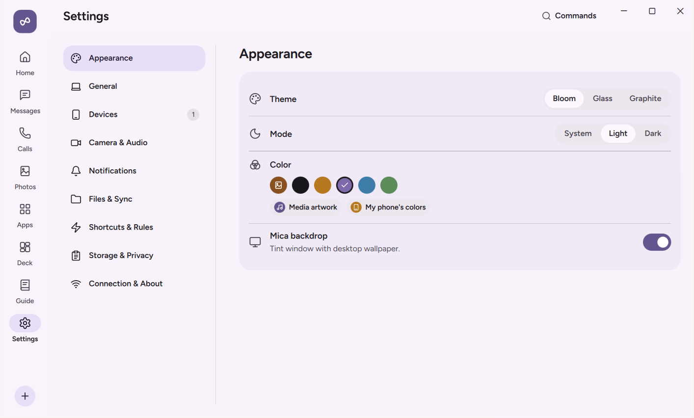
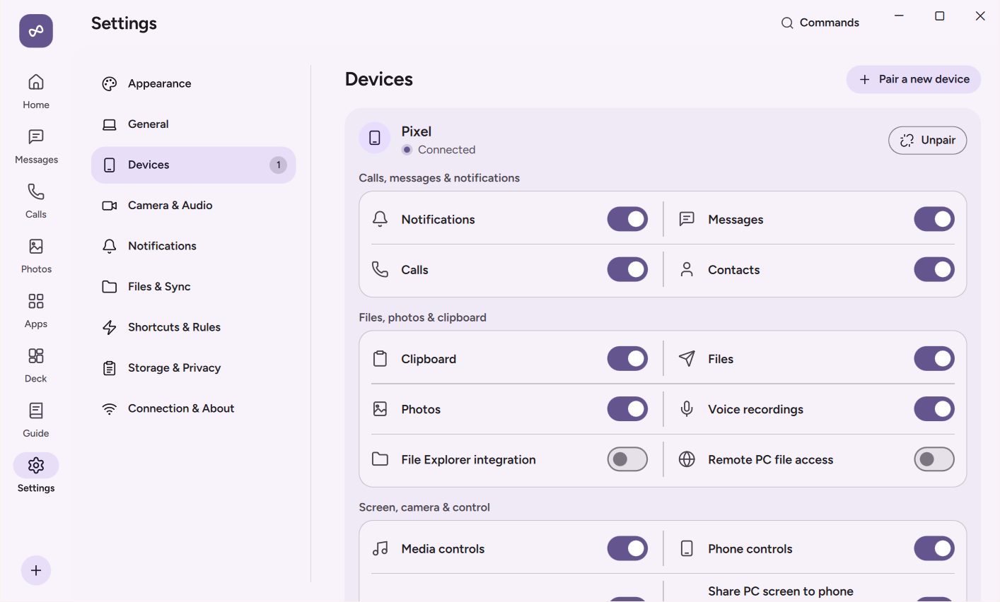
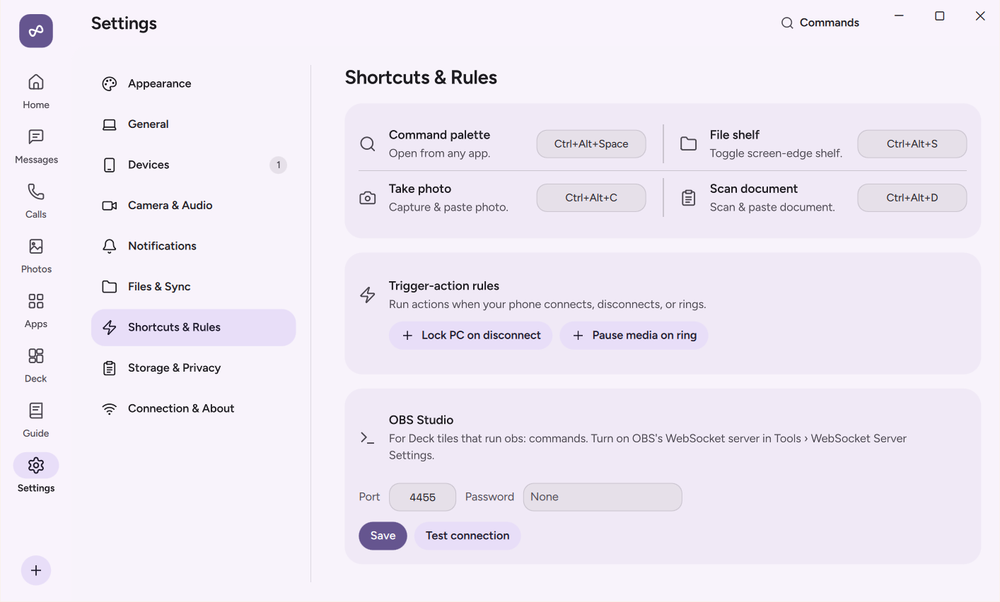
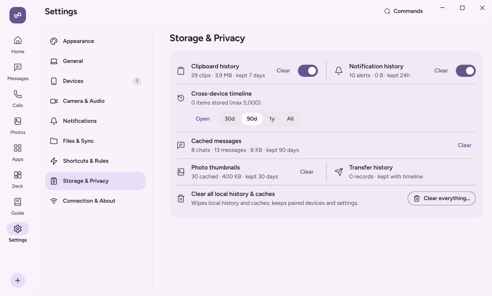
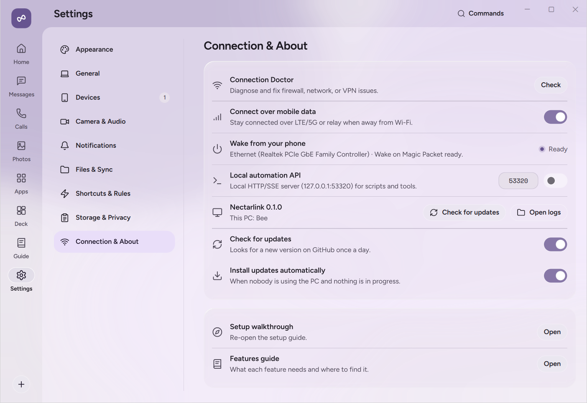
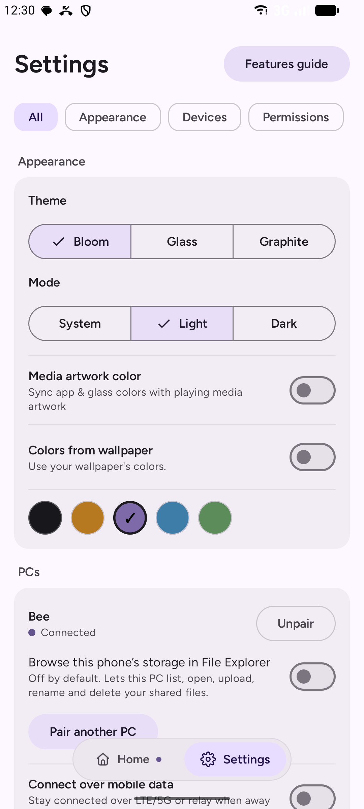
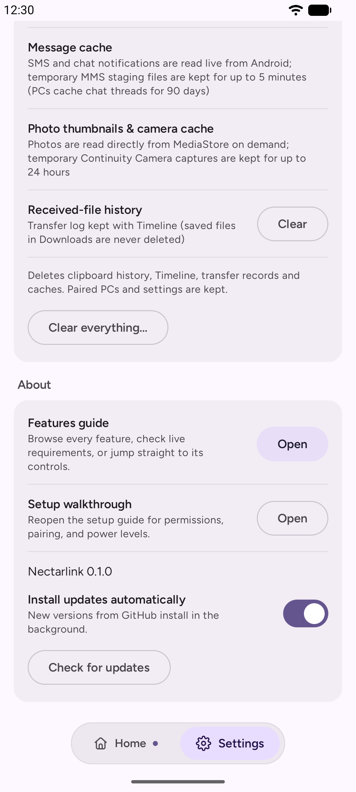

# Referencia de ajustes

Esta página explica uno a uno todos los ajustes de la app del PC (Windows y Linux) y de la app de Android, con su nombre exacto en la app, su valor predeterminado y lo que hace al cambiarlo.

  

## Ajustes de la app de Windows 11

En Windows, **Ajustes** usa una distribución de dos paneles con 9 categorías en la barra lateral izquierda (o una barra de píldoras desplazable arriba cuando la ventana mide menos de 680 píxeles de ancho). Las preferencias se guardan de forma atómica en `%LOCALAPPDATA%\Panal\desktop-settings.json`, y los permisos por dispositivo viven en la base de datos SQLite local (`nectarlink.db`).

---

### 1. Apariencia

Controla el tema visual, el modo claro u oscuro, la paleta de acento, las superficies negras OLED y el fondo Mica de Windows 11.

| Ajuste | Opciones / Predeterminado | Qué hace |
| :--- | :--- | :--- |
| **Tema** | `Nova`, `Hive`, `Bloom` (predeterminado), `Glass`, `Graphite` | Elige el estilo visual. **Nova** es el tema futurista de Panal: neón cian y violeta sobre un fondo espacial oscuro, con una retícula holográfica y brillos suaves. **Hive** es miel sobre carbón (oscuro) o cera cálida (claro), con un panal vivo detrás de toda la ventana que crece desde el logotipo, respira y emite suaves pulsos de luz; sus colores son fijos, así que las opciones de color de abajo se ocultan. **Bloom** usa superficies suaves y tintadas de Material You. **Glass** dibuja tarjetas translúcidas sobre el fondo de Windows, cada una con un borde de cristal iluminado: un reflejo especular desde arriba a la izquierda, un reflejo más suave abajo a la derecha y un leve brillo interior. **Graphite** usa superficies monocromas de alto contraste, como tinta sobre papel. |
| **Modo** | `Sistema` (predeterminado), `Claro`, `Oscuro` | Sigue el modo claro u oscuro del sistema Windows 11 o fija Panal en Claro u Oscuro. |
| **Color** *(en Bloom y Glass)* | **Fondo de pantalla** (predeterminado), **Miel**, **Lavanda**, **Océano**, **Salvia**, **Negro**, **Carátula multimedia** o **Píldoras de color del teléfono** | Elige el color semilla del acento. **Fondo de pantalla** extrae los colores del fondo de escritorio. **Carátula multimedia** adapta la paleta de la app a la carátula de la canción que suena. **Píldoras de color del teléfono** se sincronizan en directo con la paleta Material You del fondo de cada teléfono emparejado. |
| **Negro puro (AMOLED)** | **Desactivado** (predeterminado) | Aparece como píldora **AMOLED** cuando eliges la muestra **Negro** en Bloom/Glass, o como fila propia en **Graphite oscuro**. Sustituye los fondos gris oscuro por negro puro `#000000` para monitores OLED. |
| **Panal animado** *(Hive)* | **Activado** (predeterminado) | Deja que el panal de Hive respire y palpite. También se queda quieto cuando las animaciones están desactivadas en Windows, con el ahorro de energía activo y cuando la ventana no está delante. Aparece en lugar de **Fondo Mica**, que Hive no usa. |
| **Fondo Mica** | **Activado** (predeterminado) | Usa el material Mica nativo del Administrador de ventanas de escritorio (DWM) de Windows 11 para teñir sutilmente el fondo de la ventana con tu fondo de escritorio. |

---

### 2. General

Controla el inicio, la bandeja del sistema, la `Nectar Island`, los avisos de batería y la automatización del portapapeles.

| Ajuste | Predeterminado | Qué hace |
| :--- | :--- | :--- |
| **Iniciar con Windows** | **Activado** en copias instaladas | Abre Panal en silencio en la bandeja del sistema de Windows al iniciar sesión en el PC. |
| **Seguir en la bandeja del sistema** | **Activado** | Mantiene Panal en ejecución en la bandeja del sistema (descargando la ventana hasta unos 5-10 MB de memoria) al cerrar la ventana principal, para que el teléfono siga conectado. Si lo desactivas, cerrar la ventana cierra la app por completo. |
| **Nectar Island** | **Desactivado** | Muestra una píldora compacta en la parte superior central del monitor principal durante la actividad del teléfono. Se oculta sola con juegos o vídeos a pantalla completa o con No molestar de Windows. |
| **Activadores de la isla** *(con Nectar Island activada)* | **Llamadas**: sí, **Transferencias**: sí, **Multimedia**: sí, **Alertas**: no | Elige qué eventos del teléfono despliegan la `Nectar Island`: **Llamadas** entrantes o activas, **Transferencias** de archivos en curso, **Multimedia** en reproducción y **Alertas** de notificaciones del teléfono (incluidos OTP, temporizadores y grabaciones). |
| **Avisos de batería** | **Activado** | Muestra una notificación de escritorio cuando la batería de un teléfono conectado baja o llega a carga completa. |
| **Sincronizar el portapapeles con el teléfono** | **Activado** | Envía solo a los teléfonos conectados el texto y las imágenes copiados en este PC (`Ctrl+C`). |
| **El portapapeles sigue al control** | **Activado** | Envía el portapapeles del PC al teléfono cuando empiezas a controlarlo: el ratón entra en su ventana de duplicación o empieza una sesión de control remoto. |
| **Copiar códigos de un solo uso** | **Desactivado** | Copia solos al portapapeles del PC los códigos de verificación de 4 a 8 dígitos detectados en las notificaciones y los SMS que llegan al teléfono. |
| **Copiar archivos recibidos** | **Activado** | Coloca solos en el portapapeles de Windows (`CF_HDROP`) los archivos pequeños recibidos del teléfono, para que pulses `Ctrl+V` y los pegues donde quieras. |
| **Sugerir acciones del portapapeles** | **Activado** | Ofrece etiquetas de acción (**Abrir**, **Abrir en Mapas**, **Llamar**, **Seguir**, **Correo**) cuando llega del portapapeles del teléfono un enlace web, una dirección postal, un número de teléfono, un número de seguimiento de paquete o una dirección de correo. |

---

### 3. Dispositivos

Lista los teléfonos emparejados (con una barra de píldoras para elegir dispositivo arriba si hay más de uno), un botón **Emparejar un dispositivo nuevo**, un botón **Desemparejar** y 19 interruptores de permisos por dispositivo agrupados en tres secciones.

  

#### Grupo A: llamadas, mensajes y notificaciones

| Interruptor por dispositivo | Predeterminado | Qué controla para el teléfono seleccionado |
| :--- | :--- | :--- |
| **Notificaciones** (`notifications`) | **Activado** | Recibir las notificaciones del teléfono en el PC, las respuestas rápidas, los botones de acción y el reenvío opcional de notificaciones del PC al teléfono. |
| **Mensajes** (`messages`) | **Activado** | Sincronizar las conversaciones SMS/MMS y las conversaciones unificadas, y enviar respuestas de texto o MMS desde el PC. |
| **Llamadas** (`calls`) | **Activado** | Avisos de llamada entrante, identificador de llamadas, historial reciente, llamar desde el PC y controles durante la llamada. |
| **Contactos** (`contacts`) | **Activado** | Sincronizar los contactos y avatares del teléfono para Llamadas y Mensajes. |

#### Grupo B: archivos, fotos y portapapeles

| Interruptor por dispositivo | Predeterminado | Qué controla para el teléfono seleccionado |
| :--- | :--- | :--- |
| **Portapapeles** (`clipboard`) | **Activado** | Compartir texto, HTML, imágenes y archivos copiados entre este PC y el teléfono seleccionado. |
| **Archivos** (`files`) | **Activado** | Enviar y recibir archivos, carpetas y enlaces o documentos de `Handoff`. |
| **Fotos** (`photos`) | **Activado** | Ver la galería, las capturas y los álbumes del teléfono en la página **Fotos** y recibir avisos de fotos nuevas. |
| **Grabaciones de voz** (`recordings`) | **Activado** | Recibir las notas de voz grabadas en el teléfono. |
| **Integración con el Explorador de archivos** (`storage`) | **Desactivado** | Montar el almacenamiento del teléfono en `%USERPROFILE%\Panal\<Nombre del teléfono>` con Cloud Files de Windows (incluye un botón **Abrir** al activarlo) y permitir que el teléfono vea las carpetas compartidas del PC cuando **Tu PC en el bolsillo** también está activado. |
| **Acceso remoto a archivos del PC** (`remote_files`) | **Desactivado** | Permitir ver el almacenamiento cuando el teléfono y el PC están conectados por datos móviles o relé (**Conectar con datos móviles**) en lugar de por tu Wi-Fi local. |

#### Grupo C: pantalla, cámara y control

| Interruptor por dispositivo | Predeterminado | Qué controla para el teléfono seleccionado |
| :--- | :--- | :--- |
| **Controles multimedia** (`media`) | **Activado** | Mostrar la multimedia en reproducción y sus controles en ambos sentidos, y enviar el audio del PC con **Teléfono como altavoz**. |
| **Controles del teléfono** (`toggles`) | **Activado** | Ver y cambiar desde el Inicio del PC el volumen, el modo de timbre, No molestar, la linterna, el brillo, la Wi-Fi y el Bluetooth del teléfono. |
| **Duplicación de pantalla** (`mirroring`) | **Activado** | Duplicar la pantalla del teléfono y abrir apps del teléfono en ventanas (`app window`) en este PC. |
| **Compartir la pantalla del PC con el teléfono** (`pc_mirror`) | **Desactivado** | Permitir que este teléfono vea la pantalla de este PC (duplicación inversa) sin mostrar un diálogo de consentimiento en cada sesión. |
| **Webcam** (`webcam`) | **Activado** | Usar la cámara de este teléfono como webcam y lanzar capturas de foto o documento con la Cámara de continuidad. |
| **Teléfono como micrófono** (`mic`) | **Activado** | Usar el micrófono de este teléfono en este PC. Iniciarlo desde el PC sigue requiriendo un toque en el teléfono. |
| **Bloquear, suspender y encender el PC** (`pc_actions`) | **Activado** | Permitir que este teléfono bloquee o suspenda este PC y reciba sus direcciones MAC para Wake-on-LAN. |
| **Ratón, teclado y Deck remotos** (`remote_input`) | **Desactivado** | Permitir que este teléfono mueva el cursor del PC, escriba, use los controles de presentación y pulse los botones normales de `Deck`. |
| **Ejecutar comandos de shell desde Deck** (`commands`) | **Desactivado** | Permitir que este teléfono lance botones de `Deck` que ejecutan comandos de shell propios en este PC. Actívalo solo para un teléfono de confianza. |

---

### 4. Cámara y audio

Configura **Teléfono como altavoz**, la pausa de multimedia durante las llamadas, el complemento de cámara virtual **Panal Webcam** y los ajustes de la cámara en directo.

| Ajuste | Opciones / Predeterminado | Qué hace |
| :--- | :--- | :--- |
| **Enviar el audio del PC al teléfono** | **Desactivado** (predeterminado) | Envía en tiempo real el audio del sistema Windows (estéreo de 16 bits sin comprimir) al teléfono conectado para que lo escuches por sus altavoces o auriculares. |
| **Pausar multimedia durante las llamadas** | **Activado** (predeterminado) | Pausa sola la multimedia de este PC cuando suena el teléfono o hay una llamada activa, y la reanuda al terminar. |
| **Complemento de cámara virtual** | **Configurar** / **Quitar** | Registra o quita `nectarlink_vcam.dll` en Media Foundation de Windows 11 (requiere una única petición de administrador) para que **Panal Webcam** aparezca en Zoom, Teams, Meet y OBS. |
| **Teléfono** *(con más de un teléfono emparejado)* | Primer teléfono emparejado | Elige qué teléfono emparejado aporta el vídeo de la webcam. |
| **Cámara** | `Trasera` (predeterminado), `Frontal` | Elige el objetivo trasero o frontal del teléfono. |
| **Imagen en espejo** | **Desactivado** (predeterminado) | Voltea horizontalmente el vídeo de la webcam. |
| **Resolución** | `720p` (predeterminado), `1080p`, `4K` | Define la resolución vertical (`720`, `1080` o `2160`) del vídeo de la webcam a 30 fps. |
| **Iniciar webcam / Detener webcam y Vista previa** | Vista previa 16:9 en directo | Inicia o detiene la webcam y muestra una vista previa en directo dentro de Ajustes. |

---

### 5. Notificaciones

Configura la sincronización de No molestar, el reenvío de notificaciones del PC al teléfono, las horas de silencio de Windows y las reglas de notificación por app.

| Ajuste | Opciones / Predeterminado | Qué hace |
| :--- | :--- | :--- |
| **Seguir el No molestar del teléfono** | **Desactivado** (predeterminado) | Silencia los avisos emergentes de Windows en este PC mientras el teléfono está en No molestar (las notificaciones siguen esperando en silencio en el feed de Panal). |
| **Reenviar notificaciones del PC** | **Desactivado** (predeterminado) | Reenvía las notificaciones de escritorio de Windows al teléfono conectado mientras estás lejos del escritorio. |
| **Horas de silencio** | Botón **Definir un horario** | Abre **Sistema › Notificaciones** de Windows 11 para configurar horarios automáticos de Concentración / No molestar. |
| **Reglas de notificación por app** | `Mostrar` (predeterminado), `Sin avisos emergentes`, `Ocultar` | Para cada app del teléfono que haya publicado una notificación: **Mostrar** enseña los avisos emergentes de Windows y las tarjetas del feed; **Sin avisos emergentes** deja las alertas en el feed de Panal sin avisos de escritorio; **Ocultar** bloquea por completo las notificaciones de esa app. |

---

### 6. Archivos y sincronización

Configura la integración con el Explorador de archivos, el uso compartido de carpetas del PC, LocalSend, la salida de las grabaciones de voz y la sincronización automática de carpetas.

| Ajuste | Opciones / Predeterminado | Qué hace |
| :--- | :--- | :--- |
| **Enviar a desde el Explorador de archivos** | **Activado** (predeterminado) | Añade los teléfonos emparejados al menú **Enviar a** del clic derecho en el Explorador de archivos de Windows. |
| **Tu PC en el bolsillo** | **Desactivado** (predeterminado) | Comparte las carpetas `Descargas`, `Documentos`, `Escritorio`, `Imágenes` y `Panal Shared` del PC con los teléfonos emparejados que tengan activada la **Integración con el Explorador de archivos**. |
| **LocalSend en la red local** | **Desactivado** (predeterminado) | Activa el cliente y servidor LocalSend v2.1 integrado (puerto UDP/TCP `53317`) para enviar y recibir archivos sin emparejar con dispositivos LocalSend cercanos en tu Wi-Fi. |
| **Abrir los archivos compartidos desde el teléfono** | **Desactivado** (predeterminado) | Cuando compartes una sola foto o documento desde el teléfono, lo abre en su app predeterminada de Windows en cuanto llega. Desactivado, el archivo se guarda en `Descargas\Panal` sin abrir nada. |
| **Grabaciones de voz** | Formato: `M4A` (predeterminado), `MP3`, `WAV`, `FLAC`; Carpeta: **Elegir carpeta** / **Restablecer** | Define dónde se guardan las notas de voz que llegan del teléfono (`Documentos\Panal Recordings` o `Descargas\Panal` por defecto) y las convierte solas a MP3, WAV o FLAC si lo eliges. |
| **Carpetas sincronizadas** | **Sincronizar ahora**, **Añadir DCIM a Imágenes**, interruptor por regla y **Quitar** | Configura reglas de sincronización automática de carpetas en un sentido (**En un sentido (del teléfono al PC)**) o en ambos (**Sincronización en ambos sentidos**, con copias de conflicto) con verificación de integridad BLAKE3. |

---

### 7. Atajos y reglas

Configura los atajos de teclado globales de Windows y las reglas de automatización de disparador y acción.

| Ajuste | Predeterminado | Qué hace |
| :--- | :--- | :--- |
| **Paleta de comandos** | `Ctrl+Alt+Espacio` | Atajo global de Windows para abrir la `Paleta de comandos` desde cualquier app. Haz clic en el cuadro y pulsa una combinación nueva para cambiarlo, o haz clic en **Restablecer**. |
| **Bandeja de archivos** | `Ctrl+Alt+S` | Atajo global de Windows para desplegar el panel lateral `Bandeja`. |
| **Hacer foto** | `Ctrl+Alt+C` | Atajo global de Windows para lanzar la Cámara de continuidad en modo Foto en el teléfono. |
| **Escanear documento** | `Ctrl+Alt+D` | Atajo global de Windows para lanzar la Cámara de continuidad en modo Escaneo de documentos en el teléfono. |
| **Reglas de disparador y acción** | Vacío por defecto (con botones rápidos para **Bloquear el PC al desconectar** y **Pausar multimedia al sonar**) | Ejecuta acciones automáticas en el PC (`Bloquear este PC`, `Suspender este PC`, `Pausar la multimedia del PC`, `Reanudar la multimedia del PC`, `Silenciar el audio del PC`, `Reactivar el audio del PC`, `Mostrar notificación`, `Ejecutar comando`) cuando ocurre un evento del teléfono (`Cuando el teléfono se conecta`, `Cuando el teléfono se desconecta`, `Cuando suena el teléfono`, `Cuando termina una llamada`, `Cuando la batería del teléfono está baja`, `Cuando el teléfono está cargado`). |
| **OBS Studio** | Puerto `4455`, sin contraseña | Dónde llegan los botones de Deck con comandos `obs:` (`obs:record`, `obs:stream`, `obs:scene:<nombre>`) al servidor WebSocket de OBS en este PC. Escribe la contraseña de **Herramientas › Ajustes del servidor WebSocket** de OBS y haz clic en **Guardar**; se guarda cifrada con DPAPI de Windows. **Probar conexión** comprueba el puerto y la contraseña. |

  

---

### 8. Almacenamiento y privacidad

Muestra en directo el número de elementos y el espacio en disco de cada historial y caché local, con botones **Borrar** individuales y una acción general **Borrar todo**.

  

| Ajuste | Conservación / Predeterminado | Qué hace |
| :--- | :--- | :--- |
| **Historial del portapapeles** | **Activado** (predeterminado) / hasta 50 recortes / 128 MB / 7 días | Activa o desactiva el historial local del portapapeles cifrado con DPAPI de Windows (`clipboard_history.enc` y `clipboard_images/<id>.enc`) y ofrece un botón **Borrar**. |
| **Historial de notificaciones** | **Activado** (predeterminado) / hasta 300 alertas / 24 horas | Activa o desactiva la conservación durante 24 horas de las notificaciones descartadas del teléfono (`notification-history.json`) y las imágenes de notificación en caché en este PC, con un botón **Borrar**. |
| **Línea de tiempo entre dispositivos** | `30 d`, `90 d` (predeterminado), `1 año`, `Todo` (máx. 5.000 elementos) | Define cuánto se conservan las entradas de la `Línea de tiempo` antes del borrado automático, con botones **Abrir** y **Borrar**. |
| **Mensajes en caché** | 90 días | Muestra el número y el tamaño en disco de las conversaciones SMS y unificadas en caché y de los adjuntos MMS, con un botón **Borrar**. |
| **Miniaturas de fotos** | 30 días | Muestra el número y el tamaño en disco de las miniaturas de la galería en caché en `%LOCALAPPDATA%\Panal\cache\photos\`, con un botón **Borrar**. |
| **Historial de transferencias** | Se conserva con la `Línea de tiempo` | Muestra cuántos registros de transferencias hay y te permite **Borrar** el registro (nunca borra archivos guardados en `Descargas`). |
| **Borrar todo el historial y las cachés locales** | Botón **Borrar todo...** | Elimina de una vez en este PC el historial del portapapeles, la `Línea de tiempo`, el historial de notificaciones, los mensajes en caché, las miniaturas de fotos y el historial de transferencias, sin tocar los dispositivos emparejados, los ajustes ni los archivos descargados. |

---

### 9. Conexión y Acerca de

Ofrece diagnóstico de red, **Conectar con datos móviles**, el estado de Wake-on-LAN, la API HTTP de automatización local, la versión, los registros y las actualizaciones.

  

| Ajuste | Predeterminado | Qué hace |
| :--- | :--- | :--- |
| **Doctor de conexión** | Botón **Comprobar** | Comprueba en directo las reglas del Firewall de Windows, el tipo de perfil de red (Público o Privado), las interfaces VPN activas y un posible aislamiento de puntos de acceso Wi-Fi, y corrige con un clic los problemas de firewall o de perfil de red. |
| **Conectar con datos móviles** | **Desactivado** | Permite que este PC y los teléfonos emparejados sigan conectados por LTE/5G o entre redes distintas mediante paquetes de relé cifrados de extremo a extremo cuando no hay conexión directa por red local o USB. |
| **Encender desde el teléfono** | Indicador de solo lectura (`Listo`, `Desactivado en Windows`, `Revisa la configuración`, `Sin adaptador`) | Revisa el adaptador de red activo de Windows y te dice si Wake on LAN está activado en el Administrador de dispositivos para que el teléfono pueda despertar este PC. |
| **API de automatización local** | **Desactivada** (puerto predeterminado `53320`) | Inicia el servidor HTTP/JSON solo de bucle local (`127.0.0.1:<puerto>`) para PowerToys, AutoHotkey y scripts, y escribe el token Bearer de 256 bits en `%LOCALAPPDATA%\Panal\api-token.json`. |
| **Panal `<versión>`** | Botones **Buscar actualizaciones** y **Abrir registros** | Muestra la versión de la app y el nombre de este PC, busca en GitHub Releases actualizaciones verificadas con SHA-256 y firma Ed25519, o abre la carpeta local de registros de diagnóstico. |
| **Buscar actualizaciones** | **Activado** (en copias instaladas) | Consulta por HTTPS el feed del canal de actualizaciones (`https://raw.githubusercontent.com/zaiddia/NectarLink/channels/<canal>.json`) 30 segundos después de arrancar y luego cada 12 horas en **Estable** y cada 2 horas en **Nightly** (el doble con batería), y avisa al teléfono cuando hay una compilación nueva. Consultar un feed sin cambios ocupa unos pocos cientos de bytes. |
| **Canal de actualizaciones** | **Estable** (**Nightly** en una compilación nightly) | **Estable** recibe las versiones publicadas. **Nightly** recibe cada pocas horas, cuando hay cambios, una compilación del código más reciente, con los últimos arreglos y funciones y a veces errores nuevos, y también las versiones publicadas. Volver a **Estable** mantiene la nightly instalada hasta que la siguiente versión sea más nueva. Una instalación se queda en su canal al instalar una versión, hasta que lo cambies. |
| **Instalar actualizaciones automáticamente** | **Activado** | Instala sola una versión más nueva cuando nadie ha usado el PC durante 10 minutos y no hay nada en curso (ni duplicación, ni ventana de app, ni transferencia, ni llamada, ni pantalla compartida, ni webcam). Sin petición de administrador: el instalador crea una tarea que se encarga. Desactívalo para instalar desde la notificación o con **Buscar actualizaciones** cuando tú decidas. |
| **Guía de configuración y Guía de funciones** | Botones de acción / entradas de la Paleta de comandos | Vuelve a abrir cuando quieras la guía de configuración inicial o la Guía de funciones interactiva de la app. |

---

## Ajustes de la app de Android

En Android, toca **Ajustes** en la barra flotante inferior. Puedes ver todos los ajustes a la vez (**Todo**) o filtrar por categoría con las etiquetas de arriba (**Apariencia**, **Dispositivos**, **Permisos**, **Funciones y datos**).

  

### 1. Apariencia

| Ajuste | Opciones / Predeterminado | Qué hace |
| :--- | :--- | :--- |
| **Tema** | `Nova`, `Hive`, `Graphite` (predeterminado), `Bloom`, `Glass` | Elige el estilo visual en Android, igual que los temas de Windows. **Nova** usa el mismo neón cian y violeta sobre fondo espacial oscuro que en el PC. **Hive** dibuja el mismo panal detrás de cada pantalla, con colores de miel fijos (sin colores del fondo de pantalla ni de la carátula). En **Glass**, en Android 13 y posterior, la barra flotante de Inicio y Ajustes es Liquid Glass: el contenido que se desplaza debajo se curva en el borde. |
| **Modo** | `Sistema` (predeterminado), `Claro`, `Oscuro` | Sigue el tema oscuro del sistema Android o fija la app en Claro u Oscuro. |
| **Panal animado** *(Hive)* | **Activado** (predeterminado) | Deja que el panal de Hive respire y palpite. Se queda quieto con **Quitar animaciones** o el ahorro de batería activos, y cuando la app no está delante. |
| **Negro puro (AMOLED)** | **Desactivado** (predeterminado) | Aparece en Graphite oscuro o como píldora **AMOLED** cuando eliges la muestra **Negro**. Usa superficies negras reales `#000000` para pantallas OLED. |
| **Color de la carátula** *(Bloom y Glass)* | **Desactivado** (predeterminado) | Tiñe la app según la carátula de lo que suena en el teléfono o en un PC emparejado. Solo se aplica mientras está activado. Si no suena nada, la app usa los colores del fondo de pantalla o los predefinidos. |
| **Colores del fondo de pantalla** *(Android 12+)* | **Activado** (predeterminado) | Usa los colores del fondo de pantalla y se actualiza cuando cambia. En teléfonos Samsung con la **Paleta de colores** de One UI desactivada, Panal lee los colores del propio fondo. Los PC emparejados que eligen **Los colores de mi teléfono** usan la misma semilla. |
| **Muestras de color** | **Miel**, **Lavanda**, **Océano**, **Salvia**, **Negro** | Elige un color de acento predefinido cuando **Color de la carátula** y **Colores del fondo de pantalla** están desactivados. |

### 2. PC (`Dispositivos`)

| Ajuste | Predeterminado | Qué hace |
| :--- | :--- | :--- |
| **Lista de PC emparejados y Desemparejar** | Por PC emparejado | Muestra el nombre y el estado de conexión en directo (`Conectado` o `No conectado`) de cada PC emparejado, con un botón **Desemparejar**. |
| **Ver el almacenamiento de este teléfono en el Explorador de archivos** | **Desactivado** (por PC) | Permite a ese PC concreto montar el almacenamiento compartido de este teléfono (o las carpetas seleccionadas) dentro del Explorador de archivos de Windows. |
| **Emparejar otro PC** | Botón | Abre la pantalla de emparejamiento para escanear un código QR o emparejar cerca con otro PC. |
| **Conectar con datos móviles** | **Desactivado** | Permite que este teléfono siga conectado a los PC emparejados por LTE/5G o entre redes distintas cuando no está en tu Wi-Fi. |

### 3. Permisos

Cada fila de permiso muestra su estado en directo (**Activado** / **Permitido** o **Desactivado**) y un botón directo (**Permitir** o **Gestionar**) que abre el aviso del sistema Android o la pantalla de ajustes exacta:

| Sección y ajuste | Nivel de control / Para qué sirve |
| :--- | :--- |
| **Notificaciones › Mostrar notificaciones en tu PC** | Concede el acceso de escucha de notificaciones de Android para que las notificaciones del teléfono, las respuestas rápidas y las acciones funcionen en el PC. Incluye un acceso a **Información de la app** en Android 13+ por si hace falta **Permitir ajustes restringidos**. |
| **Control desde tu PC › Usar el ratón y el teclado del PC** | Activa el servicio de accesibilidad de Panal en Android (nivel de control `Assist`) para tocar, deslizar y escribir en el teléfono desde el PC durante la duplicación o con **Escribir en el teléfono**. |
| **Control desde tu PC › Toque y teclas reales (depuración inalámbrica)** | Configura o gestiona el nivel de control `Elevated` con la depuración inalámbrica integrada de Android (arrastre táctil en tiempo real, teclado y mando UHID, `app window`, sincronización del portapapeles en segundo plano, OTP sensibles de Android 15+, silenciar, poner en espera y altavoz durante la llamada, e interruptores de Wi-Fi y Bluetooth). |
| **Control desde tu PC › No molestar y modo silencio** | Concede el acceso a la política de notificaciones para que el PC pueda activar No molestar y poner el timbre en silencio. |
| **Control desde tu PC › Brillo de la pantalla** | Concede el permiso para modificar ajustes del sistema (`WRITE_SETTINGS`) para que el PC pueda ajustar el brillo de la pantalla del teléfono. |
| **Segundo plano y batería › Seguir disponible en segundo plano** | Pide la exención de optimización de batería sin restricciones de Android (`REQUEST_IGNORE_BATTERY_OPTIMIZATIONS`) y muestra instrucciones paso a paso según el fabricante del teléfono (Samsung, Xiaomi, OnePlus, Oppo/Realme, Vivo, Huawei, Pixel), con un botón **Ajustes de batería**. |
| **Segundo plano y batería › Despertar cuando el PC está cerca (dispositivo complementario)** | Asocia el PC emparejado con el `CompanionDeviceManager` de Android para que Android despierte Panal solo cuando la baliza Bluetooth LE del PC está al alcance. |
| **Llamadas, contactos y mensajes › Llamadas en tu PC** | Concede los permisos de estado del teléfono, registro de llamadas y control de llamadas. |
| **Llamadas, contactos y mensajes › Contactos en tu PC** | Concede la lectura de contactos para que los nombres y avatares aparezcan en Llamadas y Mensajes del PC. |
| **Llamadas, contactos y mensajes › Mensajes desde tu PC** | Concede los permisos de SMS para leer y enviar mensajes desde el PC. |
| **Fotos y vídeos › Fotos y vídeos en tu PC** | Concede el acceso multimedia (`Permitir todo` o `Seleccionar fotos`) para ver la galería y recibir avisos de capturas nuevas en el PC. |
| **Fotos y vídeos › Acceso a todos los archivos / Solo carpetas seleccionadas** | Define si el montaje en el Explorador de archivos y la sincronización de carpetas pueden acceder a todo el almacenamiento compartido (`MANAGE_EXTERNAL_STORAGE`) o solo a carpetas concretas que eliges con el selector de carpetas de Android (`Añadir carpeta` / `Quitar`). |

### 4. Funciones y datos (y Acerca de)

| Sección y ajuste | Opciones / Predeterminado | Qué hace |
| :--- | :--- | :--- |
| **Portapapeles › Acceso al portapapeles en segundo plano** | **Permitir** / **Gestionar** | Abre la configuración de la depuración inalámbrica (`Elevated`) para que los cambios del portapapeles del teléfono se sincronicen solos con el PC en segundo plano. |
| **Portapapeles › Sugerir acciones para el texto copiado** | **Activado** (predeterminado) | Muestra etiquetas de acción (**Abrir**, **Abrir en Mapas**, **Llamar**, **Seguir**, **Correo**) cuando llega texto del PC. |
| **Controlar tu PC › Velocidad del panel táctil** | De `0.5x` a `2.5x` (`1.0x` predeterminado) | Ajusta la sensibilidad del puntero del panel táctil remoto al controlar el PC desde el teléfono. |
| **LocalSend › LocalSend** | **Desactivado** (predeterminado) | Permite enviar y recibir archivos con dispositivos LocalSend cercanos en tu Wi-Fi (siempre pregunta antes de guardar archivos entrantes). |
| **Datos y almacenamiento › Historial de notificaciones** | Resumen informativo | Explica que las notificaciones se reflejan en directo en los PC emparejados y no se guardan otra vez en el teléfono. |
| **Datos y almacenamiento › Historial del portapapeles** | **Activado** (predeterminado) + botón **Borrar** | Activa o desactiva en este teléfono el historial del portapapeles de 50 elementos (7 días / 128 MB) cifrado con AES-256-GCM del Almacén de claves de Android, y te permite borrarlo. |
| **Datos y almacenamiento › Línea de tiempo** | `30 d`, `90 d` (predeterminado), `1 año`, `Todo` + botón **Borrar** | Define cuánto se conservan en este teléfono las entradas de la `Línea de tiempo` (hasta 5.000 elementos) y te permite borrarlas. |
| **Datos y almacenamiento › Caché de mensajes** | Botón **Borrar** | Borra los archivos temporales de MMS (se limpian solos a los 5 minutos). |
| **Datos y almacenamiento › Miniaturas de fotos y caché de cámara** | Botón **Borrar** | Borra las capturas temporales de la Cámara de continuidad (se limpian solas a las 24 horas). |
| **Datos y almacenamiento › Historial de archivos recibidos** | Botón **Borrar** | Borra el registro de transferencias sin eliminar ningún archivo guardado en `Download/Panal`. |
| **Datos y almacenamiento › Borrar todo...** | Diálogo de confirmación | Elimina en este teléfono todo el historial del portapapeles, la `Línea de tiempo`, los registros de transferencias y las cachés temporales, sin tocar los PC emparejados ni los ajustes. |
| **Acerca de › Panal `<versión>` y Buscar actualizaciones** | Botón **Buscar actualizaciones** | Muestra la versión instalada y busca en GitHub Releases (`https://api.github.com/repos/zaiddia/NectarLink/releases/latest`) actualizaciones del APK verificadas con SHA-256. |
| **Acerca de › Canal de actualizaciones** | **Estable** (**Nightly** en una compilación nightly) | Igual que en el PC. Un PC emparejado avisa al teléfono de las compilaciones nuevas, así que el teléfono rara vez consulta por su cuenta: una vez al día en **Estable**, cada seis horas en **Nightly** y al abrir la app. |
| **Acerca de › Instalar actualizaciones automáticamente** | **Activado** | Instala sola una compilación más nueva. Android 12 y posterior la instalan sin preguntar si Panal ya instaló antes una actualización; si no, una notificación pide un toque. Requiere permitir **Instalar apps desconocidas** para Panal. |

  

